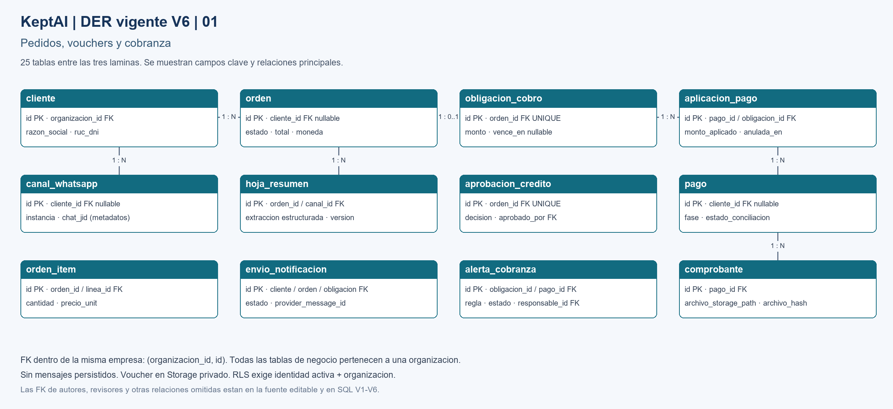
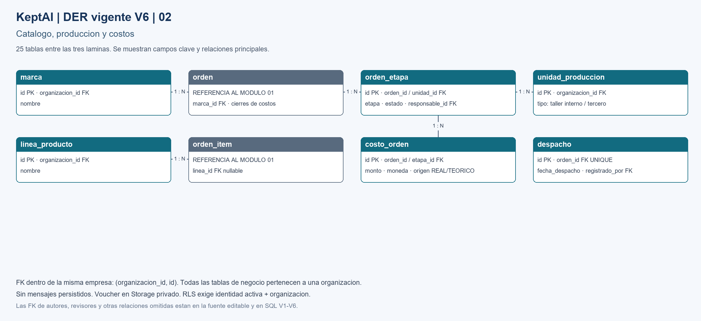
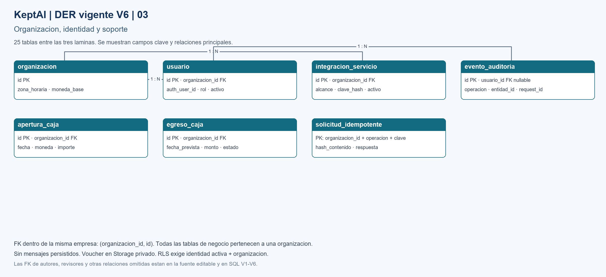

# KeptAI — Base de datos vigente (V6)

**Punto de entrada para desarrollar:** [Definicion canonica DB-DEF-001](definicion-base-datos.md). Alcance, 27 tablas V5, RLS, transacciones, vouchers y extensiones pendientes para margen por linea/centro.

Revisión de Miguel/Codex, 10/10/2026, basada en Actores/flujos/DER, D-005 y D-007. V1–V3 originales de Andrés se conservan como historial; **V4/V5** corrigen el modelo. Supabase conectado por MCP según Miguel; este trabajo no verifica ni modifica el remoto.

## Archivos y ejecución
- [Validaciones pre-Supabase (DB-VAL-001)](validaciones-pre-supabase.md): seis condiciones obligatorias de D-009, casos mínimos, responsables y evidencia. Todas siguen abiertas; migrar en local no equivale a cerrar el esquema.

- [Guia local](local/README.md): Docker, Flyway, 127.0.0.1:5433 y perfil Spring local.
- [V6](migrations/V6__mvp_25_tablas.sql): aprobacion D-008, 25 tablas; excluye contacto/notas solo si estan vacias, sin CASCADE.

- migrations/V1__esquema_inicial.sql, V2__rls_organizacion.sql y V3__nota_cliente.sql: originales, no reescribir checksums.
- [V4](migrations/V4__vouchers_contexto_y_rls.sql): vouchers sin mensajes; borradores incompletos; contexto usuario/servicio, bootstrap privado y RLS/grants separados.
- [V5](migrations/V5__integridad_financiera_indices.sql): aplicación inmutable, duplicados, gate de producción, cierre de costos y consultas/indexación.
- [Storage Supabase](supabase/vouchers_storage.sql): bucket privado y políticas independientes; se aplica aparte después de verificar el proyecto.
- [Revisión y operación](revision-sql-rls.md) y [diccionario](diccionario-datos.md).

Un solo historial Flyway: ubicación canónica `BD/migrations/`, no copiar manualmente a otro directorio. El paso de release usa rol migrador propietario, `schemas=keptai`, `defaultSchema=keptai`, `locations=filesystem:BD/migrations` desde raíz. En tests Maven, ruta `filesystem:../BD/migrations`. Runtime: Flyway desactivado, Hibernate validate, conexión al esquema keptai.

V4 requiere permiso CREATE ROLE para crear keptai_runtime NOLOGIN (sin contraseña). Provisionar fuera de Git un login JDBC miembro de ese rol; no usar postgres ni migrador para la app. Si el historial remoto está en public o ya hay mensajes, V4 aborta: inspeccionar/migrar/purgar con procedimiento explícito, no repair ni drop automático.

## DER visible

Las imágenes se ven sin soporte Mermaid. [Abrir las tres láminas y la fuente editable](../cerebro/diagramas/keptai-der-v6.md).

### Pedidos, vouchers y cobranza

### Catalogo, produccion y costos

### Organizacion, identidad y soporte

## Modelo vigente

[Mapeo individual de las 27 tablas a fuentes y requisitos](../cerebro/conocimientos/decisiones/trazabilidad-tablas-mvp.md): 16 nucleo, 6 flujo vigente, 3 soporte tecnico y 2 opcionales. No todas las tablas son exigencias explicitas de la empresa ni tienen que tener una pantalla.

Se guardan datos de negocio y vouchers privados. No se guardan mensajes, transcript, audios ni imágenes generales. `canal_whatsapp` identifica origen; `envio_notificacion` conserva solo entrega/idempotencia y no texto. Una sola `obligacion_cobro` por orden; varios pagos parciales posibles. Cliente y total pueden faltar en BORRADOR, nunca tras confirmación.

RLS para el rol runtime exige organización e identidad activa de usuario o servicio. `resolver_usuario`/`resolver_servicio` están en esquema privado, sin EXECUTE público. El JWT se valida en Spring antes del bootstrap. Data API no tiene acceso a negocio; Storage puede usar JWT del administrador con políticas propias.

La vista diferencia margen_venta_real y margen_real_cobrado. Un costo ausente/incompleto devuelve null; cualquier cambio de costo invalida su cierre previo. Spring mantiene la transacción aplicación + auditoría + alertas; SQL refuerza invariantes sin reemplazar el motor de Andrés.

## Verificar localmente

Desde Backend/: `JAVA_HOME=/usr/lib/jvm/java-21-openjdk-amd64 ./mvnw -o test -Dtest=SchemaRlsTests`. Docker debe responder. Testcontainers aplica V1–V6 en PostgreSQL 17 efímero y elimina el contenedor al terminar. No requiere .env ni proyecto remoto. El test Storage usa catálogos mínimos emulados: acredita SQL/políticas, no el servicio Supabase real.
