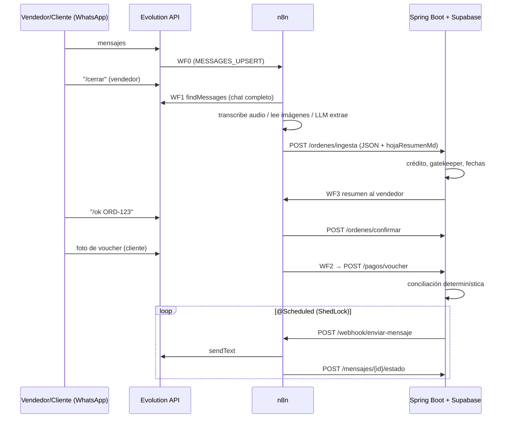

<!-- Versión 1.0.0 | 2026-10-10 | Autor: Isabelita -->
# Lazo – Integración n8n ↔ Spring Boot ↔ Evolution API

Principio: **n8n solo mueve datos y llama a la IA. Toda regla de negocio (fechas, crédito, conciliación, cadencia de recordatorios) vive en Spring.**

## Flujos

| WF | Webhook | Qué hace |
|----|---------|----------|
| WF0 Router | `POST /webhook/evolution` | Recibe MESSAGES_UPSERT de Evolution. Ignora grupos/estados. Vendedor escribe `/cerrar` → WF1. Vendedor escribe `/ok ORD-123` → backend `confirmar`. Cliente envía imagen → WF2. |
| WF1 Cierre de venta | `POST /webhook/venta-cerrar` | `findMessages` del chat completo → transcribe audios, describe imágenes → transcript único → LLM extrae JSON → arma **hoja de resumen** (markdown) → `POST /api/v1/ordenes/ingesta`. |
| WF2 Voucher | `POST /webhook/voucher` | Descarga imagen (base64) → LLM visión extrae banco/monto/fecha/código de operación → `POST /api/v1/pagos/voucher`. |
| WF3 Envío | `POST /webhook/enviar-mensaje` | **Único punto de salida**. Spring le manda el JSON de cobranza/fidelización; valida `X-Api-Secret`, normaliza número, espera delay aleatorio, envía por Evolution y devuelve estado al backend. |



## Contratos

Auth: n8n→backend `X-Api-Key`; backend→WF3 `X-Api-Secret`.

### POST /api/v1/ordenes/ingesta
```json
{
  "origen": "WHATSAPP", "instancia": "ventas-01",
  "chatId": "51XXXXXXXXX@s.whatsapp.net", "vendedorJid": "51XXXXXXXXX@s.whatsapp.net",
  "clienteNombreChat": "Colegio San José",
  "extraccion": {
    "cliente": "Colegio San José", "marca": "UNICRACK",
    "items": [{"descripcion":"Polo deportivo","cantidad":120,"talla":"mix","tela":"dry-fit","logo":"bordado pecho","precio_unit":28.5}],
    "total": 3420, "moneda": "PEN",
    "condicion_pago": {"tipo":"CREDITO","plazo_dias":30,"anticipo_monto":1000,"anticipo_pct":null},
    "fecha_entrega_solicitada": "2026-11-15",
    "pagos_mencionados": [], "observaciones": "", "faltantes": ["tallas"], "confianza": 0.82
  },
  "hojaResumenMd": "# Hoja de resumen ...", "transcript": "[10/10 09:12] CLIENTE: ...",
  "mensajesProcesados": 143, "generadoEn": "2026-10-10T14:30:00-05:00"
}
```
Respuesta sugerida: `201 {ordenId, ref:"ORD-123", estado:"PENDIENTE_APROBACION", bloqueos:[...]}`.

### POST /api/v1/ordenes/confirmar
`{ "ref":"ORD-123", "instancia":"ventas-01", "chatId":"...", "vendedorJid":"...", "mensajeId":"..." }`

### POST /api/v1/pagos/voucher
```json
{ "instancia":"ventas-01","chatId":"...","clienteJid":"...","mensajeId":"...","pushName":"...","recibidoEn":"...",
  "extraccion":{"es_voucher":true,"tipo":"YAPE","banco":"BCP","monto":1000.00,"moneda":"PEN",
  "fecha":"2026-10-10","hora":"14:02","codigo_operacion":"01234567","remitente":"...","destinatario":"...","confianza":0.9}}
```
Estados de conciliación (decide el backend): `APLICADO | PARCIAL | DUPLICADO | SIN_ORDEN | NO_CUADRA`. Duplicado = mismo código de operación + monto + fecha.

### Salida a WF3 (Spring → n8n)
```json
{ "mensajeId":"uuid", "tipo":"COBRANZA_PREVENTIVA", "instance":"ventas-01",
  "numero":"9XXXXXXXX", "texto":"Hola ...", "delayMs":null,
  "ordenId":"...", "clienteId":"...", "idempotencyKey":"orden123-m3d" }
```
`tipo`: COBRANZA_PREVENTIVA | COBRANZA_VENCIMIENTO | MORA_TEMPRANA | RECOMPRA | ESTADO_CUENTA | CONFIRMACION_PAGO | RESUMEN_VENDEDOR.
Callback: `POST /api/v1/mensajes/{id}/estado {mensajeId, estado:"ENVIADO|ERROR", providerMessageId, error}`.

## Reglas en Spring (no en n8n)
- **Inicio de producción** = fecha en que el gatekeeper pasa (crédito aprobado o anticipo verificado en banco). Sin eso, la orden no entra a cola.
- **Vencimiento** = fecha del acta de despacho + `plazo_dias` (30/45). El reloj NO corre desde el pedido.
- **Cadencia de cobranza**: −3 días, día 0, +3 días (mora temprana → escala a administración). Se cancela al verificar el pago.
- **Recompra**: última compra + intervalo medio del cliente − 7 días. Regla dura: no ofrecer crédito nuevo con mora activa.
- **Recordatorios**: `@Scheduled` + ShedLock, solo en ventana horaria (ej. 9:00–18:00 Lima), con `idempotencyKey`.
- Módulos: `ordenes, pagos, cobranza, fidelizacion, mensajeria, clientes`.

## Setup
1. Importar los 4 JSON en n8n. Activar WF1, WF2, WF3 (y WF0 al final).
2. En el nodo **Config** de cada WF poner: `evoUrl, evoKey, apiUrl, apiKey, n8nUrl, llmUrl, llmKey, llmModel, visionModel, transcribeModel, sharedSecret`. (Mejor: pasarlo a Credentials/variables; no subir a git.)
3. Webhook de Evolution: `POST {evoUrl}/webhook/set/{instancia}` con `{"enabled":true,"url":"{n8nUrl}/webhook/evolution","events":["MESSAGES_UPSERT"]}` (la forma exacta del body puede variar por versión de Evolution).
4. LLM: cualquier endpoint compatible OpenAI (`chat/completions` y `audio/transcriptions`).

## Riesgos / verificar ANTES de la demo
- **Los JSON se generaron y validaron (conexiones + sintaxis JS) pero NO se ejecutaron contra un n8n/Evolution real.** Importa y prueba flujo por flujo con ejecución manual.
- `findMessages`: la forma de la respuesta no está documentada; el nodo "Normalizar" asume registros con `key`, `message`, `messageTimestamp`. Ajusta si tu versión devuelve otra estructura (p. ej. paginada).
- Evolution debe **guardar mensajes** (variables tipo `DATABASE_SAVE_DATA_NEW_MESSAGE=true`) o `findMessages` vendrá vacío.
- `POST /chat/getBase64FromMediaMessage/{instancia}` (audios/imágenes): **no verificado en docs**; confírmalo en tu Swagger de Evolution.
- Evolution (Baileys) es **no oficial**: riesgo de baneo en envíos masivos. Solo a clientes conocidos, delay aleatorio, opt-out; para producción real, WhatsApp Cloud API.
- Los chats contienen datos personales: no los loguees completos ni los mandes a un LLM sin avisar al cliente (Ley 29733).
- Cambia los secretos de ejemplo y no expongas los webhooks sin `X-Api-Secret`/`X-Api-Key`.
- La IA extrae; **el vendedor valida** (`/ok`). Montos, fechas y conciliación los calcula código determinístico.
