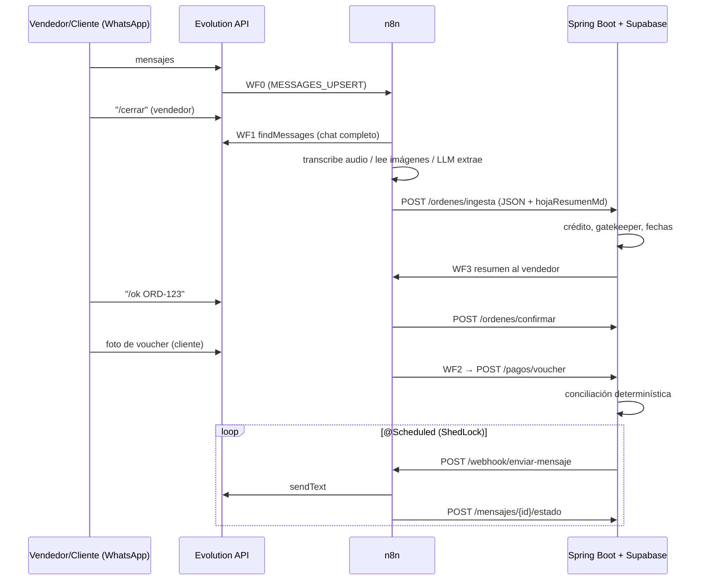

<!-- Versión 1.0.0 | 2026-10-10 | Autor: Isabelita -->
# Lazo – Integración n8n ↔ Spring Boot ↔ Evolution API

> Actualización 11/10/2026: Isabella mantiene los workflows en su propio entorno según Miguel. Los JSON de esta carpeta no se han contrastado con su export actual. Ver [muestra WF1 y acuerdos de integración](../../Backend/docs/integracion-n8n-isabella.md) y el contrato vigente en Backend/docs/openapi.yaml. Los ejemplos y reglas históricos de abajo no sustituyen D-005/D-007/D-010; no activarlos automáticamente.

Principio: **n8n solo mueve datos y llama a la IA. Toda regla de negocio (fechas, crédito, conciliación, cadencia de recordatorios) vive en Spring.**

## Flujos

| WF | Webhook | Qué hace |
|----|---------|----------|
| WF0 Router | `POST /webhook/evolution` | Recibe MESSAGES_UPSERT de Evolution. Ignora grupos/estados. Vendedor escribe `/cerrar` → WF1. Vendedor escribe `/ok ORD-123` → backend `confirmar`. Cliente envía imagen → WF2. |
| WF1 Cierre de venta | `POST /webhook/venta-cerrar` | `findMessages` del chat completo → transcribe audios, describe imágenes → transcript único → LLM extrae JSON → arma **hoja de resumen** (markdown) → `POST /api/v1/ordenes/ingesta`. |
| WF2 Voucher | `POST /webhook/voucher` | Descarga imagen (base64) → LLM visión extrae banco/monto/fecha/código de operación → `POST /api/v1/pagos/voucher`. |
| WF3 Envío | `POST /webhook/enviar-mensaje` | **Único punto de salida**. Spring le manda el JSON de cobranza/fidelización; valida `X-Api-Secret`, normaliza número, espera delay aleatorio, envía por Evolution y devuelve estado al backend. |



## Contratos

Auth (cuatro canales distintos; ver [configuración de los nodos y datos pendientes](../../Backend/docs/integracion-n8n-isabella.md#mig-03-d3--conexión-de-los-nodos-finales-con-spring-alcance-local--11102026)): Evolution→WF0 y WF0→WF1/WF2 los define el entorno de Isabella; n8n→backend `X-Api-Key` (una clave por organización+instancia+alcance; INGESTA para WF1/WF2); backend→WF3 `X-Api-Secret`. Hoy `/ordenes/ingesta` (201, orden y hoja BORRADOR) y `/pagos/voucher` (201, pago RECIBIDO con `imagen_base64`) están implementadas con Storage simulado en las pruebas; `/ordenes/confirmar` y `/mensajes/{id}/estado` siguen cerradas (403). Instrucciones exactas de los nodos y ejemplo completo de WF2 en la guía enlazada.

### POST /api/v1/ordenes/ingesta — implementada (MIG-05; cliente por contacto registrado, V10)
> `chatId` debe ser el JID de un contacto REGISTRADO (`<dígitos>@s.whatsapp.net`); si no existe, 422 `CONTACT_NOT_REGISTERED` y no se crea nada. El vendedor queda pendiente.
El nodo final de WF1 usa `POST`, `Content-Type: application/json` y `X-Api-Key` de un servicio INGESTA activo; `instancia` debe ser la registrada para la clave (`isabel`). Body: **un objeto** por solicitud (nunca el array de items de n8n). Respuesta: `201` con `ordenId`, `ref`, `estado: BORRADOR`, `hojaResumenVersion`, `camposAusentes`, `avisos` (y `Idempotency-Replayed: true` si repite una solicitud idéntica). Crea solo un borrador sin confirmar ni asociar cliente/marca/vendedor. Los nombres del contrato para los datos extraídos son `cliente={nombre,ruc,tipo}`, `marca=CORPOTEX/UNICRACK_SPORT/UNICRACK_UNIFORMES` e `items` con `detalle_tallas`, `logo_diseno` y `precio_unitario`. Ejemplo ficticio en `Backend/docs/openapi.yaml` (componente `N8nIngestaCredit`). Detalle, errores y reintentos: [guía de integración](../../Backend/docs/integracion-n8n-isabella.md).

### POST /api/v1/pagos/voucher — implementada (MIG-04/05)
Un objeto JSON con `instancia`, `chatId`, `clienteJid`, `mensajeId` (id original de Evolution, obligatorio), `pushName`, `recibidoEn`, `extraccion` e `imagen_base64` (Base64 puro del archivo original, sin `data:`). Ejemplo ficticio completo y reproducible: `Backend/docs/ejemplos/wf2-voucher-ficticio.json`.

### POST /api/v1/ordenes/confirmar
`{ "ref":"ORD-123", "instancia":"ventas-01", "chatId":"...", "vendedorJid":"...", "mensajeId":"..." }`

Estados de conciliación que devuelve el backend para un voucher recién registrado: `PENDIENTE` o `DUPLICADO` (mismo código de operación + monto + fecha que un pago anterior). Nunca `APLICADO`: el voucher queda en fase `RECIBIDO`, sin fondos verificados ni saldo modificado (el antecedente de este README que sugería `APLICADO` era incorrecto).

### Salida a WF3 (Spring → n8n)
```json
{ "mensajeId":"uuid", "tipo":"COBRANZA_PREVENTIVA", "instance":"ventas-01",
  "numero":"9XXXXXXXX", "texto":"Hola ...", "delayMs":null,
  "ordenId":"...", "clienteId":"...", "idempotencyKey":"orden123-m3d" }
```
`tipo`: COBRANZA_PREVENTIVA | COBRANZA_VENCIMIENTO | MORA_TEMPRANA | RECOMPRA | ESTADO_CUENTA | CONFIRMACION_PAGO | RESUMEN_VENDEDOR.
Callback: `POST /api/v1/mensajes/{id}/estado {mensajeId, estado:"ENVIADO|ERROR", providerMessageId, error}`.

## Reglas en Spring (no en n8n)
- **Inicio de producción** = fecha en que el gatekeeper pasa (crédito aprobado o anticipo verificado en banco). Sin eso, la orden no entra a cola.
- **Vencimiento** = fecha del acta de despacho + `plazo_dias` (30/45). El reloj NO corre desde el pedido.
- **Cadencia de cobranza**: −3 días, día 0, +3 días (mora temprana → escala a administración). Se cancela al verificar el pago.
- **Recompra**: última compra + intervalo medio del cliente − 7 días. Regla dura: no ofrecer crédito nuevo con mora activa.
- **Recordatorios**: `@Scheduled` + ShedLock, solo en ventana horaria (ej. 9:00–18:00 Lima), con `idempotencyKey`.
- Módulos: `ordenes, pagos, cobranza, fidelizacion, mensajeria, clientes`.

## Setup
1. Importar los 4 JSON en n8n. Activar WF1, WF2, WF3 (y WF0 al final).
2. En el nodo **Config** de cada WF poner: `evoUrl, evoKey, apiUrl, apiKey, n8nUrl, llmUrl, llmKey, llmModel, visionModel, transcribeModel, sharedSecret`. (Mejor: pasarlo a Credentials/variables; no subir a git.)
3. Webhook de Evolution: `POST {evoUrl}/webhook/set/{instancia}` con `{"enabled":true,"url":"{n8nUrl}/webhook/evolution","events":["MESSAGES_UPSERT"]}` (la forma exacta del body puede variar por versión de Evolution).
4. LLM: cualquier endpoint compatible OpenAI (`chat/completions` y `audio/transcriptions`).

## Riesgos / verificar ANTES de la demo
- **Los JSON se generaron y validaron (conexiones + sintaxis JS) pero NO se ejecutaron contra un n8n/Evolution real.** Importa y prueba flujo por flujo con ejecución manual.
- `findMessages`: la forma de la respuesta no está documentada; el nodo "Normalizar" asume registros con `key`, `message`, `messageTimestamp`. Ajusta si tu versión devuelve otra estructura (p. ej. paginada).
- Evolution debe **guardar mensajes** (variables tipo `DATABASE_SAVE_DATA_NEW_MESSAGE=true`) o `findMessages` vendrá vacío.
- `POST /chat/getBase64FromMediaMessage/{instancia}` (audios/imágenes): **no verificado en docs**; confírmalo en tu Swagger de Evolution.
- Evolution (Baileys) es **no oficial**: riesgo de baneo en envíos masivos. Solo a clientes conocidos, delay aleatorio, opt-out; para producción real, WhatsApp Cloud API.
- Los chats contienen datos personales: no los loguees completos ni los mandes a un LLM sin avisar al cliente (Ley 29733).
- Cambia los secretos de ejemplo y no expongas los webhooks sin `X-Api-Secret`/`X-Api-Key`.
- La IA extrae; **el vendedor valida** (`/ok`). Montos, fechas y conciliación los calcula código determinístico.
