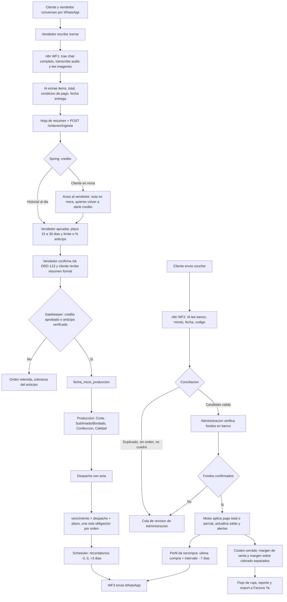

<!-- Versión 1.4.0 | 2026-10-10 | Autor: Isabelita -->
# KeptAI – Actores, flujos y DER

> ID: PROP-FLUJO-DER-001. Versión 1.4.0. Fecha: 10 de octubre de 2026. Fuente: texto aportado por Isabel (USR-FLUJO-002, v1.0.0, donde el producto aparecía como "Lazo"; el nombre vigente es KeptAI).
> Estado: dirección del equipo para actores, flujo e integración WhatsApp ([D-005](decisiones-del-proyecto.md)); el DER es un **modelo fusionado propuesto** con [PROP-DB-001](modelo-base-datos-mvp.md), pendiente de revisión de Andrés y Miguel. No acredita implementación ni políticas aprobadas por Corpotex.

> Actualización de Miguel (D-007, 10/10/2026): se persisten **vouchers y datos estructurados de negocio**, sin mensajes, transcripciones, audios ni imágenes ajenas al voucher. n8n procesa el chat transitoriamente. `CANAL_WHATSAPP` identifica instancia/JID; `ENVIO_NOTIFICACION` conserva solo metadatos, sin texto. V4/V5 corrigen el SQL previo; RLS Supabase pendiente de despliegue remoto.

Sistema order-to-cash para pymes que venden a crédito por WhatsApp (reto Corpotex).
Regla central: **ninguna orden entra a producción sin crédito aprobado o anticipo verificado, y ningún sol cobrado queda sin conciliar.**

## 1. Quiénes interactúan y cómo

| Actor | Qué hace | Por dónde |
|---|---|---|
| **Cliente** (colegio, empresa o persona) | Pide, negocia, acepta condiciones, paga y manda el voucher. Recibe resumen, estado de cuenta, cobranza y recompra. | WhatsApp |
| **Vendedor** | Negocia en su cuenta de WhatsApp. Cierra con `/cerrar`, aprueba el crédito según el historial del cliente y valida con `/ok ORD-123`. | WhatsApp y panel (sin integración ERP en el MVP) |
| **Administración / Cobranza** | Tiene acceso a los pagos y los verifica, atiende mora, resuelve pagos dudosos y escala. | Panel web (móvil y escritorio) |
| **Jefe de taller / producción** | Recibe solo órdenes liberadas, avanza etapas, registra costos y mermas. | Panel web |
| **Gerencia** | Ve margen real, flujo de caja, reporte automático y exporta a contabilidad. | Panel web |
| **Evolution API** | Entrega los mensajes entrantes y envía los salientes. | Sistema |
| **n8n** | Lee el chat, llama a la IA y reenvía JSON a Spring. Se usa por el poco tiempo disponible; no guarda reglas de negocio. | Sistema |
| **IA (LLM)** | Extrae datos del chat, transcribe audios y lee vouchers. Propone; no confirma. | Sistema |
| **Scheduler (Spring)** | Calcula fechas y dispara cobranza y recompra. | Sistema |
| **Banco** | Fuente de verdad del pago. Corpotex ya tiene acceso a sus pagos; KeptAI no se conecta al banco, solo concilia. | Consulta de Administración |
| **Factura Ya** | Recibe el CSV/Excel exportado. | Archivo |
| **Kommo** | CRM actual; opcional, fase 2. | API |

Spring Boot sigue siendo el único backend (D-004): n8n orquesta mensajes y llamadas a la IA, pero fechas, crédito, conciliación y saldos se deciden en Spring.

## 2. Flujo principal

### Workflows de n8n

| Workflow | Disparador | Qué hace | Entrega a Spring |
|---|---|---|---|
| **WF1 – Ingesta de orden** | Vendedor escribe `/cerrar` | Trae el chat completo, transcribe audios, lee imágenes y pide a la IA la extracción. | `POST /ordenes/ingesta` con hoja de resumen en borrador |
| **WF2 – Voucher** | Cliente envía imagen de pago | La IA lee banco, monto, fecha y código de operación. | Pago en fase `RECIBIDO` + comprobante |
| **WF3 – Salientes** | Scheduler de Spring | Envía por WhatsApp los mensajes que Spring ya programó. | Resultado de envío (`ENVIADO` / `ERROR`) |

### Reglas de fechas (las calcula Spring, no n8n)
- **Inicio de producción:** cuando el gatekeeper pasa (credito aprobado o anticipo verificado y aplicado a esa orden).
- **Vencimiento:** fecha del acta de despacho + plazo (15 a 30 días).
- **Cobranza:** −3 días, día 0, +3 días (mora temprana → escala a administración). Se revalida tras aplicar el pago; un parcial no cancela toda la cobranza.
- **Crédito:** lo aprueba el vendedor según el estado del cliente; por ejemplo, si ya tiene pedidos anteriores y todos están pagados. La mora no bloquea: el sistema solo avisa al vendedor ("este cliente está en mora, ¿quieres volver a darle crédito?") y él decide.
- **Recompra:** última compra + intervalo medio del cliente − 7 días. Si el cliente está en mora, el vendedor ve el aviso antes de ofrecer crédito.

### Controles que se conservan de PROP-DB-001
- La IA y el voucher solo **proponen**: un pago pasa por `RECIBIDO → VERIFICADO_BANCO → APLICADO`; solo el aplicado mueve saldo.
- Duplicado, sin orden o no cuadra **no altera la deuda**: va a la cola de revisión.
- Aplicar un pago es una transacción única: aplicación + auditoría + cancelación de alertas. Si falla, se revierte todo.
- Cada ingesta de n8n y cada mensaje saliente lleva `idempotency_key`: reintentar no duplica órdenes, pagos ni cobranzas.
- Saldo y margen se calculan en Spring a partir de aplicaciones válidas; nunca se aceptan desde el navegador, n8n u OCR.

## 3. DER fusionado (propuesta histórica)

> Para implementar V4/V5, usar el [DER visible vigente: 27 tablas](../../diagramas/keptai-der-v5.md), derivado del SQL. El esquema Mermaid de esta sección conserva la propuesta anterior; sus campos y entidades de fases futuras no definen el esquema físico vigente.

Todas las tablas de negocio llevan `organizacion_id` (aislamiento por empresa, P-006); se omite en el diagrama para que sea legible. Importes en PEN `numeric(18,2)` con moneda explícita.

```mermaid
erDiagram
  ORGANIZACION ||--o{ USUARIO : "tiene"
  ORGANIZACION ||--o{ MARCA : "opera"
  ORGANIZACION ||--o{ CLIENTE : "atiende"
  MARCA ||--o{ ORDEN : "vende bajo"
  LINEA_PRODUCTO ||--o{ ORDEN_ITEM : clasifica
  CLIENTE ||--o{ CONTACTO : tiene
  CLIENTE ||--o{ CANAL_WHATSAPP : "conversa en"
  CLIENTE ||--o{ ORDEN : solicita
  CLIENTE ||--o| PERFIL_RECOMPRA : tiene
  CLIENTE ||--o{ TOKEN_ESTADO_CUENTA : "consulta con"
  USUARIO ||--o{ ORDEN : "vende o gestiona"
  CANAL_WHATSAPP ||--o{ HOJA_RESUMEN : origina
  ORDEN ||--o{ HOJA_RESUMEN : "versiones"
  ORDEN ||--|{ ORDEN_ITEM : detalla
  ORDEN ||--o| APROBACION_CREDITO : "requiere"
  USUARIO ||--o{ APROBACION_CREDITO : aprueba
  ORDEN ||--o| OBLIGACION_COBRO : "tiene una"
  ORDEN ||--o{ APLICACION_PAGO : "recibe"
  PAGO ||--o{ APLICACION_PAGO : "se reparte en"
  OBLIGACION_COBRO ||--o{ APLICACION_PAGO : "se cubre con"
  PAGO ||--o{ COMPROBANTE : "respaldado por"
  CLIENTE ||--o{ PAGO : realiza
  ORDEN ||--o{ ORDEN_ETAPA : "pasa por"
  UNIDAD_PRODUCCION ||--o{ ORDEN_ETAPA : ejecuta
  UNIDAD_PRODUCCION ||--o{ PRECIO_TRANSFERENCIA : define
  ORDEN ||--o| DESPACHO : "se entrega en"
  ORDEN ||--o{ COSTO_ORDEN : acumula
  ORDEN ||--o{ ENVIO_NOTIFICACION : genera
  CLIENTE ||--o{ ENVIO_NOTIFICACION : recibe
  OBLIGACION_COBRO ||--o{ ALERTA_COBRANZA : dispara
  USUARIO ||--o{ ALERTA_COBRANZA : atiende
  USUARIO ||--o{ EVENTO_AUDITORIA : registra
  ORGANIZACION ||--o{ APERTURA_CAJA : declara
  ORGANIZACION ||--o{ EGRESO_CAJA : prevé
  ORGANIZACION ||--o{ CONFIG_ESCENARIO : configura
  EXPORTACION_CONTABLE }o--o{ ORDEN : incluye

  ORGANIZACION {
    uuid id PK
    string nombre
    string zona_horaria
  }
  MARCA {
    uuid id PK
    string nombre "CORPOTEX o UNICRACK"
  }
  LINEA_PRODUCTO {
    uuid id PK
    string nombre "DEPORTIVO PROFESIONAL ESCOLAR"
  }
  CLIENTE {
    uuid id PK
    string razon_social
    string tipo "COLEGIO EMPRESA PERSONA"
    string ruc_dni
    boolean en_mora
    decimal limite_credito
  }
  CONTACTO {
    uuid id PK
    uuid cliente_id FK
    string nombre
    string whatsapp_jid
  }
  USUARIO {
    uuid id PK
    string nombre
    string rol "VENDEDOR ADMIN GERENTE JEFE_TALLER"
    string whatsapp_jid
  }
  CANAL_WHATSAPP {
    uuid id PK
    uuid cliente_id FK
    string instancia
    string chat_jid
  }
  HOJA_RESUMEN {
    uuid id PK
    uuid chat_id FK
    uuid orden_id FK
    int version
    jsonb extraccion
    jsonb campos_ausentes
    text resumen_md
    decimal confianza
    string estado "BORRADOR CONFIRMADA"
    uuid revisado_por FK
  }
  ORDEN {
    uuid id PK
    string ref "ORD-123"
    uuid cliente_id FK
    uuid marca_id FK
    uuid vendedor_id FK
    string estado
    string condicion_pago "CONTADO ANTICIPO CREDITO"
    int plazo_dias
    decimal anticipo_requerido
    decimal total
    string moneda
    date fecha_entrega_solicitada
    date fecha_inicio_produccion
    date fecha_vencimiento
    string tipo_produccion "INTERNA TERCERIZADA"
    string idempotency_key
  }
  ORDEN_ITEM {
    uuid id PK
    uuid orden_id FK
    uuid linea_id FK
    string descripcion
    string tela
    string talla
    string logo
    int cantidad
    decimal precio_unit
  }
  APROBACION_CREDITO {
    uuid id PK
    uuid orden_id FK
    uuid aprobado_por FK
    string decision "PENDIENTE APROBADO RECHAZADO"
    boolean aviso_mora_mostrado
    decimal saldo_referencia
    int plazo_dias
    decimal anticipo_pct
    string compromiso_digital_id
  }
  OBLIGACION_COBRO {
    uuid id PK
    uuid orden_id FK
    string evento_inicio_plazo "DESPACHO"
    date vence_en
    decimal monto
    string estado "PENDIENTE PARCIAL PAGADA MORA"
  }
  PAGO {
    uuid id PK
    uuid cliente_id FK
    decimal monto
    string moneda
    date fecha_pago
    string medio "YAPE PLIN TRANSFERENCIA"
    string codigo_operacion
    string fase "RECIBIDO VERIFICADO_BANCO APLICADO"
    string estado_conciliacion "APLICADO PARCIAL DUPLICADO SIN_ORDEN NO_CUADRA"
    string idempotency_key
  }
  COMPROBANTE {
    uuid id PK
    uuid pago_id FK
    string provider_message_id "solo ID de evento voucher"
    string instancia_origen
    string banco
    string imagen_url
    string archivo_hash
    jsonb ocr_extraccion
    decimal confianza
  }
  APLICACION_PAGO {
    uuid id PK
    uuid pago_id FK
    uuid obligacion_id FK
    decimal monto_aplicado
  }
  UNIDAD_PRODUCCION {
    uuid id PK
    string nombre
    string tipo "TALLER_INTERNO TERCERO"
  }
  ORDEN_ETAPA {
    uuid id PK
    uuid orden_id FK
    uuid unidad_id FK
    string etapa "CORTE SUBLIMADO_BORDADO CONFECCION CALIDAD"
    string estado
    timestamp inicio
    timestamp fin
  }
  PRECIO_TRANSFERENCIA {
    uuid id PK
    uuid unidad_id FK
    string etapa
    decimal precio_unit
    date vigente_desde
  }
  DESPACHO {
    uuid id PK
    uuid orden_id FK
    date fecha_despacho
    string acta_url
  }
  COSTO_ORDEN {
    uuid id PK
    uuid orden_id FK
    string concepto "MATERIA_PRIMA MANO_OBRA TERCERO CIF LOGISTICA"
    decimal monto
    string origen "REAL TEORICO"
    string fuente
  }
  ENVIO_NOTIFICACION {
    uuid id PK
    uuid cliente_id FK
    uuid orden_id FK
    string tipo "COBRANZA_PREVENTIVA COBRANZA_VENCIMIENTO MORA_TEMPRANA RECOMPRA ESTADO_CUENTA"
    string idempotency_key
    string estado "PENDIENTE ENVIADO ERROR CANCELADO"
    int intentos
    timestamp programado_para
  }
  ALERTA_COBRANZA {
    uuid id PK
    uuid obligacion_id FK
    uuid responsable_id FK
    string regla
    string estado "ABIERTA RESUELTA CANCELADA"
    text resolucion
  }
  PERFIL_RECOMPRA {
    uuid id PK
    uuid cliente_id FK
    date ultima_compra
    int intervalo_medio_dias
    date proximo_recordatorio
  }
  APERTURA_CAJA {
    uuid id PK
    date fecha
    string moneda
    decimal importe
    string fuente
  }
  EGRESO_CAJA {
    uuid id PK
    date fecha_prevista
    decimal monto
    string estado "PREVISTO REALIZADO"
  }
  CONFIG_ESCENARIO {
    uuid id PK
    decimal factor_cobro
    int plazo_dias_defecto
    date vigente_desde
    string fuente
  }
  TOKEN_ESTADO_CUENTA {
    uuid id PK
    uuid cliente_id FK
    string token_hash
    timestamp expira_en
    timestamp revocado_en
  }
  EVENTO_AUDITORIA {
    uuid id PK
    uuid usuario_id FK
    string operacion
    string entidad_ref
    jsonb cambios
    timestamp ocurrido_en
  }
  EXPORTACION_CONTABLE {
    uuid id PK
    date periodo
    string formato "CSV XLSX"
    string archivo_url
  }
```

### Qué viene de cada modelo

| Entidad fusionada | Modelo de Isabel (v1.0.0) | PROP-DB-001 (Andrés) | Qué se tomó |
|---|---|---|---|
| `ORGANIZACION`, `organizacion_id` en todo | — | `organization`, `membership` | Aislamiento por empresa. `membership` se simplifica a `USUARIO.rol` dentro de una organización. |
| `MARCA`, `LINEA_PRODUCTO` | `MARCA` | `brand`, `product_line`, `commercial_entity` | Se añade línea para medir margen por pedido, línea y marca (D-003). `commercial_entity`/RUC queda fuera hasta conocerlo. |
| `CLIENTE`, `CONTACTO`, `CANAL_WHATSAPP` | Sí | `customer`, `evidence` | Solo metadatos de canal. Evidencia persistente: voucher en `COMPROBANTE`; sin historial de mensajes. |
| `HOJA_RESUMEN` | Sí | `extraction_draft` | Versiones del resumen + campos ausentes y quién revisó. |
| `ORDEN`, `ORDEN_ITEM` | Sí | `order`, `order_item` | Se añaden moneda e `idempotency_key`. |
| `APROBACION_CREDITO` | Sí | `credit_authorization` | Se añaden estado `PENDIENTE` y saldo de referencia. |
| `OBLIGACION_COBRO` | Sí | `receivable` | La cuota es la obligación; se añade el evento que inicia el plazo. |
| `PAGO`, `COMPROBANTE`, `APLICACION_PAGO` | Sí | `payment`, `payment_evidence`, `payment_application` | Un pago admite varios comprobantes; se añaden moneda, hash e idempotencia. |
| `ORDEN_ETAPA`, `UNIDAD_PRODUCCION`, `DESPACHO` | Sí | — | Producción por etapas y acta de despacho, que fija el vencimiento. |
| `COSTO_ORDEN`, `PRECIO_TRANSFERENCIA` | Sí | `order_cost`, `internal_charge` | Se añade fuente del costo. La transferencia interna no es ingreso externo. |
| `ENVIO_NOTIFICACION`, `ALERTA_COBRANZA` | `ENVIO_NOTIFICACION` | `collection_alert`, `job` | Lo que se envía al cliente va separado de la alerta interna con responsable y resolución. `job` se cubre con estado, intentos y fecha programada. |
| `APERTURA_CAJA`, `EGRESO_CAJA`, `CONFIG_ESCENARIO` | — | `cash_opening`, `cash_outflow`, `scenario_setting` | Sin ellas no hay flujo de caja a 4 semanas. |
| `TOKEN_ESTADO_CUENTA` | — | `shared_statement_token` | Estado de cuenta del cliente sin URL predecible. |
| `EVENTO_AUDITORIA` | — | `audit_event` | Quién hizo qué; no se borra historial para corregir. |
| `PERFIL_RECOMPRA`, `EXPORTACION_CONTABLE` | Sí | — | Recompra y export a contabilidad. |

### Decisiones del modelo
- `APLICACION_PAGO` es el puente entre `PAGO`, `ORDEN` y `OBLIGACION_COBRO`: un pago puede cubrir varias órdenes, y una orden puede recibir varios pagos (pago parcial).
- No existe `MENSAJE` persistente. `ENVIO_NOTIFICACION` es una cola de metadatos (estado, destino, tipo, idempotencia), sin texto; Spring genera el texto al enviar.
- `COSTO_ORDEN.origen` (REAL/TEORICO) da margen teórico vs margen real percibido; `UNIDAD_PRODUCCION` + `PRECIO_TRANSFERENCIA` dan el taller como centro de resultados.
- Para el demo se puede dejar fuera: `EXPORTACION_CONTABLE`, `PERFIL_RECOMPRA`, `PRECIO_TRANSFERENCIA`, `TOKEN_ESTADO_CUENTA`, `CONFIG_ESCENARIO`.
- Los nombres van en español como en la v1.0.0; PROP-DB-001 los tenía en inglés. El idioma final de tablas y columnas lo cierra Andrés al escribir la migración Flyway.

## 4. Definido por Isabel (10/10/2026)

- **Plazo de crédito:** de 15 a 30 días. La entrevista A02-Q32 menciona 30 y 45; prevalece esta indicación y el plazo sigue siendo un dato por orden.
- **Quién aprueba el crédito:** el vendedor, según el estado del cliente (pedidos anteriores en orden y pagados).
- **Pagos:** Corpotex ya tiene acceso a sus pagos. KeptAI no integra el banco; su alcance es la conciliación: cruzar voucher, pago verificado y orden.
- **Mora:** no hay bloqueo automático. El sistema avisa que el cliente está en mora y el vendedor decide si vuelve a darle crédito; la decisión queda registrada en `APROBACION_CREDITO`.
- **Plazo único:** cada orden tiene una sola obligación de pago, sin cronograma de cuotas (coincide con la entrevista A02-Q32). `OBLIGACION_COBRO` es esa única obligación por orden; los pagos parciales se siguen registrando en `APLICACION_PAGO`.
- **n8n:** se usa para orquestar WhatsApp e IA porque hay poco tiempo de desarrollo.

## 5. Por validar

- **Criterio de aprobación del vendedor:** falta precisar qué cuenta como "cliente al día" (cuántos pedidos pagados, límite de monto) y qué pasa con un cliente nuevo sin historial.
- **Recompra:** aparece en el flujo, pero D-003 la deja en segunda fase; por eso queda fuera del demo.
- **Factura Ya:** el nombre viene de la entrevista como posible (P-002); el formato del CSV/Excel no está verificado.
- **Evolution API:** en el MVP es solo una prueba con un número de prueba y un contacto (indicación de Isabel, 10/10/2026); no se conectan cuentas reales de vendedores ni chats de clientes. Para uso real falta definir números y consentimiento para leer chats completos.
- **Línea de producto:** los valores de `LINEA_PRODUCTO` son ilustrativos; ver [catálogo](../productos/catalogo.md).

## Relaciones y referencias

- [Índice del cerebro](../INDICE.md).
- [Decisiones del proyecto](decisiones-del-proyecto.md): D-003 (capa de caja), D-004 (Spring Boot), D-005 (WhatsApp con Evolution API y n8n).
- [Modelo de base de datos PROP-DB-001](modelo-base-datos-mvp.md): invariantes, transacción de pago, semilla y pruebas de aceptación, que siguen vigentes sobre este DER.
- [Infraestructura](infraestructura-desarrollo-mvp.md) y [roadmap del equipo](roadmap-hackathon-equipo.md).
- [Rediseño de procesos de crédito y cobranza](../procesos/rediseno-procesos-credito-y-cobranza.md) y [Reto 6](reto-6-corpotex-conciliacion-y-rentabilidad.md).
## 6. Revisión SQL y RLS vigente (D-007)
D-009 añade [validaciones obligatorias de cierre](../../../BD/validaciones-pre-supabase.md). Conservar V5/V6 y validar las seis condiciones en DB/API y en el destino; el DER no acredita idempotencia ni aislamiento operativo.

- D-008 aprueba 25 tablas: [DER V6](../../diagramas/keptai-der-v6.md). Contacto/notas fuera de esta etapa; V6 solo retira vacias. Ver [guia local](../../../BD/local/README.md). El DER V5 se conserva como antecedente.

- [DB-MAP-001](trazabilidad-tablas-mvp.md) justifica cada tabla y distingue fuente empresarial/decision/diseno. Contacto/notas son opcionales; centro y margen por linea no estan completos en V5.

- Definicion para implementar: [DB-DEF-001](../../../BD/definicion-base-datos.md). Ciclo de anticipos, caja, permisos y extensiones de costeo aun sin SQL.

- V1–V3 se conservan como historial; V4–V5 eliminan mensajes, renombran canal y outbox y refuerzan integridad. No editar checksums ya versionados.
- La app usa el esquema privado `keptai`, rol JDBC `keptai_runtime` sin propiedad ni BYPASSRLS. Usuario o servicio activo + organización autorizada se fijan localmente en cada transacción. No dar permisos de tablas al navegador.
- Cada ingesta solo propone un borrador y pagos RECIBIDO. Administración verifica y aplica; sobreaplicaciones y duplicados no modifican saldo.
- Una extracción incompleta cabe en BORRADOR; no se rellena con cero ni un cliente inventado. Antes de confirmar se exigen cliente, condición y total positivo.
- Margen sobre cobrado y margen sobre venta son métricas distintas; con costos no cerrados, los márgenes quedan `null`.
- [Revisión detallada SQL](../../../BD/revision-sql-rls.md), [migraciones](../../../BD/migrations/) y [preparación Supabase](../desarrollo/miguel/preparacion-supabase-rls.md).
