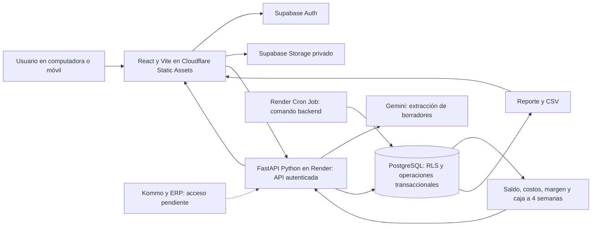

# Infraestructura y tecnologías para desarrollar el MVP KeptAI

> ID: PROP-INFRA-001. Versión: 1.1. Fecha: 10 de octubre de 2026, America/Lima.
> Origen: solicitud del usuario de completar el roadmap con infraestructura y tecnologías.
> Estado: recomendación técnica para comenzar. No acredita cuentas creadas, servicios contratados, código implementado ni aprobación empresarial de políticas.
> Alcance: prototipo funcional de captura, conciliación, cobranza y rentabilidad/caja. Miguel y Andrés backend; Germán e Isabella frontend. No incluye preparación de pitch.

## 1. Recomendación principal y criterio de elección

Para este MVP recomiendo **FastAPI (Python) como único backend**, React/TypeScript/Vite en Cloudflare Workers Static Assets, PostgreSQL/Auth/Storage de Supabase y Gemini API. FastAPI se despliega como servicio web en Render, separado del frontend.

### FastAPI frente a Spring Boot

- **FastAPI:** Python tipado, validación con Pydantic y contrato OpenAPI/documentación interactiva integrado. Es mi recomendación para desarrollar los cuatro módulos, orquestar extracción IA y entregar contratos temprano al frontend. [Características oficiales](https://fastapi.tiangolo.com/features/).
- **Spring Boot:** alternativa válida para esta misma operación financiera, especialmente si el equipo ya domina Java/Spring o dispone de código empresarial reutilizable; Spring dispone de gestión declarativa de transacciones. [Transacciones Spring](https://docs.spring.io/spring-framework/reference/data-access/transaction/declarative.html).
- **Criterio de este proyecto:** rapidez de construcción de una API modular de captura, conciliación, cobranza y caja con dos integrantes backend. No se ha confirmado experiencia previa de Andrés/Miguel en Python o Java; no se atribuye al equipo una habilidad no indicada. Si ambos dominan Java y no Python, revisar la elección antes de iniciar. No existe evidencia que obligue aquí al ecosistema Spring.
- **La integridad financiera no depende del framework:** transacciones PostgreSQL, importes decimales/centavos, permisos, idempotencia y pruebas son obligatorios con cualquiera de los dos. FastAPI puede sostener el piloto y el producto; no se prescribe migrarlo a Spring cuando crezca ni se promete rendimiento sin medirlo.

Esta versión sustituye la recomendación de Supabase Edge Functions/TypeScript de infraestructura v1.0 y roadmap v1.1. Supabase permanece como servicio de datos, identidad y archivos, no como runtime del backend de negocio. La elección es una recomendación técnica solicitada por el usuario; no acredita contratación ni implementación.

La aplicación vive en un repositorio de código separado del cerebro. Se propone un monolito modular FastAPI: un servicio desplegable con módulos internos, sin microservicios iniciales. No crear ahora ese repositorio ni contratar servicios: esta entrega documenta cómo hacerlo.

## 2. Tecnologías por componente

### Frontend — Germán e Isabella

- **React + TypeScript + Vite:** tres pantallas del roadmap, componentes compartidos y build estático. Elegir versiones estables compatibles, guardar el lockfile y usar la misma versión Node en desarrollo y CI. [Vite](https://vite.dev/guide/).
- **Node.js 24 LTS + npm:** herramientas de desarrollo y build. Node no es el runtime del backend Python. [Node LTS](https://nodejs.org/en/about/previous-releases).
- **CSS y componentes accesibles reutilizables:** partir de lo que el equipo ya conoce y de una única librería visual si se necesita. No introducir un generador de interfaces ni varias librerías de componentes como dependencia del flujo.
- **@supabase/supabase-js:** sesión, acceso autorizado y carga de evidencias; el cliente privilegiado permanece fuera del navegador.
- **Zod:** contrato y validación de datos en TypeScript. Mantener las reglas monetarias y transaccionales en backend/base de datos, aunque el formulario también valide. [Zod](https://zod.dev/).

Isabella construye experiencia, componentes y reglas funcionales; Germán estructura rutas, cliente de API, sesión, carga y manejo técnico de errores. El servidor es la autoridad de saldo y margen.

### Hosting web — Germán

**Cloudflare Workers Static Assets** sirve el build de Vite. Se usa como alojamiento del frontend; el backend de negocio es FastAPI en Render. Cloudflare recomienda Workers para proyectos nuevos en lugar de comenzar un proyecto nuevo de Pages. [Static Assets](https://developers.cloudflare.com/workers/static-assets/), [orientación de plataforma](https://developers.cloudflare.com/pages/framework-guides/).

- Build: `npm ci` y `npm run build`; salida `dist/`.
- Configurar assets apuntando a `dist/` y fallback `single-page-application` para abrir directamente rutas del frontend.
- La URL inicial es el subdominio disponible del servicio; el dominio propio no es dependencia para empezar.
- Configurar variables de build públicas y URLs permitidas de retorno de Auth y CORS.
- Conectar GitHub al despliegue cuando el proyecto ya exista; una publicación manual con Wrangler sirve como primera prueba.

La configuración SPA y los builds están documentados por el proveedor. [SPA](https://developers.cloudflare.com/workers/static-assets/routing/single-page-application/), [Workers Builds](https://developers.cloudflare.com/workers/ci-cd/builds/).

### Backend — Miguel y Andrés

**FastAPI + Python 3.12 + Pydantic 2 + Uvicorn**, con versiones compatibles fijadas en `pyproject.toml` y un lockfile. Python 3.12 es una base propuesta de compatibilidad; no una afirmación de que sea la versión más reciente. Una API REST `/api/v1`, OpenAPI y routers por módulo. [FastAPI](https://fastapi.tiangolo.com/features/).

- **Miguel:** routers/endpoints, autenticación de llamadas, orquestación de Gemini, borradores, pedidos y acceso a resultados.
- **Andrés:** SQLAlchemy 2 + psycopg 3, esquema y migraciones Alembic, servicios financieros, operaciones transaccionales, costos, caja, estados y permisos.
- Capas: routers → servicios de aplicación → dominio/repositorios. Compartir esquemas Pydantic y errores; frontend consume OpenAPI, sin compartir código Python con TypeScript.
- Respuestas con `request_id`, estado y error recuperable; entradas validadas y operaciones idempotentes. Usar `Decimal` o centavos en backend y representación explícita en JSON.

**Despliegue propuesto: Render Web Service**, desde el repo de aplicación, con raíz de servicio `backend/`, build `uv sync --frozen --no-dev` (uv instalado/fijado en el entorno) y comando `uv run --no-sync uvicorn app.main:app --host 0.0.0.0 --port $PORT`. Comenzar con una instancia/un worker y pool pequeño; medir antes de escalar. Configurar HTTPS, `/health` sin secretos y comprobación de disponibilidad. Render documenta el despliegue FastAPI; plan, región, cuotas y suspensión se comprueban antes de la demo. [Render FastAPI](https://render.com/docs/deploy-fastapi), [contenedores FastAPI](https://fastapi.tiangolo.com/deployment/docker/).

Docker es opcional para reproducir API/local; no exige Kubernetes. No alojar Python en Cloudflare Static Assets ni en Supabase Edge Functions. Desplegar migraciones como paso controlado antes de publicar una versión que las requiera, no al arrancar cada worker.

Extracción breve: llamada Gemini con timeout y límites de entrada. Si excede la solicitud, guardar un trabajo persistente y devolver su ID. `BackgroundTasks` no ofrece durabilidad de negocio; no usarlo como garantía de conciliación, cobro o reintento tras reiniciar. Un worker persistente se añade solo si las muestras lo necesitan. [Background tasks](https://fastapi.tiangolo.com/tutorial/background-tasks/).

### Datos y transacciones — Andrés

**PostgreSQL administrado por Supabase**, con migraciones Alembic versionadas; Andrés conserva un solo historial de migraciones para el esquema de negocio. Para este dominio es preferible una base relacional por las relaciones entre documentos, pagos, aplicaciones, costos y entidades; la elección es una recomendación de diseño, no una limitación universal de otros productos.

- Entidades mínimas: organizaciones, membresías, entidades comerciales, marcas/líneas, clientes, pedidos, evidencias, borradores, documentos por cobrar, pagos, aplicaciones, costos, cargos internos, movimientos/expectativas de caja, alertas y auditoría.
- `organization_id` separa empresas usuarias del producto; `entity_id`, marca y línea describen unidades dentro de un acceso autorizado. No convertir marcas de Corpotex en personas jurídicas confirmadas.
- Para PEN, guardar importes como centavos enteros o `numeric` decimal con escala definida. No calcular saldos con punto flotante Python ni JavaScript. El contrato debe fijar representación y límites; ratios se redondean para mostrar, no para rehacer saldos.
- Guardar instantes con zona y convertir presentación a America/Lima; los vencimientos de fecha calendario mantienen su significado local.
- Aplicar un pago, validar saldo y registrar auditoría en **una transacción SQLAlchemy/PostgreSQL**, con bloqueo del documento y claves de idempotencia. Usar `Session.begin()`, bloqueo de fila y restricciones únicas; una falla revierte pago, aplicación y auditoría juntos. Varias llamadas sueltas al SDK no forman una transacción. [SQLAlchemy](https://docs.sqlalchemy.org/en/20/orm/session_transaction.html).
- Restringir inserción y modificación directa de aplicaciones de pago: el navegador no puede saltarse verificación y autorización llamando a una tabla o RPC sin controles. El permiso y la verificación se validan dentro de la operación.
- Detectar posibles duplicados por referencia, canal, destinatario y organización cuando existan; hash de archivo es una señal complementaria. Un campo ausente exige revisión y un duplicado no prueba fraude.

Andrés controla migraciones y secuencia de despliegue; Miguel consume los servicios del motor. La API conecta mediante `DATABASE_URL` con TLS y rol runtime limitado, distinto del rol de migración. Usar conexión directa si la red la soporta o pooler en modo sesión para backend persistente en IPv4; limitar conexiones según el plan. [Conexión PostgreSQL](https://supabase.com/docs/guides/database/connecting-to-postgres).

Las tablas de negocio se guardan en un esquema no expuesto a la Data API y se acceden únicamente por FastAPI. La API obtiene usuario del JWT verificado y comprueba membresía/rol; no confía en un `organization_id` enviado por cliente. El rol runtime no es dueño ni tiene `BYPASSRLS`; usar políticas RLS y establecer contexto de organización local a cada transacción desde la membresía autorizada. Probar ausencia de contexto y reutilización de conexión entre dos organizaciones; el JWT no se propaga automáticamente a una conexión SQLAlchemy. Las políticas de Storage se comprueban por separado.

### Autenticación y archivos — Germán, Miguel y Andrés

**Supabase Auth:** comenzar con acceso email/contraseña para cuentas de prueba precreadas, comprobadas en demo; no depender de un correo de confirmación durante el recorrido. [Auth](https://supabase.com/docs/guides/auth). Cuentas de prueba creadas para el equipo y roles mínimos de revisión/administración. El prototipo no necesita construir un sistema de identidad propio. Configurar el método de acceso y comprobarlo en la URL real antes de depender de correo u OAuth durante la entrega.

**Supabase Storage privado:** un bucket de evidencias, con rutas por organización y evidencia; otro de reportes solo si se necesitan archivos persistentes. Conservar `storage_path`, tipo, tamaño, hash, autor y procedencia. Usar descarga autenticada o enlaces firmados breves para revisión; no hacer públicas fotos de vouchers. [Buckets privados](https://supabase.com/docs/guides/storage/buckets/fundamentals).

**JWT verificado + RLS + grants + controles de FastAPI:** política por membresía de organización y acceso a entidad. Revisar permisos de tablas, vistas, RPC y archivos; una clave privilegiada salta RLS y no garantiza aislamiento por sí sola. Verificar firma del JWT con las claves/método configurados de Supabase, emisor, audiencia y expiración; no basta decodificarlo. Limitar tareas privilegiadas a rutas controladas. [JWT Supabase](https://supabase.com/docs/guides/auth/jwts). [RLS](https://supabase.com/docs/guides/database/postgres/row-level-security).

### Captura con IA — Miguel

**Gemini API**, modelo inicial recomendado **`gemini-3.5-flash-lite`**, configurable mediante `GEMINI_MODEL`. La ficha oficial lo identifica como estable y con entrada de texto, imagen/audio/PDF y salida estructurada; es adecuado como punto de partida de extracción. Probar accesibilidad y calidad con las tres modalidades en la cuenta del equipo antes de fijarlo. [Modelo](https://ai.google.dev/gemini-api/docs/models/gemini-3.5-flash-lite).

- Enviar evidencia desde backend y pedir un JSON con campos, valores ausentes y fragmentos de procedencia. El modelo sugiere; una persona corrige y confirma.
- Validar esquema y reglas con Pydantic en FastAPI; Zod queda para formularios frontend. JSON válido no garantiza verdad del importe o autenticidad del voucher.
- No usar IA para calcular saldos, aprobar crédito ni confirmar fondos bancarios: esas operaciones tienen reglas y responsables explícitos.
- La llamada no recibe herramientas para modificar cuentas; texto del chat se trata como evidencia, no como instrucción del agente.
- Poner timeout, límite de tamaño del MVP, límite de intentos y estado de fallo. Para comenzar se proponen imágenes hasta 5 MB y audio corto hasta 10 MB; son límites del producto propuestos, no límites oficiales de Gemini.
- Si un archivo necesita Files API, no publicar la URL privada del Storage ni asumir que Gemini puede leerla: subirlo por el backend y registrar su ciclo de vida. Comprobar formatos y restricciones vigentes.

La API contempla extracción de imagen/audio y respuestas con esquema. [Imagen](https://ai.google.dev/gemini-api/docs/image-understanding), [audio](https://ai.google.dev/gemini-api/docs/audio), [salida estructurada](https://ai.google.dev/gemini-api/docs/structured-output).

### Alertas y trabajos — Andrés y Miguel

Empezar con alertas persistidas en PostgreSQL y evaluación al actualizar el pedido o pago. Añadir **Render Cron Job** para revisar vencimientos y reportes cuando el recorrido básico ya funcione. [Cron Render](https://render.com/docs/cronjobs).

Para cada trabajo guardar estado, intentos, próxima ejecución y error. Una reejecución no duplica alertas ni pagos. El cron ejecuta un comando del mismo backend, por ejemplo `uv run --no-sync python -m app.jobs.vencimientos` desde `backend/`, que termina al completar el lote. Configurar calendario UTC y convertir reglas de fecha a America/Lima. No ejecutar un scheduler en cada worker HTTP; no activar además Supabase Cron para el mismo trabajo. El cron no sustituye un worker continuo y su costo requiere revisión. Eliminar avisos pendientes cuando se confirme pago, y suspender avisos externos si saldo o conciliación están desactualizados.

Durante el MVP, las alertas se muestran en la aplicación. WhatsApp/correo reales entran cuando exista canal autorizado y configuración comprobada. Kommo, ERP y Apps Script mantienen conectores pendientes; usar archivos para la prueba no acredita una integración.

### Pruebas y operación — cada dueño de módulo

- **Vitest:** validadores, transformaciones y funciones TypeScript del frontend. [Vitest](https://vitest.dev/guide/).
- **pytest + HTTPX y pruebas PostgreSQL:** Andrés y Miguel comprueban el motor real, transacciones, permisos y repetición de pagos; un test de UI no demuestra atomicidad. Casos mínimos: pago parcial, dos solicitudes concurrentes/reintentadas, rollback por fallo intermedio, aislamiento de dos organizaciones y saldo sin alterar ante extracción no verificada. [pytest](https://docs.pytest.org/en/stable/).
- **Playwright:** Germán automatiza el recorrido desplegado, móvil, recarga y estados fallidos con Andrés coordinando los resultados. [Playwright](https://playwright.dev/docs/intro).
- **GitHub Actions:** typecheck, pruebas y build por PR; dos jobs: Node 24 para frontend y Python 3.12 para backend, instalación bloqueada, Ruff y pytest con PostgreSQL de prueba. No demostrar transacciones usando solo SQLite. Aprobar migraciones y despliegue por responsable, sin publicar cada rama contra datos del piloto. [CI Node](https://docs.github.com/en/actions/tutorials/build-and-test-code/nodejs).
- **Logs de Render, Supabase y Cloudflare:** trazabilidad por `request_id`, resultado y latencia. No registrar claves, vouchers completos o transcripciones sensibles en logs. Sentry es posterior si esos logs no bastan.

## 3. Arquitectura y recorrido operativo



La carga directa a Storage solo está permitida con sesión y política de organización. La extracción corre en backend. El comprobante pasa por borrador, revisión, verificación y aplicación; solo la última operación modifica el saldo. Los cargos internos afectan resultados de gestión según la regla, pero no crean entrada bancaria externa.

## 4. Estructura del repo de aplicación propuesto

```text
repo-aplicacion/
├── src/
│   ├── features/captura/
│   ├── features/pedidos-cobranza/
│   ├── features/resultados-caja/
│   ├── components/
│   └── lib/api/
├── backend/
│   ├── app/main.py
│   ├── app/api/v1/
│   ├── app/core/                 # config, JWT, permisos
│   ├── app/schemas/              # Pydantic
│   ├── app/services/             # captura, pagos, resultados
│   ├── app/models/
│   ├── app/repositories/
│   ├── app/jobs/
│   ├── migrations/              # Alembic
│   ├── alembic.ini
│   ├── tests/
│   ├── scripts/seed_demo.py
│   ├── pyproject.toml
│   ├── uv.lock
│   └── .env.example
├── supabase/policies/            # configuración Auth/Storage versionada
├── tests/e2e/
├── docs/contrato-api.md
├── .github/workflows/checks.yml
├── .env.example
├── package-lock.json
└── wrangler.jsonc
```

Esta estructura no existe por documentarla. Germán controla estructura frontend y hosting; Isabella componentes/flujo; Miguel FastAPI/API; Andrés SQLAlchemy, migraciones Alembic y motor. Los contratos entre ambos equipos se versionan antes de completar toda la lógica.

## 5. Entornos, secretos y puesta en marcha

### Entornos mínimos

- **Local:** Node 24/npm para frontend, Python 3.12 y uv para API; Supabase CLI opcional. La pila Supabase local usa un runtime Docker compatible cuando se levanta completa; si el equipo no lo tiene listo, usar un proyecto remoto de demo con datos ficticios y aislamiento por miembro/semilla. [CLI local](https://supabase.com/docs/guides/local-development/cli/getting-started).
- **Demo compartida:** un proyecto Supabase exclusivo para demostración, una API FastAPI en Render y un frontend desplegado. Las previews solo acceden a datos ficticios; no se conectan al piloto real.
- **Piloto posterior:** proyecto separado, datos autorizados, backups y restauración probada. No reutilizar claves ni el proyecto de demo como producción por comodidad.

El uso de Docker aquí se limita al entorno local; no implica desplegar un clúster o administrar un VPS.

### Variables públicas del frontend

`VITE_SUPABASE_URL`, `VITE_SUPABASE_PUBLISHABLE_KEY`, `VITE_API_BASE_URL`, `VITE_APP_ENV`. Toda variable `VITE_` debe tratarse como pública. Nunca incluir una clave IA o privilegiada allí.

### Variables y credenciales de backend/CI

Backend Render: `DATABASE_URL`, `SUPABASE_URL`, `SUPABASE_JWT_ISSUER`, `SUPABASE_JWT_AUDIENCE`, `GEMINI_API_KEY`, `GEMINI_MODEL`, `ALLOWED_ORIGINS`, `APP_ENV`; una credencial Supabase privilegiada solo si una tarea controlada de archivos la necesita. La URL del emisor determina las claves/método de verificación configurados; comprobarlo contra el proyecto real. Credencial de migración separada del runtime. Guardar secretos en Render/CI; `.env.example` lleva nombres, no valores. Credenciales de despliegue Cloudflare/Render/Supabase van en secretos de CI, sin compartirse en Markdown ni chats.

Validar sesión/JWT, pertenencia, rol y permiso en cada operación. CORS restringido al origen conocido ayuda al navegador, pero no reemplaza autenticación ni autorización. Configurar retorno de Auth para URL local y desplegada.

### Orden concreto para comenzar

1. **Andrés + Miguel:** comprobar acceso a Supabase, Render y al proveedor IA; decidir región del proyecto según disponibilidad y latencia probada. No asumir región o plan de la cuenta.
2. **Germán:** inicializar React/TypeScript con Vite en el repo de aplicación acordado, fijar Node/lockfile y publicar una página mínima en Cloudflare.
3. **Andrés:** migración Alembic inicial, membresías, RLS/grants y datos ficticios P-001/P-002; preparar operación de pago transaccional.
4. **Miguel:** API FastAPI: salud, consulta autenticada y extracción de una muestra; publicar en Render; configurar secretos, timeout y corrección humana.
5. **Germán + Isabella:** iniciar sesión, cargar evidencia privada y consultar el mismo pedido mediante API.
6. **Los cuatro:** primera prueba remota antes de H1: autenticación → evidencia → borrador → pedido persistente. Si no pasa, resolver infraestructura antes de ampliar pantallas.
7. **Andrés + Miguel:** conectar aplicación de pago, resultados y caja; Germán integra; Isabella valida la lectura funcional.
8. **Germán + Andrés:** build/pruebas y recorrido móvil de la URL final; anexar resultados y procedimiento de reinicio.

Para iniciar la app, los comandos orientativos son `npm create vite@latest . -- --template react-ts`, `npm install` y `npm run dev` dentro de un repo vacío acordado; después fijar las versiones resueltas. Para backend, definir `pyproject.toml`/`uv.lock`, ejecutar `uv sync --frozen`, `uv run alembic upgrade head` en entorno autorizado y `uv run uvicorn app.main:app --reload` desde `backend/`. Configurar `VITE_API_BASE_URL` y generar tipos frontend a partir de OpenAPI. Supabase CLI y Wrangler se instalan conforme al entorno y documentación vigente. No ejecutar estos comandos en este repo de conocimiento ni usar `db reset` contra un entorno compartido para limpiar una demo.

## 6. Costos, recuperación y criterios de infraestructura lista

No se prescribe una tarifa: depende de planes, cuotas, región, llamadas IA, almacenamiento y egreso. Verificar cuentas y límites al empezar; usar niveles disponibles para la demo y aprobar un presupuesto máximo antes de contratar o activar cobros. El costo del piloto requiere medición, no asumir gratuidad por usar servicios administrados.

Semilla ficticia versionada + migraciones permiten reconstruir la demo. Para datos reales, programar respaldo de base y de archivos privados por separado y probar restauración; un dump SQL no respalda las imágenes del Storage. Guardar backups fuera del repo y comprobar la cobertura del plan activo. [CLI de respaldo](https://supabase.com/docs/reference/cli/supabase-db-dump).

Infraestructura lista significa que existe evidencia de:

- URL con HTTPS que abre y recarga una ruta interna del frontend.
- Acceso de prueba funcionando y usuario no autorizado rechazado.
- Archivo privado que un usuario de otra organización no puede descargar.
- API FastAPI desplegada accesible desde frontend sin claves IA/privilegiadas en navegador.
- Pago duplicado/reintentado aplicado una sola vez en la base real.
- Costos/caja y CSV calculados desde registros persistidos.
- Logs suficientes para localizar un fallo sin exponer evidencias.
- Lockfile, migración y semilla que otro integrante puede reproducir.

No incluir Kubernetes, Redis, Kafka, Jenkins, Pinecone, servidor OCR propio o múltiples backends para comenzar. Si aparece una necesidad concreta posterior de procesamiento pesado, incorporar un worker separado con cola persistente; no migrar todo el producto por anticipación.

## 7. Relación con el roadmap

Los pasos 1–4 pertenecen a B0/B1; la integración real al cierre H1/B2; transacciones, resultados y captura completa a B2–B4; estabilidad y recuperación a B5–B8. El [roadmap](roadmap-hackathon-equipo.md) contiene responsables y entregables por bloque.

Esta recomendación amplía P-004/P-005 sin convertirlas en aprobación empresarial. Las fórmulas financieras, políticas de crédito y acceso a sistemas de Corpotex siguen pendientes de validación donde lo indican las fuentes. Referencias de puesta en marcha: [Alembic](https://alembic.sqlalchemy.org/en/latest/tutorial.html) y [uv en contenedores](https://docs.astral.sh/uv/guides/integration/docker/). Documentación técnica consultada el 10 de octubre de 2026; verificar versiones/cuotas al implementar.
