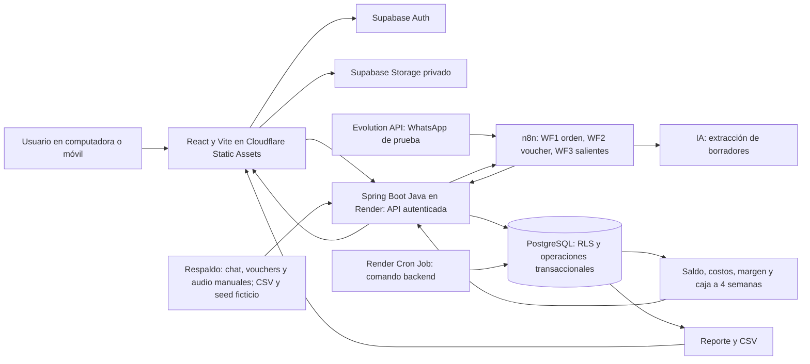

# Infraestructura y tecnologías para desarrollar el MVP KeptAI

> ID: PROP-INFRA-001. Versión: 1.2. Fecha: 10 de octubre de 2026, America/Lima.
> Origen: solicitud del usuario de completar el roadmap con infraestructura y tecnologías.
> Estado: recomendación técnica para comenzar. No acredita cuentas creadas, servicios contratados, código implementado ni aprobación empresarial de políticas.
> Actualización D-005 (10/10/2026): WhatsApp entra al MVP mediante Evolution API y n8n, como prueba con un número y un contacto; n8n invoca la IA y entrega JSON a Spring, que sigue siendo el único backend con reglas. Plazo de crédito de 15 a 30 días y una sola obligación por orden; el vendedor aprueba el crédito y la mora solo genera un aviso, sin bloqueo. KeptAI no integra el banco: concilia. Detalle en [actores, flujos y DER](actores-flujos-y-der-mvp.md). Lo que este documento diga en contrario queda como antecedente.
> Pendiente: asignar responsable de los workflows de n8n y de la instancia de Evolution API.
> Alcance: prototipo funcional de captura, conciliación, cobranza y rentabilidad/caja. Miguel y Andrés backend; Germán e Isabella frontend. No incluye preparación de pitch.

## 1. Recomendación principal y criterio de elección

La dirección vigente del usuario es **Spring Boot como único backend**: Miguel y Andrés conocen Spring y lo han manejado (USR-EQUIPO-003, D-004). Esto sustituye FastAPI, recomendado antes de conocer esa experiencia. La familiaridad del equipo reduce el esfuerzo de arranque; la falta de datos ERP/CRM define las entradas, no demuestra una superioridad universal del framework.

Stack: React/TypeScript/Vite en Cloudflare Workers Static Assets; Spring Boot/Java en Render mediante Docker; PostgreSQL/Auth/Storage de Supabase; Gemini para extracción. No se requieren datos, API, exportaciones o credenciales de ERP/CRM. Entradas del MVP: chat pegado/cargado, vouchers y audio aportados manualmente, registros manuales/CSV y semilla ficticia de pedidos, costos, vencimientos y caja. Por D-005 se añade la entrada por WhatsApp con Evolution API y n8n (un número y un contacto de prueba); la carga manual queda como respaldo. Los conectores ERP/CRM quedan fuera del MVP, sin pasos de conexión ni accesos que bloqueen H1.

**Andrés es responsable del diseño de base de datos**, además del motor financiero. Miguel revisa el esquema y construye API/captura; no se incorpora un quinto integrante sin nombre. [Modelo de base propuesto](modelo-base-datos-mvp.md). Germán ejecuta el [roadmap frontend](roadmap-german-frontend.md) basado en el prompt recibido, coordinado con Isabella.

Para el trabajo vigente de Miguel (D-006), usar Backend/ de este checkout; cerebro/ mantiene documentación y BD/ conserva diseño de Andrés. No crear otro repo. Un monolito modular Spring Boot basta al comienzo: captura, pedidos/pagos, cobranza y resultados/caja. Se conserva el núcleo de D-003 y no se avanza pitch. Esta documentación no acredita implementación ni despliegue.

## 2. Tecnologías por componente

### Frontend — Germán e Isabella

- **React + TypeScript + Vite:** tres pantallas del roadmap, componentes compartidos y build estático. Elegir versiones estables compatibles, guardar el lockfile y usar la misma versión Node en desarrollo y CI. [Vite](https://vite.dev/guide/).
- **Node.js 24 LTS + npm:** herramientas de desarrollo y build. Node no es el runtime del backend Java. [Node LTS](https://nodejs.org/en/about/previous-releases).
- **CSS y componentes accesibles reutilizables:** partir de lo que el equipo ya conoce y de una única librería visual si se necesita. No introducir un generador de interfaces ni varias librerías de componentes como dependencia del flujo.
- **@supabase/supabase-js:** sesión, acceso autorizado y carga de evidencias; el cliente privilegiado permanece fuera del navegador.
- **Zod:** contrato y validación de datos en TypeScript. Mantener las reglas monetarias y transaccionales en backend/base de datos, aunque el formulario también valide. [Zod](https://zod.dev/).

Isabella construye experiencia, componentes y reglas funcionales; Germán estructura rutas, cliente de API, sesión, carga y manejo técnico de errores. El servidor es la autoridad de saldo y margen.

### Hosting web — Germán

**Cloudflare Workers Static Assets** sirve el build de Vite. Se usa como alojamiento del frontend; el backend de negocio es Spring Boot en Render. Cloudflare recomienda Workers para proyectos nuevos en lugar de comenzar un proyecto nuevo de Pages. [Static Assets](https://developers.cloudflare.com/workers/static-assets/), [orientación de plataforma](https://developers.cloudflare.com/pages/framework-guides/).

- Build: `npm ci` y `npm run build`; salida `dist/`.
- Configurar assets apuntando a `dist/` y fallback `single-page-application` para abrir directamente rutas del frontend.
- La URL inicial es el subdominio disponible del servicio; el dominio propio no es dependencia para empezar.
- Configurar variables de build públicas y URLs permitidas de retorno de Auth y CORS.
- Conectar GitHub al despliegue cuando el proyecto ya exista; una publicación manual con Wrangler sirve como primera prueba.

La configuración SPA y los builds están documentados por el proveedor. [SPA](https://developers.cloudflare.com/workers/static-assets/routing/single-page-application/), [Workers Builds](https://developers.cloudflare.com/workers/ci-cd/builds/).

### Backend — Miguel y Andrés

**Java 21 LTS + Spring Boot 4.1.1 + Maven Wrapper**, como base compatible recomendada. La documentación oficial consultada identifica 4.1.1 como estable y compatible con Java 21. Fijar versión/BOM y wrapper; si el equipo tiene plantilla conocida de otra línea todavía soportada, acordar y documentar una única versión antes de B1. No usar snapshots. [Requisitos Spring Boot](https://docs.spring.io/spring-boot/system-requirements.html).

- Spring Web MVC para REST `/api/v1`, Bean Validation para DTOs, Spring Security OAuth2 Resource Server para JWT, Spring Data JPA/Hibernate y driver PostgreSQL; Flyway y su módulo PostgreSQL compatible para migraciones.
- **Miguel:** controllers, DTOs, API/contratos, autenticación, captura Gemini y revisión de borradores, despliegue.
- **Andrés:** modelo relacional, Flyway, entidades/repositorios, servicios transaccionales de pagos, costos, alertas y caja. Miguel revisa las migraciones antes de consumirlas.
- Capas: controller → service → repository; módulos por negocio dentro de un deploy. Entregar `docs/openapi.yaml` versionado y ejemplos a frontend; no depender de una librería OpenAPI no comprobada para Boot 4.
- Usar `BigDecimal` o centavos y contrato JSON explícito; errores con `request_id` y códigos estables. Spring Security valida firma, emisor, expiración y audiencia con configuración comprobada. [JWT](https://docs.spring.io/spring-security/reference/servlet/oauth2/resource-server/jwt.html).

**Render Web Service con Docker multi-stage**, raíz `backend/`, build Maven Wrapper y runtime JRE 21. Comando del contenedor: `java -jar app.jar`, `server.port=${PORT:8080}` en configuración. Ejecutar como usuario sin privilegios, fijar imágenes/dependencias y probar memoria, arranque, HTTPS y health. Exponer solo salud mínima de Actuator; endpoints administrativos protegidos. Render admite Docker; plan, región, cuotas/suspensión y presupuesto se comprueban antes de la demo. [Docker en Render](https://render.com/docs/docker).

Primera versión: una instancia; pool HikariCP pequeño ajustado a las conexiones disponibles. Docker local para PostgreSQL/API es útil, pero no requiere Kubernetes. Flyway se ejecuta como paso controlado de release con rol migrador, antes de iniciar API con rol runtime; en el servicio runtime desactivar migración automática (`spring.flyway.enabled=false`) y usar `ddl-auto=validate`, nunca `update/create` en entorno compartido.

Por D-005, n8n orquesta la extracción: llama a la IA y envía el JSON a Spring, que valida el DTO y lo deja como borrador a revisar. Lo siguiente aplica solo si se conserva una llamada directa como respaldo: Gemini se invoca desde Java mediante cliente HTTP con timeout, límites y respuesta DTO validada. No añadir un backend Python para esa llamada. Si tarda más que la solicitud, persistir trabajo y estado; tareas en memoria o `@Async` no garantizan reintento tras reinicio. Un worker del mismo código solo se añade si las muestras lo necesitan.

### Datos y transacciones — Andrés

**PostgreSQL administrado por Supabase**, con migraciones Flyway versionadas; Andrés conserva un solo historial de migraciones para el esquema de negocio. Para este dominio es preferible una base relacional por las relaciones entre documentos, pagos, aplicaciones, costos y entidades; la elección es una recomendación de diseño, no una limitación universal de otros productos.

- Entidades mínimas: organizaciones, membresías, entidades comerciales, marcas/líneas, clientes, pedidos, evidencias, borradores, documentos por cobrar, pagos, aplicaciones, costos, cargos internos, movimientos/expectativas de caja, alertas y auditoría.
- `organization_id` separa empresas usuarias del producto; `entity_id`, marca y línea describen unidades dentro de un acceso autorizado. No convertir marcas de Corpotex en personas jurídicas confirmadas.
- Para PEN, guardar importes como centavos enteros o `numeric` decimal con escala definida. No calcular saldos con punto flotante Java ni JavaScript. El contrato debe fijar representación y límites; ratios se redondean para mostrar, no para rehacer saldos.
- Guardar instantes con zona y convertir presentación a America/Lima; los vencimientos de fecha calendario mantienen su significado local.
- Aplicar un pago, validar saldo y registrar auditoría en **una transacción Spring/PostgreSQL**, con bloqueo del documento y claves de idempotencia. Usar un servicio público `@Transactional` invocado a través del proxy Spring, bloqueo de fila/JPA y restricciones únicas; definir rollback de errores relevantes y evitar autoinvocación que omita el proxy; una falla revierte pago, aplicación y auditoría juntos. Varias llamadas sueltas al SDK no forman una transacción. [@Transactional](https://docs.spring.io/spring-framework/reference/data-access/transaction/declarative/annotations.html).
- Restringir inserción y modificación directa de aplicaciones de pago: el navegador no puede saltarse verificación y autorización llamando a una tabla o RPC sin controles. El permiso y la verificación se validan dentro de la operación.
- Detectar posibles duplicados por referencia, canal, destinatario y organización cuando existan; hash de archivo es una señal complementaria. Un campo ausente exige revisión y un duplicado no prueba fraude.

Andrés controla migraciones y secuencia de despliegue; Miguel consume los servicios del motor. La API conecta mediante `SPRING_DATASOURCE_URL` JDBC más usuario/contraseña con TLS y rol runtime limitado, distinto del rol de migración. Usar conexión directa si la red la soporta o pooler en modo sesión para backend persistente en IPv4; limitar conexiones según el plan. [Conexión PostgreSQL](https://supabase.com/docs/guides/database/connecting-to-postgres).

Las tablas de negocio se guardan en un esquema no expuesto a la Data API y se acceden únicamente por Spring Boot. La API obtiene usuario del JWT verificado y comprueba membresía/rol; no confía en un `organization_id` enviado por cliente. El rol runtime no es dueño ni tiene `BYPASSRLS`; usar políticas RLS y establecer contexto de organización local a cada transacción desde la membresía autorizada. Probar ausencia de contexto y reutilización de conexión entre dos organizaciones; el JWT no se propaga automáticamente a una conexión JDBC/JPA. Las políticas de Storage se comprueban por separado.

### Autenticación y archivos — Germán, Miguel y Andrés

**Supabase Auth:** comenzar con acceso email/contraseña para cuentas de prueba precreadas, comprobadas en demo; no depender de un correo de confirmación durante el recorrido. [Auth](https://supabase.com/docs/guides/auth). Cuentas de prueba creadas para el equipo y roles mínimos de revisión/administración. El prototipo no necesita construir un sistema de identidad propio. Configurar el método de acceso y comprobarlo en la URL real antes de depender de correo u OAuth durante la entrega.

**Supabase Storage privado:** un bucket de evidencias, con rutas por organización y evidencia; otro de reportes solo si se necesitan archivos persistentes. Conservar `storage_path`, tipo, tamaño, hash, autor y procedencia. Usar descarga autenticada o enlaces firmados breves para revisión; no hacer públicas fotos de vouchers. [Buckets privados](https://supabase.com/docs/guides/storage/buckets/fundamentals).

**JWT verificado + RLS + grants + controles de Spring Boot:** política por membresía de organización y acceso a entidad. Revisar permisos de tablas, vistas, RPC y archivos; una clave privilegiada salta RLS y no garantiza aislamiento por sí sola. Verificar firma del JWT con las claves/método configurados de Supabase, emisor, audiencia y expiración; no basta decodificarlo. Limitar tareas privilegiadas a rutas controladas. [JWT Supabase](https://supabase.com/docs/guides/auth/jwts). [RLS](https://supabase.com/docs/guides/database/postgres/row-level-security).

### Captura con IA — Miguel

**Gemini API**, modelo inicial recomendado **`gemini-3.5-flash-lite`**, configurable mediante `GEMINI_MODEL`. La ficha oficial lo identifica como estable y con entrada de texto, imagen/audio/PDF y salida estructurada; es adecuado como punto de partida de extracción. Probar accesibilidad y calidad con las tres modalidades en la cuenta del equipo antes de fijarlo. [Modelo](https://ai.google.dev/gemini-api/docs/models/gemini-3.5-flash-lite).

- Enviar evidencia desde backend y pedir un JSON con campos, valores ausentes y fragmentos de procedencia. El modelo sugiere; una persona corrige y confirma.
- Validar esquema y reglas con Bean Validation/DTOs en Spring Boot; Zod queda para formularios frontend. JSON válido no garantiza verdad del importe o autenticidad del voucher.
- No usar IA para calcular saldos, aprobar crédito ni confirmar fondos bancarios: esas operaciones tienen reglas y responsables explícitos.
- La llamada no recibe herramientas para modificar cuentas; texto del chat se trata como evidencia, no como instrucción del agente.
- Poner timeout, límite de tamaño del MVP, límite de intentos y estado de fallo. Para comenzar se proponen imágenes hasta 5 MB y audio corto hasta 10 MB; son límites del producto propuestos, no límites oficiales de Gemini.
- Si un archivo necesita Files API, no publicar la URL privada del Storage ni asumir que Gemini puede leerla: subirlo por el backend y registrar su ciclo de vida. Comprobar formatos y restricciones vigentes.

La API contempla extracción de imagen/audio y respuestas con esquema. [Imagen](https://ai.google.dev/gemini-api/docs/image-understanding), [audio](https://ai.google.dev/gemini-api/docs/audio), [salida estructurada](https://ai.google.dev/gemini-api/docs/structured-output).

### Alertas y trabajos — Andrés y Miguel

Empezar con alertas persistidas en PostgreSQL y evaluación al actualizar el pedido o pago. Añadir **Render Cron Job** para revisar vencimientos y reportes cuando el recorrido básico ya funcione. [Cron Render](https://render.com/docs/cronjobs).

Para cada trabajo guardar estado, intentos, próxima ejecución y error. Una reejecución no duplica alertas ni pagos. El cron ejecuta un comando del mismo backend, por ejemplo `java -jar app.jar --spring.profiles.active=job-vencimientos` con modo sin servidor web y salida al terminar, que termina al completar el lote. Configurar calendario UTC y convertir reglas de fecha a America/Lima. No ejecutar un scheduler en cada worker HTTP; no activar además Supabase Cron para el mismo trabajo. El cron no sustituye un worker continuo y su costo requiere revisión. Eliminar avisos pendientes cuando se confirme pago, y suspender avisos externos si saldo o conciliación están desactualizados.

Durante el MVP, las alertas internas se muestran en la aplicación. Por D-005, los mensajes de resumen y cobranza al cliente salen por WhatsApp mediante n8n (WF3) y Evolution API, solo al contacto de prueba; Spring decide qué y cuándo se envía. Correo, ERP, CRM y Apps Script quedan fuera del MVP: no hay datos ni integración. Un CSV o chat cargado manualmente no acredita conexión al sistema de origen.

### Pruebas y operación — cada dueño de módulo

- **Vitest:** validadores, transformaciones y funciones TypeScript del frontend. [Vitest](https://vitest.dev/guide/).
- **JUnit 5 + Spring Boot Test + MockMvc + PostgreSQL real de prueba/Testcontainers:** Andrés y Miguel comprueban el motor real, transacciones, permisos y repetición de pagos; un test de UI no demuestra atomicidad. Casos mínimos: pago parcial, dos solicitudes concurrentes/reintentadas, rollback por fallo intermedio, aislamiento de dos organizaciones y saldo sin alterar ante extracción no verificada. [Spring Boot Test](https://docs.spring.io/spring-boot/reference/testing/index.html).
- **Playwright:** Germán automatiza el recorrido desplegado, móvil, recarga y estados fallidos con Andrés coordinando los resultados. [Playwright](https://playwright.dev/docs/intro).
- **GitHub Actions:** typecheck, pruebas y build por PR; dos jobs: Node 24 para frontend y Java 21/Maven Wrapper para backend, `./mvnw verify` con PostgreSQL de prueba. No demostrar transacciones usando solo SQLite. Aprobar migraciones y despliegue por responsable, sin publicar cada rama contra datos del piloto. [CI Node](https://docs.github.com/en/actions/tutorials/build-and-test-code/nodejs).
- **Logs de Render, Supabase y Cloudflare:** trazabilidad por `request_id`, resultado y latencia. No registrar claves, vouchers completos o transcripciones sensibles en logs. Sentry es posterior si esos logs no bastan.

## 3. Arquitectura y recorrido operativo



La carga directa a Storage solo está permitida con sesión y política de organización. La extracción corre en backend. El comprobante pasa por borrador, revisión, verificación y aplicación; solo la última operación modifica el saldo. Los cargos internos afectan resultados de gestión según la regla, pero no crean entrada bancaria externa.

## 4. Estructura del repo de aplicación propuesto

```text
repo-aplicacion/
├── src/
│   ├── features/captura/
│   ├── features/pedidos-cobranza/
│   ├── features/resultados-caja/
│   ├── components/
│   └── lib/api/
├── backend/
│   ├── src/main/java/.../KeptAiApplication.java
│   ├── src/main/java/.../captura/
│   ├── src/main/java/.../pagos/
│   ├── src/main/java/.../cobranza/
│   ├── src/main/java/.../resultados/
│   ├── src/main/java/.../security/
│   ├── src/main/resources/application.yml
│   ├── src/main/resources/db/migration/
│   ├── src/test/java/
│   ├── pom.xml
│   ├── mvnw y .mvn/wrapper/
│   ├── Dockerfile
│   └── .env.example
├── supabase/policies/            # configuración Auth/Storage versionada
├── tests/e2e/
├── docs/contrato-api.md
├── .github/workflows/checks.yml
├── .env.example
├── package-lock.json
└── wrangler.jsonc
```

Esta estructura no existe por documentarla. Germán controla estructura frontend y hosting; Isabella componentes/flujo; Miguel Spring/API; Andrés diseño de base, JPA, Flyway y motor. Los contratos entre ambos equipos se versionan antes de completar toda la lógica.

## 5. Entornos, secretos y puesta en marcha

### Entornos mínimos

- **Local:** Node 24/npm para frontend, JDK 21 y Maven Wrapper para API; Supabase CLI opcional. La pila Supabase local usa un runtime Docker compatible cuando se levanta completa; si el equipo no lo tiene listo, usar un proyecto remoto de demo con datos ficticios y aislamiento por miembro/semilla. [CLI local](https://supabase.com/docs/guides/local-development/cli/getting-started).
- **Demo compartida:** un proyecto Supabase exclusivo para demostración, una API Spring Boot en Render y un frontend desplegado. Las previews solo acceden a datos ficticios; no se conectan al piloto real.
- **Piloto posterior:** proyecto separado, datos autorizados, backups y restauración probada. No reutilizar claves ni el proyecto de demo como producción por comodidad.

El uso de Docker aquí se limita al entorno local; no implica desplegar un clúster o administrar un VPS.

### Variables públicas del frontend

`VITE_SUPABASE_URL`, `VITE_SUPABASE_PUBLISHABLE_KEY`, `VITE_API_BASE_URL`, `VITE_APP_ENV`. Toda variable `VITE_` debe tratarse como pública. Nunca incluir una clave IA o privilegiada allí.

### Variables y credenciales de backend/CI

Backend Render: `SPRING_DATASOURCE_URL`, `SPRING_DATASOURCE_USERNAME`, `SPRING_DATASOURCE_PASSWORD`, `SUPABASE_URL`, `SUPABASE_JWT_ISSUER`, `SUPABASE_JWKS_URI`, `SUPABASE_JWT_AUDIENCE`, `GEMINI_API_KEY`, `GEMINI_MODEL`, `ALLOWED_ORIGINS`, `APP_ENV`, `PORT`. Estas variables se enlazan explícitamente desde `application.yml`; los nombres personalizados no configuran Spring por sí solos. Configurar issuer y jwk-set-uri del proyecto y audiencia esperada; no asumir discovery OIDC. Credenciales migrador/runtime separadas y clave privilegiada Storage solo para rutas controladas que la necesiten. Guardar secretos en Render/CI y nombres sin valores en `.env.example`.

Validar sesión/JWT, pertenencia, rol y permiso en cada operación. CORS restringido al origen conocido ayuda al navegador, pero no reemplaza autenticación ni autorización. Configurar retorno de Auth para URL local y desplegada.

### Orden concreto para comenzar

1. **Andrés + Miguel:** comprobar acceso a Supabase, Render y al proveedor IA; decidir región del proyecto según disponibilidad y latencia probada. No asumir región o plan de la cuenta.
2. **Germán:** inicializar React/TypeScript con Vite en la carpeta de aplicación acordada del repo existente, fijar Node/lockfile y publicar una página mínima en Cloudflare.
3. **Andrés:** ER/diccionario, migración Flyway inicial, membresías, RLS/grants y datos ficticios P-001/P-002; preparar operación de pago transaccional.
4. **Miguel:** API Spring Boot: salud, consulta autenticada y extracción de una muestra; publicar en Render; configurar secretos, timeout y corrección humana.
5. **Germán + Isabella:** iniciar sesión, cargar evidencia privada y consultar el mismo pedido mediante API.
6. **Los cuatro:** primera prueba remota antes de H1: autenticación → evidencia → borrador → pedido persistente. Si no pasa, resolver infraestructura antes de ampliar pantallas.
7. **Andrés + Miguel:** conectar aplicación de pago, resultados y caja; Germán integra; Isabella valida la lectura funcional.
8. **Germán + Andrés:** build/pruebas y recorrido móvil de la URL final; anexar resultados y procedimiento de reinicio.

Para iniciar la app, los comandos orientativos son `npm create vite@latest . -- --template react-ts`, `npm install` y `npm run dev` dentro de un repo vacío acordado; después fijar las versiones resueltas. Para backend, crear proyecto Spring Initializr con versiones/dependencias acordadas, guardar Maven Wrapper y ejecutar `./mvnw verify` y `./mvnw spring-boot:run` desde `backend/`. En Windows usar `mvnw.cmd`. Migraciones Flyway y semilla se ejecutan únicamente en el entorno autorizado; semilla ficticia debe ser explícita y no correr al arrancar producción. Configurar `VITE_API_BASE_URL` y contratos `docs/openapi.yaml`. Supabase CLI y Wrangler se instalan conforme al entorno y documentación vigente. No ejecutar estos comandos en este repo de conocimiento ni usar `db reset` contra un entorno compartido para limpiar una demo.

## 6. Costos, recuperación y criterios de infraestructura lista

No se prescribe una tarifa: depende de planes, cuotas, región, llamadas IA, almacenamiento y egreso. Verificar cuentas y límites al empezar; usar niveles disponibles para la demo y aprobar un presupuesto máximo antes de contratar o activar cobros. El costo del piloto requiere medición, no asumir gratuidad por usar servicios administrados.

Semilla ficticia versionada + migraciones permiten reconstruir la demo. Para datos reales, programar respaldo de base y de archivos privados por separado y probar restauración; un dump SQL no respalda las imágenes del Storage. Guardar backups fuera del repo y comprobar la cobertura del plan activo. [CLI de respaldo](https://supabase.com/docs/reference/cli/supabase-db-dump).

Infraestructura lista significa que existe evidencia de:

- URL con HTTPS que abre y recarga una ruta interna del frontend.
- Acceso de prueba funcionando y usuario no autorizado rechazado.
- Archivo privado que un usuario de otra organización no puede descargar.
- API Spring Boot desplegada accesible desde frontend sin claves IA/privilegiadas en navegador.
- Pago duplicado/reintentado aplicado una sola vez en la base real.
- Costos/caja y CSV calculados desde registros persistidos.
- Logs suficientes para localizar un fallo sin exponer evidencias.
- Lockfile, migración y semilla que otro integrante puede reproducir.

No incluir Kubernetes, Redis, Kafka, Jenkins, Pinecone, servidor OCR propio o múltiples backends para comenzar. Si aparece una necesidad concreta posterior de procesamiento pesado, incorporar un worker separado con cola persistente; no migrar todo el producto por anticipación.

## 7. Relación con el roadmap

Los pasos 1–4 pertenecen a B0/B1; la integración real al cierre H1/B2; transacciones, resultados y captura completa a B2–B4; estabilidad y recuperación a B5–B8. El [roadmap](roadmap-hackathon-equipo.md) contiene responsables y entregables por bloque.

Esta recomendación amplía P-004/P-005 sin convertirlas en aprobación empresarial. Las fórmulas financieras, políticas de crédito y acceso a sistemas de Corpotex siguen pendientes de validación donde lo indican las fuentes. Documentación técnica consultada el 10 de octubre de 2026; verificar versiones/cuotas al implementar.
