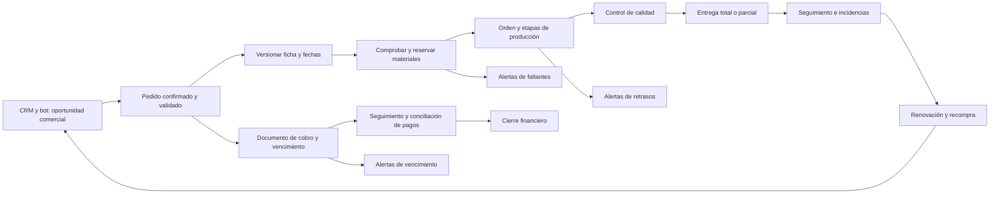

# Ventas, producción, inventario y cobranza

> Corte documental: 10 de octubre de 2026. Versión: 1.0.
> Los procesos actuales se describen según entrevistas automáticas editadas, sin verificación humana por escucha. Los procesos futuros se identifican como propuestas.

## Alcance

Este archivo reúne la venta y el cumplimiento del pedido, incluida producción, inventario, entrega y cobranza, dentro de la estructura de seis documentos solicitada.

## Funcionamiento descrito

### Captación y cotización

Según la entrevista, las campañas llevan directamente a WhatsApp; se atiende también presencialmente a clientes corporativos y de a pie. [A01-Q03] 01_pedidos_whatsapp_crm.md, 00:31–00:39 [A01-Q01] 01_pedidos_whatsapp_crm.md, 00:00–00:23

Se estiman costos manualmente con materia prima, suministros, mano de obra, alquiler, gastos indirectos, experiencia de los dueños y precios de proveedores. El margen se calcula manualmente; Excel no queda confirmado inequívocamente. [A02-Q08] 02_ventas_produccion_cobranza.md, 03:53–04:35 [A02-Q21] 02_ventas_produccion_cobranza.md, 10:04–10:17

### Registro y producción

Según la entrevista, facturación está vinculada al inventario y un módulo reciente registra pedidos de confección. Se genera una ficha técnica que pasa por áreas como corte y sublimado. No se acredita un recorrido completo de todas las etapas. [A02-Q02] 02_ventas_produccion_cobranza.md, 00:23–01:23 [A02-Q26] 02_ventas_produccion_cobranza.md, 14:25–14:56

Si un cliente modifica un pedido antes de producir, se acepta el cambio. Si la producción comenzó, se describe un nuevo plazo de entrega. La regla relatada requiere validación antes de automatizarla: faltan condiciones y fórmula del nuevo plazo. [A02-Q06] 02_ventas_produccion_cobranza.md, 02:51–03:26

### Inventario y entrega

Según la entrevista, las vendedoras consultan stock. El inventariado de insumos estaba “casi al 100%”, referido al avance, sin acreditar exactitud de existencias. [A02-Q14] 02_ventas_produccion_cobranza.md, 06:55–07:24 [A02-Q18] 02_ventas_produccion_cobranza.md, 09:04–09:23

Se describen productos ya entregados de ventas a crédito. Falta un procedimiento detallado de despacho, recepción, devoluciones y entregas parciales. [A02-Q04] 02_ventas_produccion_cobranza.md, 02:17–02:38

### Cobranza

Según la entrevista, se asignan fechas de pago, el seguimiento puede ser insuficiente y el módulo de cuentas por cobrar puede quedar desactualizado. Los pendientes se revisan una vez al mes. [A02-Q03] 02_ventas_produccion_cobranza.md, 01:23–02:17 [A02-Q04] 02_ventas_produccion_cobranza.md, 02:17–02:38 [A02-Q12] 02_ventas_produccion_cobranza.md, 06:25–06:40

Se describe ausencia de un límite para continuar otorgando crédito. Esto conserva su carácter de declaración. Se mencionan 30 y 45 días y una confirmación final de 30 días; falta precisar cuándo se aplica cada plazo. [A02-Q30] 02_ventas_produccion_cobranza.md, 16:22–16:48 [A02-Q32] 02_ventas_produccion_cobranza.md, 17:34–17:44

## Cifras con restricciones

- “300”: significado, unidad y moneda pendientes; no representa ventas diarias demostradas. [A02-Q01] 02_ventas_produccion_cobranza.md, 00:00–00:23
- Cifras del tramo sobre trabajos y plazos: reconocimiento discrepante; no utilizarlas como datos. [A02-Q10] 02_ventas_produccion_cobranza.md, 05:29–05:44
- “30%”: estimación sin período ni denominador; no constituye tasa de morosidad validada. [A02-Q11] 02_ventas_produccion_cobranza.md, 05:44–06:25
- “20%”: ejemplo retomado sin mes ni cálculo; no constituye límite de crédito aprobado. [A02-Q30] 02_ventas_produccion_cobranza.md, 16:22–16:48
- “Más de 100”: importe sin unidad, moneda o escala recuperadas. Se declara afectación de liquidez para planilla, sin monto calculable. [A02-Q31] 02_ventas_produccion_cobranza.md, 16:48–17:34

## Reglas del flujo futuro recomendado

**Estado: propuestas del mapa de arquitectura.**

Validar cliente, líneas, cantidades, especificaciones, responsable, fecha y versión antes de generar producción. Una oportunidad ganada incompleta queda pendiente de validación.

Producción registra avances, bloqueos, cantidades y responsable. Los cambios conservan versiones y fechas anteriores y se aprueban antes de comunicarlos.

Separar el cierre operativo del financiero y registrar entregas y pagos parciales. Una captura de transferencia constituye evidencia pendiente; verificación y aplicación del pago son operaciones diferentes.

Definir cuál sistema conserva cada dato oficial. El posible nombre “Factura Ya” no identifica un proveedor confirmado ni demuestra una API disponible. [A02-Q05] 02_ventas_produccion_cobranza.md, 02:38–02:51

El anexo conserva el mapa completo del proceso y todas las reglas propuestas para mantener inventario actualizado: recepción, reserva, consumo, terminación, despacho, devoluciones, mermas, traslados y conciliación.

## Responsabilidades propuestas, pendientes de asignación

- Ventas: validar pedido y comunicar cambios aprobados.
- Producción: registrar avance, consumo y bloqueos.
- Almacén: recepción, movimientos, reservas, conteos y despacho.
- Administración/cobranza: documentos, pagos verificados y diferencias.
- Integraciones: sincronización, errores y recuperación.

Estas funciones no constituyen cargos nominales confirmados. Una persona puede asumir varias según el piloto.

## Relaciones

[Catálogo](../productos/catalogo.md) contiene productos y datos maestros; [atención](atencion-cliente.md), comunicaciones y alertas; [decisiones](../decisiones/decisiones-del-proyecto.md), arquitectura y controles.

## Anexo de evidencia: registros completos

Se conservan las secciones depuradas originales, incluidas sus notas. El tipo y las limitaciones adicionales proceden de la base local. Todos estos registros tienen verificación `transcripcion_automatica_editada_sin_escucha_humana`.

### A01-Q03 — ¿Las campañas llevan directamente a WhatsApp o pasan por una landing y luego los contactan?

**Fuente:** [A01-Q03] 01_pedidos_whatsapp_crm.md, 00:31–00:39.

**Tipo:** `declaracion_entrevista`.

**Respuesta:** Directamente a WhatsApp.

### A02-Q01 — ¿Cuántas ventas realizan diariamente?

**Fuente:** [A02-Q01] 02_ventas_produccion_cobranza.md, 00:00–00:23.

**Tipo:** `dato_ambiguo`.

**Respuesta:** Se pregunta si se trata del volumen. Se menciona una cifra de “300” asociada al “ticket promedio” y al cliente “de a pie”.

**Dato pendiente de confirmar:** La frase no permite establecer con seguridad si se habla de un importe o del número de tickets. Tampoco se especifica moneda. El canal en la pregunta inicial no se reconoce con claridad. **No usar “300 ventas diarias” como dato confirmado.**

**Limitaciones del registro:**

- 300 no tiene unidad ni moneda confirmadas; no usar como ventas diarias ni importe.

### A02-Q04 — ¿El producto de esas ventas a crédito ya se entregó?

**Fuente:** [A02-Q04] 02_ventas_produccion_cobranza.md, 02:17–02:38.

**Tipo:** `declaracion_entrevista`.

**Respuesta:** Sí. En el sistema de facturación existe un módulo de cuentas por cobrar. Allí se tienen que actualizar todos los pagos, pero muchas veces la información está desactualizada.

### A02-Q05 — ¿Cómo manejan ese registro y qué sistema utilizan?

**Fuente:** [A02-Q05] 02_ventas_produccion_cobranza.md, 02:38–02:51.

**Tipo:** `declaracion_con_incertidumbre`.

**Respuesta:** Es un sistema de facturación. En el intercambio se repite “Factura Ya” [posible nombre del sistema; escritura comercial pendiente de confirmar].

**Limitaciones del registro:**

- Factura Ya es un posible nombre; escritura comercial pendiente.

### A02-Q06 — ¿Qué sucede si el cliente modifica un pedido confirmado antes de recibirlo?

**Fuente:** [A02-Q06] 02_ventas_produccion_cobranza.md, 02:51–03:26.

**Tipo:** `declaracion_entrevista`.

**Respuesta:** Si la producción todavía no ha empezado, se acepta la modificación. Si ya empezó, la política es establecer un nuevo plazo de entrega. El plazo deja de contarse desde la fecha inicialmente otorgada y se calcula desde otra fecha.

### A02-Q09 — ¿Cómo podrían conectarse ventas, facturación y seguimiento?

**Fuente:** [A02-Q09] 02_ventas_produccion_cobranza.md, 04:35–05:29.

**Tipo:** `propuesta`.

**Intervención de los entrevistadores:** Se plantea conectar ventas con facturación para enviar recordatorios a quienes tienen pagos pendientes. También se propone facilitar las cotizaciones considerando materia prima y producción, y asociar cada pedido con una fecha de producción para enviar recordatorios. Se menciona que algunas empresas pagan al contado.

**Nota:** Es una propuesta formulada durante la entrevista. La afirmación de que ventas y facturación no están conectadas no queda confirmada de forma inequívoca en este tramo. Más adelante se explica que facturación y gestión están entrelazadas.

**Fragmento incompleto:** Al comienzo aparece una pregunta sobre lo que necesita un empleado, seguida de “tenía una pregunta y me olvidé”; no se desarrolla una respuesta.

**Limitaciones del registro:**

- No confirma que ventas y facturación estén desconectadas; contrastar A02-Q14.

### A02-Q10 — Intercambio sobre trabajo a crédito y plazos

**Fuente:** [A02-Q10] 02_ventas_produccion_cobranza.md, 05:29–05:44.

**Tipo:** `dato_ambiguo`.

**Fragmento de reconocimiento incierto:** Las dos pasadas de reconocimiento discrepan: la primera recoge una pregunta sobre trabajos y cifras como “35” y “80”; la segunda sugiere trabajo a crédito y un plazo en días, pero tampoco recupera las cifras con claridad. No se puede determinar con seguridad la formulación exacta ni los valores. Se conserva el tramo como pendiente de verificación, sin convertirlo en un dato del negocio.

**Limitaciones del registro:**

- Las dos transcripciones discrepan; no utilizar las cifras.

### A02-Q11 — ¿Cuántas cuentas abiertas tienen que seguir cobrando?

**Fuente:** [A02-Q11] 02_ventas_produccion_cobranza.md, 05:44–06:25.

**Tipo:** `estimacion_declarada`.

**Respuesta:** Aproximadamente un 30%.

**Aclaración del intercambio:** El sistema permite llevar el seguimiento, pero queda a cargo de las personas. No hay recordatorios, alertas ni notificaciones automáticas. Se comenta que el sistema está más centrado en la facturación.

**Alcance del porcentaje:** Se da como estimación. No se explicita un período de medición ni un denominador preciso; no equivale automáticamente a una tasa de morosidad.

**Limitaciones del registro:**

- 30% es una estimación sin denominador ni período; no es una tasa de morosidad.

### A02-Q12 — ¿Con qué frecuencia revisan o concilian los pagos pendientes?

**Fuente:** [A02-Q12] 02_ventas_produccion_cobranza.md, 06:25–06:40.

**Tipo:** `declaracion_entrevista`.

**Respuesta:** Una vez al mes. Revisan los clientes a los que les falta pagar y realizan seguimiento.

### A02-Q26 — ¿Qué tienen implementado actualmente en producción?

**Fuente:** [A02-Q26] 02_ventas_produccion_cobranza.md, 14:25–14:56.

**Tipo:** `declaracion_con_incertidumbre`.

**Respuesta:** Se registra el pedido y, a partir de él, se obtiene una ficha técnica que pasa por distintas áreas, como corte y sublimado. Se menciona una implementación relacionada con producción [la descripción inicial se reconoce de forma incierta].

**Intercambio posterior:** Se destacan producción y alertas de vencimiento como temas de interés. No se da por confirmado que esas alertas ya estén operativas.

**Limitaciones del registro:**

- No confirma alertas ya operativas ni un flujo completo de producción.

### A02-Q30 — ¿Existe un límite para seguir otorgando crédito cuando aumentan las cuentas por cobrar?

**Fuente:** [A02-Q30] 02_ventas_produccion_cobranza.md, 16:22–16:48.

**Tipo:** `declaracion_con_incertidumbre`.

**Respuesta:** No hay un límite establecido; se sigue otorgando crédito. En la respuesta se menciona haber superado el 20% de las ventas en cuentas por cobrar en un mes, sin identificar el mes ni aportar el cálculo.

**Contexto:** La pregunta introduce el 20% como ejemplo y la respuesta retoma ese porcentaje. Se conserva como declaración de la entrevista, no como política de crédito ni como saldo actual verificado.

**Limitaciones del registro:**

- 20% se retoma de un ejemplo y no tiene mes ni cálculo; no es límite de crédito ni saldo actual.

### A02-Q31 — ¿Las cuentas pendientes han afectado la liquidez para la planilla?

**Fuente:** [A02-Q31] 02_ventas_produccion_cobranza.md, 16:48–17:34.

**Tipo:** `dato_ambiguo`.

**Respuesta parcialmente reconocida:** Se menciona que algunos clientes concentraban un porcentaje importante de las cuentas por cobrar y que la situación llegó a jugar en contra de la planilla.

**Cifra incierta:** Se pregunta por el monto y se reconoce “más de 100” y “un poco más”. La unidad, moneda y escala no se recuperan con fiabilidad. No se convierte esa expresión en un importe utilizable ni en una cantidad de clientes.

**Limitaciones del registro:**

- Más de 100 no tiene moneda, escala ni unidad fiable; no convertir a un importe.

### A02-Q32 — ¿Manejan el crédito en cuotas o con un plazo único?

**Fuente:** [A02-Q32] 02_ventas_produccion_cobranza.md, 17:34–17:44.

**Tipo:** `declaracion_con_incertidumbre`.

**Respuesta:** No se maneja en cuotas; se establece un plazo. En el intercambio se mencionan 30 y 45 días; la segunda pasada recupera una confirmación final de 30 días. Conviene confirmar en qué casos se aplica cada plazo.

**Limitaciones del registro:**

- Se mencionan 30 y 45 días; confirmar los casos antes de aplicar una política general.

## Anexo de diseño: secciones completas del mapeo

Las recomendaciones conservan su estado de propuesta salvo lo identificado como dirección explícita del equipo. Los números corresponden al mapeo original y no establecen un nuevo orden de aprobación.

### 3. Mapa del proceso completo

Producción y cobranza avanzan en paralelo: puede haber anticipos, pagos parciales, entregas parciales y crédito después de entregar. **Entregado no significa pagado**, y un pedido pagado puede seguir pendiente de producción.

El cierre operativo exige completar las entregas y resolver incidencias. El cierre financiero exige que no quede saldo exigible pendiente. Ambos se muestran por separado.

### 5. Cómo mantener el inventario actualizado

#### 5.1. Definir una autoridad para cada dato

La propuesta inicial es conservar el sistema actual como registro oficial de existencias y facturación, sujeto a comprobar su calidad y capacidad de integración. La nueva herramienta conserva el seguimiento operativo y una copia sincronizada para consultas.

Hay dos formas de desplegar el módulo de stock:

- **Con integración suficiente:** la herramienta captura o solicita movimientos y los envía al sistema oficial; muestra si están pendientes, aceptados o rechazados. Solo los movimientos aceptados se consideran confirmados.
- **Sin integración suficiente:** se utilizan importaciones con conciliación y una última fecha de corte visible. Si se decide que la nueva herramienta sea el registro oficial, se realiza una migración con conteo inicial y fecha de cambio. Desde ese momento debe existir un único lugar para escribir cada tipo de movimiento.

No mantener dos inventarios editables e independientes. La elección de autoridad se configura por empresa antes del piloto.

#### 5.2. Capturar lo que ocurre físicamente

- **Recepción:** almacén registra material, unidad, cantidad, ubicación y referencia del ingreso.
- **Reserva:** al aprobar un pedido, se asigna material disponible. Reservar no disminuye la existencia física.
- **Consumo:** producción confirma cuánto material utilizó y libera la parte correspondiente de la reserva, en una misma operación.
- **Terminación:** se da entrada al producto terminado y se registra el resultado del control de calidad.
- **Despacho:** almacén registra la salida real y la entrega asociada, incluso si es parcial.
- **Devolución:** se registra el ingreso, pero queda bloqueado hasta determinar si puede volver a usarse o venderse.
- **Merma y ajuste:** se registra cantidad, motivo y aprobación cuando corresponda. No se borra el movimiento anterior: se corrige con otro movimiento trazable.
- **Traslado:** salida y entrada entre ubicaciones se relacionan; un traslado no crea stock adicional.

El sistema no descubre estos hechos automáticamente. Almacén y producción necesitan formularios breves, acceso desde el punto de trabajo y responsabilidades claras. Un código QR puede facilitar la identificación de la orden, pero no sustituye el registro del movimiento.

#### 5.3. Cálculos y controles

`Disponible = existencia física utilizable − reservas activas`

La existencia utilizable excluye stock bloqueado por calidad. Si el sistema externo ya entrega un saldo disponible descontando reservas, no se vuelven a restar. Los pedidos de compra aún no recibidos se muestran como entradas previstas, no como material existente.

Las reservas se validan de forma transaccional para que dos vendedores no comprometan las mismas unidades. Para materiales expresados en metros, kilos o unidades, se conservan unidades y reglas de conversión explícitas; no se suman magnitudes distintas.

Cada movimiento conserva empresa, artículo, ubicación, cantidad, unidad, pedido, autor, fecha de ocurrencia, fecha de registro e identificador del sistema de origen.

Administración ve movimientos pendientes, diferencias de conciliación, artículos sin actualizar y fecha de la última sincronización correcta. Los conteos físicos periódicos detectan errores que una integración no puede descubrir.

#### 5.4. Ejemplo ilustrativo

Hay 100 metros utilizables y se reservan 30 para un pedido: quedan 70 disponibles. Se consumen 28 y se cierra la reserva liberando los 2 restantes: quedan 72 metros físicos y 72 disponibles, si no existen otras reservas. Un ingreso confirmado de 20 lleva el saldo a 92.

Este ejemplo describe la lógica propuesta; no son datos de Corpotex.
