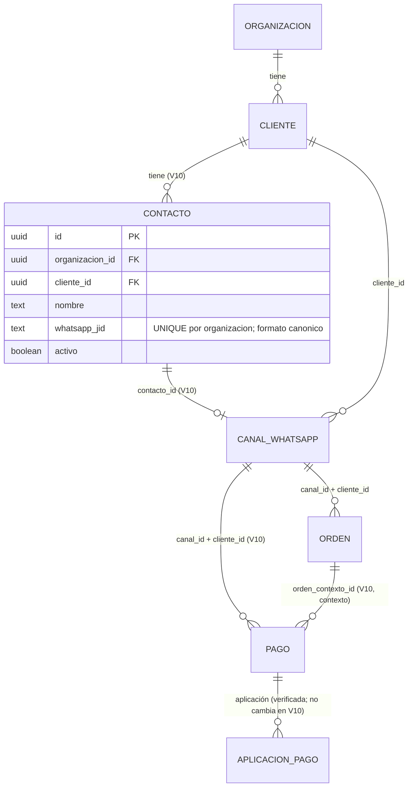

# KeptAI — Cambios del DER en V10 (fuente editable)

Fecha: 11/10/2026. Fuente: BD/migrations/V10__contacto_whatsapp.sql, D-011. Conserva el [DER V9](keptai-der-v9.md) (láminas PNG vigentes de V1–V9); este documento solo describe la **diferencia** y su fuente Mermaid. La exportación a lámina PNG queda pendiente (no se alteró ningún diagrama existente).

Reglas: el contacto no es vendedor, ni organización, ni usuario de Auth. Las FK compuestas (organización, canal, cliente, jid) impiden asociaciones cruzadas. `pago.orden_contexto_id` no reemplaza a `aplicacion_pago`.
