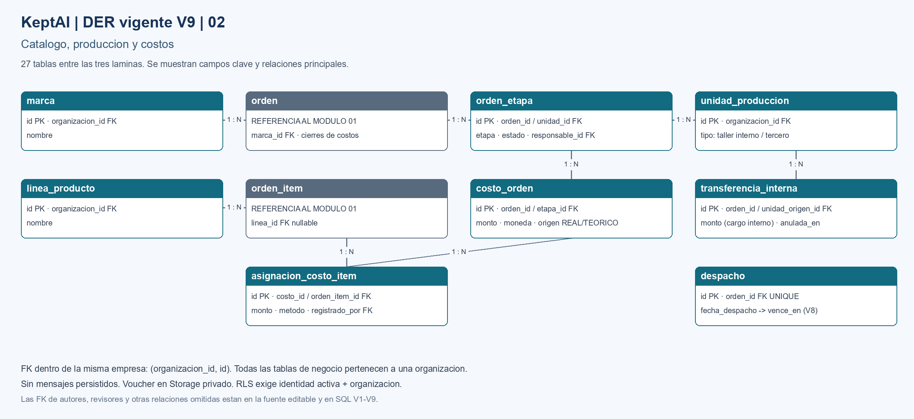

# KeptAI — DER visible y editable (SQL V9)

Fecha: 11/10/2026. Fuente: BD/migrations/V1–V9, D-007, D-010. Describe el SQL vigente, aplicado en local y en Supabase (historial Flyway V7 baseline, V8, V9). El [DER V6](keptai-der-v6.md) se conserva como antecedente.

## Pedidos, vouchers y cobranza

## Catalogo, produccion y costos

## Organizacion, identidad y soporte

## Lectura y alcance

Las tres láminas incluyen las 27 tablas, con referencias repetidas para conectar módulos. Los recuadros grises repiten una tabla de otra lámina. PK = clave primaria; FK = clave foránea. Las líneas muestran relaciones principales, no un recorrido de ejecución. La fuente Mermaid siguiente enumera todas las FK declaradas, incluidos autores/revisores y relaciones opcionales. Campos y restricciones completos: [diccionario](../../BD/diccionario-datos.md) y [migraciones](../../BD/migrations/).

Una orden tiene cero o una obligación, y cada obligación corresponde a una orden. Pago y obligación se vinculan mediante aplicaciones; el pago puede seguir sin cliente identificado. La mora se calcula en una vista, no en cliente. No existe tabla mensaje ni contenido de notificaciones. Las vistas de margen/saldo/mora no son tablas. Auth y Storage son servicios/esquemas de Supabase externos a estas 27 tablas. RLS no se representa como una relación: consultar [revisión SQL/RLS](../../BD/revision-sql-rls.md).

## Cambios desde V6

- **V7 (autorización):** sin tablas ni relaciones nuevas. Crédito solo VENDEDOR, autoría ligada al usuario autenticado, padres financieros congelados con aplicaciones vigentes y lecturas por mínimo privilegio.
- **V8 (cobranza):** sin tablas nuevas. Insertar un `despacho` pasa la orden a DESPACHADA y fija `obligacion_cobro.vence_en = fecha_despacho + plazo` (trigger). El acta no cambia de fecha ni de orden.
- **V9 (C-05/C-06):** `asignacion_costo_item` reparte cada costo entre los ítems de su orden, en la misma moneda y sin superar el costo. `transferencia_interna` registra el cargo interno del taller propio: solo taller interno, inmutable salvo anulación y una activa por orden y unidad. El cargo interno no es pago ni caja y se elimina al consolidar.

## Fuente editable — relaciones físicas

```mermaid
erDiagram
  organizacion ||--o{ usuario : organizacion_id
  organizacion ||--o{ marca : organizacion_id
  organizacion ||--o{ linea_producto : organizacion_id
  organizacion ||--o{ cliente : organizacion_id
  organizacion ||--o{ canal_whatsapp : organizacion_id
  cliente |o--o{ canal_whatsapp : cliente_id
  usuario |o--o{ canal_whatsapp : vendedor_id
  organizacion ||--o{ orden : organizacion_id
  cliente |o--o{ orden : cliente_id
  marca |o--o{ orden : marca_id
  usuario |o--o{ orden : vendedor_id
  canal_whatsapp |o--o{ orden : canal_id
  organizacion ||--o{ orden_item : organizacion_id
  orden ||--o{ orden_item : orden_id
  linea_producto |o--o{ orden_item : linea_id
  organizacion ||--o{ hoja_resumen : organizacion_id
  orden ||--o{ hoja_resumen : orden_id
  canal_whatsapp |o--o{ hoja_resumen : canal_id
  usuario |o--o{ hoja_resumen : revisado_por
  organizacion ||--o{ aprobacion_credito : organizacion_id
  orden ||--o| aprobacion_credito : orden_id
  usuario |o--o{ aprobacion_credito : aprobado_por
  organizacion ||--o{ obligacion_cobro : organizacion_id
  orden ||--o| obligacion_cobro : orden_id
  organizacion ||--o{ pago : organizacion_id
  cliente |o--o{ pago : cliente_id
  usuario |o--o{ pago : verificado_por
  organizacion ||--o{ comprobante : organizacion_id
  pago ||--o{ comprobante : pago_id
  organizacion ||--o{ aplicacion_pago : organizacion_id
  pago ||--o{ aplicacion_pago : pago_id
  obligacion_cobro ||--o{ aplicacion_pago : obligacion_id
  usuario ||--o{ aplicacion_pago : aplicado_por
  usuario |o--o{ aplicacion_pago : anulada_por
  organizacion ||--o{ unidad_produccion : organizacion_id
  organizacion ||--o{ orden_etapa : organizacion_id
  orden ||--o{ orden_etapa : orden_id
  unidad_produccion |o--o{ orden_etapa : unidad_id
  usuario |o--o{ orden_etapa : responsable_id
  organizacion ||--o{ despacho : organizacion_id
  orden ||--o| despacho : orden_id
  usuario ||--o{ despacho : registrado_por
  organizacion ||--o{ costo_orden : organizacion_id
  orden ||--o{ costo_orden : orden_id
  orden_etapa |o--o{ costo_orden : etapa_id
  usuario |o--o{ costo_orden : registrado_por
  organizacion ||--o{ envio_notificacion : organizacion_id
  cliente |o--o{ envio_notificacion : cliente_id
  usuario |o--o{ envio_notificacion : usuario_destino_id
  orden |o--o{ envio_notificacion : orden_id
  obligacion_cobro |o--o{ envio_notificacion : obligacion_id
  organizacion ||--o{ alerta_cobranza : organizacion_id
  obligacion_cobro |o--o{ alerta_cobranza : obligacion_id
  pago |o--o{ alerta_cobranza : pago_id
  usuario |o--o{ alerta_cobranza : responsable_id
  organizacion ||--o{ apertura_caja : organizacion_id
  organizacion ||--o{ egreso_caja : organizacion_id
  organizacion ||--o{ evento_auditoria : organizacion_id
  usuario |o--o{ evento_auditoria : usuario_id
  organizacion ||--o{ solicitud_idempotente : organizacion_id
  organizacion ||--o{ integracion_servicio : organizacion_id
  pago |o--o{ pago : duplicado_de_pago_id
  orden ||--o{ costo_orden : orden_id_moneda
  orden ||--o| obligacion_cobro : orden_id_moneda
  organizacion ||--o{ asignacion_costo_item : organizacion_id
  costo_orden ||--o{ asignacion_costo_item : costo_id
  orden_item ||--o{ asignacion_costo_item : orden_item_id
  usuario |o--o{ asignacion_costo_item : registrado_por
  organizacion ||--o{ transferencia_interna : organizacion_id
  orden ||--o{ transferencia_interna : orden_id_moneda
  unidad_produccion ||--o{ transferencia_interna : unidad_origen_id
  usuario ||--o{ transferencia_interna : registrado_por
  usuario |o--o{ transferencia_interna : anulada_por
```

Para regenerar las imágenes: ejecutar `render-der-v9.py` con Python y Pillow; el generador usa fuentes Arial de Windows.
