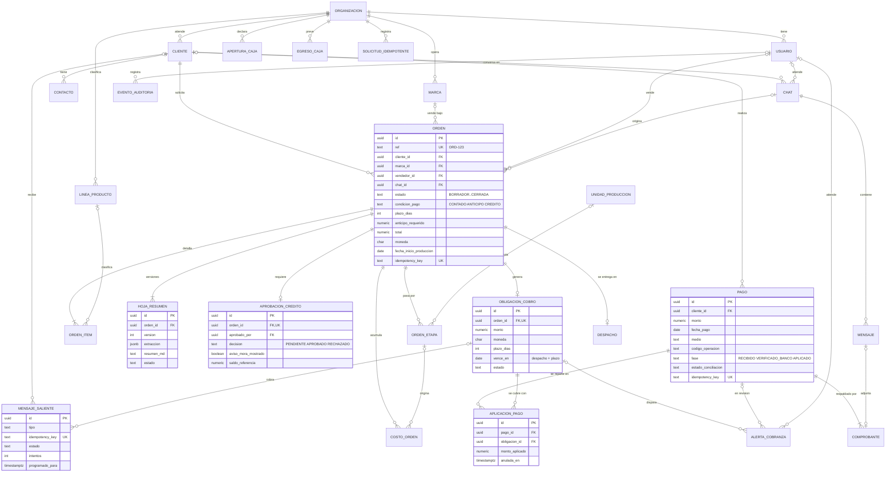

<!-- Versión 1.0.0 | 2026-10-10 | Autor: Andrés -->
# KeptAI – Base de datos del MVP (DER v1)

> ID: DB-DER-001. Implementa el DER fusionado [PROP-FLUJO-DER-001](../cerebro/conocimientos/decisiones/actores-flujos-y-der-mvp.md) con los invariantes de [PROP-DB-001](../cerebro/conocimientos/decisiones/modelo-base-datos-mvp.md).
> Estado: propuesta de Andrés, **pendiente de revisión de Miguel** (contratos/entidades) e Isabel (significado). Validada en PostgreSQL 16 local; aún no desplegada en Supabase.

## Archivos

| Archivo | Contenido |
|---|---|
| [migrations/V1__esquema_inicial.sql](migrations/V1__esquema_inicial.sql) | 26 tablas, FK compuestas por organización, trigger anti-sobreaplicación y vistas de saldo, mora y margen. |
| [migrations/V2__rls_organizacion.sql](migrations/V2__rls_organizacion.sql) | RLS por `app.organizacion_id` en todas las tablas. |
| [migrations/V3__nota_cliente.sql](migrations/V3__nota_cliente.sql) | Tabla `nota_cliente` (notas internas sobre clientes) con su RLS. |
| [diccionario-datos.md](diccionario-datos.md) | Columnas, nulabilidad, claves y reglas de cada tabla. |

Las migraciones se moverán a `backend/src/main/resources/db/migration/` cuando exista el proyecto Spring. Flyway debe configurarse con un esquema privado (`spring.flyway.schemas=keptai`), que no queda expuesto a la Data API de Supabase; el SQL no fija el esquema.

## Decisiones de esta versión (sobre el DER fusionado)

| # | Cambio | Motivo |
|---|---|---|
| 1 | Nombres en español `snake_case`. | Coinciden con el DER y con los contratos de n8n. |
| 2 | `CUOTA` pasa a ser **`obligacion_cobro`**, 1:1 con la orden (`UNIQUE orden_id`), sin `numero`. | D-005: una sola obligación por orden. Los parciales siguen en `aplicacion_pago`. |
| 3 | `aplicacion_pago` ya no lleva `orden_id`. | Es redundante: se llega a la orden a través de la obligación. |
| 4 | `cliente.en_mora` se elimina y se reemplaza por la vista `v_cliente_mora`. | La mora es saldo vencido y se calcula. Un flag guardado se desincroniza. |
| 5 | El saldo no se guarda: vista `v_saldo_obligacion`. | PROP-DB-001: el saldo se calcula a partir de las aplicaciones válidas. |
| 6 | Las aplicaciones no se borran: se anulan (`anulada_en`, `anulada_por`, `motivo_anulacion`). | PROP-DB-001: no se borra historial para corregir. |
| 7 | Nueva tabla `solicitud_idempotente` (clave + hash del contenido). | Misma clave con mismo contenido devuelve la respuesta previa; con otro contenido se rechaza. |
| 8 | `mensaje_saliente` acepta un usuario como destino y los tipos `CONFIRMACION_PAGO` y `RESUMEN_VENDEDOR`. | Contrato WF3 en `Middleware/n8n/README.md`. |
| 9 | `alerta_cobranza` puede apuntar a un pago (`PAGO_EN_REVISION`). | Cola de revisión de Administración: duplicado, sin orden o no cuadra. |
| 10 | Archivos como `*_storage_path` (bucket privado), no URL. | Los vouchers nunca son públicos. |
| 11 | Columnas `version` en `orden`, `obligacion_cobro` y `pago`. | Bloqueo optimista con JPA `@Version`. |

**Fuera de V1** (se añaden en V3+): `exportacion_contable`, `perfil_recompra`, `precio_transferencia`, `token_estado_cuenta`, `config_escenario`.

## DER

Todas las tablas llevan `organizacion_id`. En el diagrama se omite para que se pueda leer.



El detalle de todas las columnas está en el [diccionario](diccionario-datos.md).

## Invariantes garantizados por la base

Spring es la primera línea de control. Estas reglas son la red de seguridad si algo se escapa del servicio:

- **Aislamiento:** las FK compuestas `(organizacion_id, x_id)` impiden enlazar filas de organizaciones distintas. RLS filtra por `app.organizacion_id`, y sin contexto no se ve ninguna fila.
- **Conciliación:** el trigger `tg_aplicacion_pago_validar` rechaza una aplicación si el pago está en `RECIBIDO`, si la moneda no coincide o si se sobreaplica el pago o la obligación. Bloquea ambas filas `FOR UPDATE`, así que dos aplicaciones concurrentes se serializan.
- **Idempotencia:** `UNIQUE (organizacion_id, idempotency_key)` en `orden`, `pago` y `mensaje_saliente`, más `solicitud_idempotente`.
- **Dinero:** `numeric(18,2)` con `CHECK` de no negativos y moneda ISO de 3 letras.

## Uso desde Spring

```java
// Al inicio de cada transacción, después de validar el JWT y la membresía:
jdbc.queryForObject("select set_config('app.organizacion_id', ?, true)", String.class, orgId.toString());
```

- Rol **runtime** (`SPRING_DATASOURCE_USERNAME`): no es dueño de las tablas y no tiene BYPASSRLS. Tiene `SELECT, INSERT, UPDATE` y no tiene `DELETE` sobre `aplicacion_pago` ni sobre `evento_auditoria`.
- Rol **migrador**: dueño de las tablas y lo usa solo Flyway. En runtime: `spring.flyway.enabled=false` y `ddl-auto=validate`.

## Pruebas realizadas (PostgreSQL 16 local, 10/10/2026)

| Caso | Resultado |
|---|---|
| Orden de la org A con cliente de la org B | Rechazada por FK compuesta ✔ |
| Aplicar un pago en fase `RECIBIDO` | Rechazada por el trigger ✔ |
| Aplicar 300 + 300 sobre un pago de 500 | La segunda se rechaza por sobreaplicación ✔ |
| Vistas `v_saldo_obligacion`, `v_cliente_mora` y `v_margen_orden` | Cobrado 300, saldo 500, mora 500 ✔ |
| Rol runtime sin contexto | Ve 0 filas ✔ |
| Contexto de la org B que inserta una fila de la org A | Rechazado por RLS ✔ |
| Contexto local a la transacción | Desaparece tras el `ROLLBACK` ✔ |

**Pendiente de probar:** concurrencia real con dos sesiones, la semilla P-001/P-002 y RLS con conexiones reutilizadas del pool de Hikari.

## Siguientes pasos

1. Miguel revisa nombres, nulabilidad y contratos DTO frente a este esquema.
2. V3: semilla ficticia opt-in (P-001/P-002, V-001..V-003, caja de 4 semanas), solo para el perfil demo.
3. Registrar estos cambios (CUOTA → obligacion_cobro, mora calculada) en el cerebro y regenerar la skill `keptai-conocimiento`.
