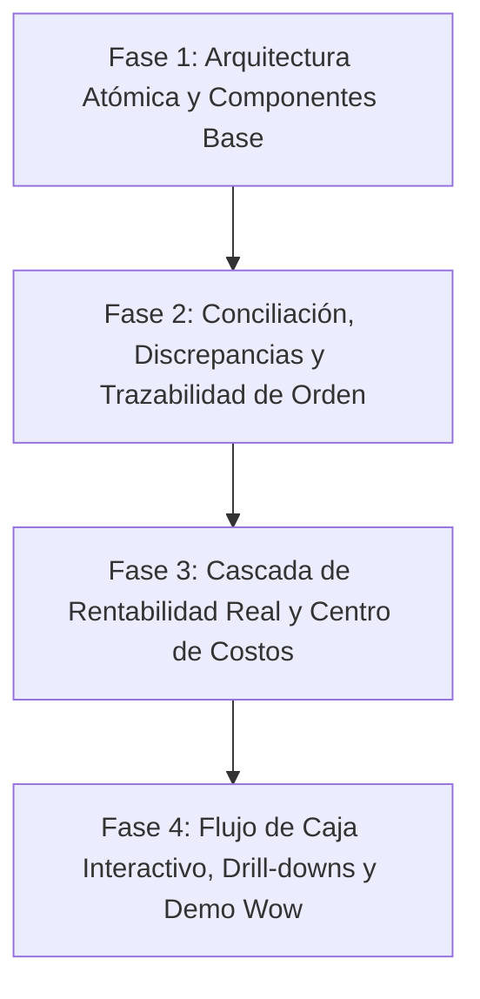

# Plan Maestro de Implementación Frontend — KeptAI (Reto 06 Piura Innova)

> **Documento Rector y Pilar de Desarrollo Frontend**  
> **Autor / Rol:** Senior UX/UI Designer & Frontend Architect  
> **Rama de trabajo:** `frontend-isabel`  
> **Fecha de creación:** Octubre 2026  
> **Referencia de Reto:** Cloud Technologies RETO 06 · *Del chat al dato: conciliación de pagos y rentabilidad real por pedido (Corpotex & Unicrack)*

---

## 1. Contexto Estratégico y Diagnóstico del Jurado

En la evaluación del Reto 06, la solución obtuvo el siguiente dictamen:

* **Criterio Mejor Evaluado:** *Viabilidad Técnica* (la persistencia, idempotencia, modelado transaccional y adapters en backend son de alto nivel).
* **Criterio con Mayor Brecha:** *Diseño UI / UX (Funcional Básico)*.
* **Brecha Prioritaria Declarada:**
  > *"UI/UX fue la dimensión más débil: el usuario necesita entender discrepancias y rentabilidad sin reconstruir manualmente la información. Probar conciliación entre pedido, cobro y costo; incluir estados, discrepancias, historial y trazabilidad de cada cifra de rentabilidad."*

### Causa Raíz de la Brecha
1. **Sobrecarga Cognitiva por Fragmentación:** El usuario debía saltar entre `/pedidos`, `/conciliacion`, `/cobranza` y `/resultado` para deducir el estado de una sola transacción. El sistema operaba con islas de datos en lugar de un hilo conductor integral *Order-to-Cash*.
2. **Opacidad en Cifras Financieras:** El margen y la rentabilidad se presentaban como cifras finales aisladas o leyendas de "costeo incompleto", sin una cascada visual que explique cómo los costos de materia prima, mano de obra y terceros impactan la utilidad neta.
3. **Discrepancias Pasivas en Conciliación:** Ante un pago duplicado, incompleto o no coincidente, la interfaz se limitaba a deshabilitar botones o mostrar avisos de texto, en lugar de ofrecer una mesa de trabajo interactiva de resolución de diferencias.
4. **Desconexión con la Capacidad Transaccional del Backend:** La robusta lógica de conciliación, aplicaciones de pago y auditoría no se reflejaba visualmente para el operador ni para el jurado.

---

## 2. Sistema de Diseño Atómico (Atomic Design System)

Para maximizar la reusabilidad, escalabilidad y coherencia visual sin perder la sobriedad y elegancia del producto financiero KeptAI, todos los componentes se organizan bajo **Atomic Design**.

### 2.1. Tokens Visuales y Look & Feel Preservado
* **Colores Primarios de Marca:**
  - `brand-blue` (`#03509B` - Hyper Blue): Botones primarios, enlaces activos, foco.
  - `brand-navy` (`#00285F` - Black Sea Night): Hover de acciones, texto de encabezados sobre fondos claros, isotipo.
  - `brand-deep` (`#042450` - Subnautical): Fondo del panel lateral en login y acentos oscuros.
  - `brand-yellow` (`#FAA901` - Spicy Sweetcorn): Acento en logo ("AI"), badges de alerta y acciones destacadas.
* **Semáforo Financiero y de Estados:**
  - **Aprobado / Conciliado / Rentable:** `#04685D` / Fondo `#E1F5EF` (Dark: `#6FDCBF` / `#0F3D3A`).
  - **Advertencia / Por Vencer / Costeo Incompleto:** `#8A5A00` / Fondo `#FFF3D6` (Dark: `#FCC955` / `#3F3416`).
  - **Mora / Discrepancia / Pérdida:** `#B23A2F` / Fondo `#FCEAE8` (Dark: `#F3ADA5` / `#472E30`).
  - **Informativo / En Proceso:** `#03509B` / Fondo `#E2EDF8` (Dark: `#7FB8F0` / `#163A62`).
* **Tipografía:**
  - Principal (UI & Datos): `'Inter', sans-serif` con kerning cerrado (`tracking-tight`).
  - Monospace (Códigos, IDs de Operación, Montos Tabulares): `'JetBrains Mono', monospace`.
  - Documentos / Reportes Formales: `'Merriweather', serif`.
* **Geometría y Ergonomía:**
  - Radio base: `12px` (`rounded-lg`), inputs y botones: `10px` (`rounded-md`), pills: `9999px` (`rounded-full`).
  - Altura táctil mínima accesible: `44px` (`min-h-11`).
  - Sombras sutiles: `shadow-soft` (`0 10px 30px rgba(15, 23, 42, 0.08)`) con micro-interacciones `translateY(-2px)`.

---

### 2.2. Mapa de Componentes por Capas Atómicas

```
Frontend/src/components/
├── atoms/                     # Elementos primitivos indivisibles
│   ├── Button/                # Variantes: primary, secondary, danger, ghost, violet
│   ├── Input/                 # Text, Number, Textarea con soporte de Money
│   ├── MoneyText/             # Formato monetario tabular estricto (S/ 0.00) con color semántico
│   ├── StatusDot/             # Indicador circular de salud (ok, warn, bad, info)
│   ├── Typography/            # Heading, Text, MonoCode, Caption
│   ├── Skeleton/              # Shimmer adaptativo para estados de carga
│   └── Icon/                  # Wrapper estándar de Phosphor Icons
│
├── molecules/                 # Uniones funcionales de átomos
│   ├── StatusChip/            # Chips para pedidos, finanzas, conciliación y crédito
│   ├── MetricTile/            # KPI con título, importe grande, tendencia y contexto
│   ├── SearchInput/           # Input con debounce, lupa integrada y borrado rápido
│   ├── SegmentedControl/      # Pestañas con animación física (Motion slider)
│   ├── DatePickerField/       # Campo de fecha con cómputo automático de días restantes
│   ├── DiscrepancyNotice/     # Alerta contextual con explicación de diferencia matemática
│   ├── UserAvatarGroup/       # Avatar con iniciales, nombre y rol del operador
│   └── ScopeSelector/         # Selector de alcance (Consolidado, Corpotex, Unicrack)
│
├── organisms/                 # Componentes complejos y módulos interactivos
│   ├── AppHeader/             # Barra superior con búsqueda, scope, tema y usuario
│   ├── AppSidebar/            # Navegación lateral con contadores de pendientes
│   ├── ReconciliationCard/    # Comparador Voucher vs Deuda con botones de resolución
│   ├── EvidenceSplitViewer/   # Visor de imagen de voucher con zoom y formulario OCR
│   ├── MarginWaterfallCard/   # Cascada interactiva de costos y márgenes
│   ├── OrderLifecycleBar/     # Barra de trazabilidad de 4 etapas con estado financiero
│   ├── KanbanBoard/           # Tablero multietapa para pedidos y clientes
│   ├── OrdersDataTable/       # Tabla interactiva con ordenamiento, filtros y drill-down
│   ├── CashFlowChartWidget/   # Gráfico de flujo de caja semanal con Recharts
│   └── ConfirmActionModal/    # Modal accesible con foco atrapado y registro de auditoría
│
├── templates/                 # Estructuras de página sin datos acoplados
│   ├── SplitDetailLayout/     # Lista a la izquierda (340px) + detalle a la derecha (1fr)
│   ├── DashboardLayout/       # Grilla superior de métricas + cuerpo analítico
│   ├── FormCardLayout/        # Contenedor centrado para captura y edición
│   └── PrintableReportLayout/ # Vista optimizada para pantalla y exportación PDF/Print A4
│
└── pages/                     # Vistas conectadas a rutas y fuentes de datos
```

---

## 3. Ficha y Auditoría por Pantalla

Para cada pantalla de KeptAI se definen: **Alcance**, **Objetivo**, **Usuario/Rol**, **Diagnóstico de Brecha** y **Propuesta de Rediseño Funcional**.

---

### Pantalla 1: Conciliación de Pagos y Discrepancias (`/conciliacion` y `/conciliacion/:id`)
* **Alcance:** Recepción de comprobantes de pago (Yape, Plin, BCP, BBVA, Interbank), comparación algorítmica contra deudas de clientes, resolución de inconsistencias (`amount_mismatch`, `duplicate`, `partial`, `orphan`) y aplicación a cuentas por cobrar.
* **Objetivo:** Resolver en segundos cualquier discrepancia entre el abono bancario y el pedido sin cálculos manuales, dejando registro inmutable de auditoría.
* **Usuario:** Administración y Finanzas (`ADMIN`).
* **Diagnóstico de Brecha:** La pantalla actual bloquea la acción si el monto no es idéntico o si es duplicado, forzando al usuario a investigar en Excel o WhatsApp.
* **Propuesta de Rediseño:**
  1. **Visualizador Comparativo (Split-Inspector):** Imagen del comprobante al 50% de pantalla con zoom, y al lado derecho la tarjeta con:  
     `Monto Declarado en Voucher` vs `Saldo de Orden Pendiente` $\rightarrow$ `Diferencia Calculada`.
  2. **Botones de Resolución de Discrepancia:**
     - Si el abono es menor: Botón *"Aplicar como Abono Parcial (saldo restante: S/ X)"*.
     - Si el abono es mayor: Botón *"Aplicar total y registrar saldo a favor del cliente"*.
     - Si es duplicado: Botón *"Comparar con comprobante original #XXX"* con previsualización superpuesta de ambas imágenes.
  3. **Segregación D-012 Transparente:** Si la misma persona verificó en banco, el sistema explica claramente que la aplicación requiere la firma de un segundo usuario, o permite un override explícito con justificación escrita si el negocio opera con un solo administrador.

---

### Pantalla 2: Rentabilidad Real y Resultado por Pedido (`/resultado`)
* **Alcance:** Cálculo y visualización de la rentabilidad real de cada pedido, línea de producto (deportivo vs. corporativo) y marca (Corpotex vs. Unicrack), desglosando costos propios vs. tercerizados.
* **Objetivo:** Explicar la procedencia de cada sol de utilidad, identificar qué pedidos están generando pérdidas y alertar sobre costos pendientes de imputar.
* **Usuario:** Gerencia General (`GERENTE`).
* **Diagnóstico de Brecha:** Muestra cifras estáticas de margen o la leyenda "costeo incompleto". No existe trazabilidad entre lo cobrado y el costo incurrido.
* **Propuesta de Rediseño:**
  1. **Cascada Visual de Rentabilidad (Waterfall):** Por cada orden, un desglose claro:  
     $$\text{Venta Neta } (S/ 2,500) - \text{Materia Prima } (S/ 900) - \text{Mano de Obra } (S/ 550) - \text{Terceros } (S/ 250) = \mathbf{\text{Margen Bruto } (S/ 800 / 32\%)}$$
  2. **Doble Métrica: Margen Devengado vs. Margen Percibido:**  
     - *Margen en Papel:* Venta − Costo total.  
     - *Margen en Caja (Percibido):* Dinero efectivamente cobrado − Costos incurridos pagados. Si el cliente no ha pagado, el margen percibido se muestra en rojo/alerta para evidenciar el riesgo de caja.
  3. **Filtro de Modalidad de Taller:** Pestañas para comparar la rentabilidad de pedidos confeccionados en taller propio frente a los tercerizados.

---

### Pantalla 3: Detalle 360° de la Orden (`/pedidos/:ref`)
* **Alcance:** Vista profunda del ciclo de vida de un pedido individual desde su captura en WhatsApp hasta su cancelación y cierre financiero.
* **Objetivo:** Brindar a vendedores y administradores una única fuente de verdad para auditar avance, crédito, fechas críticas y estado de cobro.
* **Usuario:** Vendedor, Administración, Gerente.
* **Diagnóstico de Brecha:** Pestañas desconectadas que obligan a reconstruir mentalmente si el taller ya puede empezar a cortar tela o si está retenido por falta de anticipo.
* **Propuesta de Rediseño:**
  1. **Barra Unificada de Trazabilidad:** Indicador horizontal con 4 checkpoints dinámicos:  
     `1. Comercial (Confirmado)` $\rightarrow$ `2. Gatekeeper Financiero (Anticipo 50% verificado)` $\rightarrow$ `3. Producción (En taller / Despachado)` $\rightarrow$ `4. Cobranza (Cancelado / Por cobrar)`.
  2. **Línea de Tiempo de Eventos (Audit Stream):** Registro cronológico:  
     *10:15 AM* Ingresado por WhatsApp $\rightarrow$ *11:00 AM* Aprobado crédito por Admin $\rightarrow$ *11:45 AM* Voucher verificado en BCP $\rightarrow$ *02:30 PM* Ingresado a Taller.

---

### Pantalla 4: Tablero y Gestión de Pedidos (`/pedidos`)
* **Alcance:** Vista global de órdenes agrupadas por etapa operativa y comercial.
* **Objetivo:** Priorizar órdenes críticas, detectar cuellos de botella en producción y agilizar la liberación de pedidos.
* **Usuario:** Vendedor y Administración.
* **Diagnóstico de Brecha:** Tarjetas con texto plano sin jerarquía visual sobre el estado financiero.
* **Propuesta de Rediseño:**
  - Micro-barras de progreso en cada tarjeta (porcentaje cobrado vs pendiente).
  - Badge prominente cuando el cliente se encuentra en mora en otros pedidos.
  - Alternador fluido entre vista de lista tabular y tablero Kanban por etapas.

---

### Pantalla 5: Resumen Financiero y Flujo de Caja (`/resumen` / `/dashboard`)
* **Alcance:** Tablero ejecutivo con KPIs globales (ventas, cobranzas, cartera vencida) y gráfico predictivo de flujo de caja a 4 semanas.
* **Objetivo:** Anticipar quiebres de liquidez y proyectar compromisos de pago a proveedores y talleres.
* **Usuario:** Gerencia y Administración.
* **Diagnóstico de Brecha:** El gráfico de barras muestra proyecciones semanales, pero no permite saber qué pedidos componen los ingresos proyectados.
* **Propuesta de Rediseño:**
  - **Drill-down interactivo:** Al hacer clic sobre cualquier semana del gráfico de caja, se despliega un panel lateral con la lista de clientes y facturas que sustentan ese monto esperado.

---

### Pantalla 6: Cobranza y Gestión de Cartera (`/cobranza`)
* **Alcance:** Segmentación de cuentas por cobrar por antigüedad (vencido, vence en 3 días, al día), alertas de cobranza y bitácora de recordatorios WhatsApp.
* **Objetivo:** Reducir la mora y ordenar las llamadas de cobranza por orden de prioridad monetaria.
* **Usuario:** Administración y Vendedores.
* **Diagnóstico de Brecha:** Se muestran los saldos sin clasificar la gravedad del cliente ni permitir acciones de contacto inmediatas.
* **Propuesta de Rediseño:**
  - Clasificación por criticidad (clientes con entregas pendientes vs. clientes que ya retiraron prendas).
  - Acciones rápidas de 1 clic: *"Descargar Estado de Cuenta en PDF"* y *"Copiar resumen de cobro para WhatsApp"*.

---

### Pantalla 7: Taller y Despacho (`/taller`)
* **Alcance:** Gestión de órdenes en confección y registro de actas de despacho físico.
* **Objetivo:** Evitar que el taller fabrique órdenes sin anticipo verificado (Gatekeeper) y registrar la fecha exacta de salida física que da inicio al plazo de crédito.
* **Usuario:** Jefe de Taller (`JEFE_TALLER`).
* **Diagnóstico de Brecha:** El jefe de taller ve pedidos retenidos pero no sabe si es por diseño o por dinero, y el registro de despacho es formulario básico sin guía de entrega.
* **Propuesta de Rediseño:**
  - Identificación clara: *Retenida por Anticipo* vs *Liberada para Confección*.
  - Modal de despacho asistido con generación automática del comprobante de entrega y notificación en tiempo real a Cobranza.

---

### Pantalla 8: Clientes y Estado de Cuenta (`/clientes` y `.../estado-cuenta`)
* **Alcance:** Ficha completa del cliente, historial de pedidos, línea de crédito otorgada y estado de cuenta formal imprimible.
* **Objetivo:** Proporcionar transparencia al cliente y al vendedor sobre deudas consolidadas y aplicaciones de pago.
* **Usuario:** Vendedor y Administración.
* **Diagnóstico de Brecha:** El estado de cuenta actual carece de la relación explícita entre qué voucher canceló qué orden.
* **Propuesta de Rediseño:**
  - Tabla de cuenta corriente estilo extracto bancario: `Fecha | Detalle (Pedido o Voucher) | Cargo (+) | Abono (-) | Saldo`.
  - Botón de exportación e impresión A4 limpia (`@media print`).

---

### Pantalla 9: Captura Multimodal y Revisión de Borradores (`/captura`)
* **Alcance:** Carga manual o asistida de comprobantes y pedidos cuando no ingresan por WhatsApp, y corrección de datos extraídos por OCR.
* **Objetivo:** Digitalizar y estructurar vouchers en menos de 30 segundos con validación humana asistida.
* **Usuario:** Vendedor y Administración.
* **Diagnóstico de Brecha:** En modo API no se visualiza la imagen original durante la corrección de los campos extraídos.
* **Propuesta de Rediseño:**
  - Interfaz lado a lado: comprobante original a la izquierda con controles de zoom y formulario de validación a la derecha con semáforo de confianza en cada campo.

---

### Pantalla 10: Bandeja de Entrada de Pendientes (`/pendientes` / Home)
* **Alcance:** Vista inicial para roles operativos (Vendedor y Administración).
* **Objetivo:** Responder de inmediato a la pregunta: *"¿Qué tengo que resolver hoy primero?"*.
* **Usuario:** Vendedor y Administración.
* **Diagnóstico de Brecha:** Listado plano sin distinción de urgencia financiera ni priorización cronológica.
* **Propuesta de Rediseño:**
  - Tarjetas priorizadas por impacto financiero: 1. *Vouchers pendientes de verificación en banca* $\rightarrow$ 2. *Pedidos esperando aprobación para entrar a taller* $\rightarrow$ 3. *Cobranzas vencidas*.

---

## 4. Puntos Ciegos y Faltantes en la Lógica de Negocio

Para asegurar un desarrollo coherente y resolver discrepancias en el código, se identifican las siguientes 7 definiciones pendientes:

1. **Imputación de Costos Indirectos de Fabricación (CIF):**  
   *Situación:* El reporte de margen muestra *"Indirectos (asignación por validar)"*.  
   *Definición requerida:* Establecer la regla de absorción (¿tasa por minuto de confección o porcentaje plano sobre el costo de la tela?).
2. **Vouchers Multipedido (1 a N):**  
   *Situación:* Colegios o empresas suelen pagar varias órdenes con una sola transferencia.  
   *Definición requerida:* Habilitar en el motor de conciliación y en la UI la distribución de un solo comprobante entre 2 o más pedidos.
3. **Tolerancia de Redondeos y Comisiones:**  
   *Situación:* Diferencias de centavos por transferencias interplaza o redondeos bancarios provocan el estado `amount_mismatch`.  
   *Definición requerida:* Configurar una regla de tolerancia (ej. diferencias menores a S/ 2.00 se ajustan como descuento financiero o redondeo).
4. **Precios de Transferencia del Taller:**  
   *Situación:* El reto solicita modelar la producción como centro de resultados sin doble conteo de margen en el consolidado.  
   *Definición requerida:* Separar con claridad el margen comercial de la marca del margen operativo interno del taller.
5. **Criterio de Aplicación de Pagos no Especificados (FIFO vs Selección):**  
   *Situación:* Cuando un cliente paga sin referenciar un pedido específico.  
   *Definición requerida:* Aplicar por defecto a la deuda más antigua vencida, permitiendo modificación manual.
6. **Capacidad del Taller al Comprometer Fechas de Entrega:**  
   *Situación:* Los vendedores comprometen fechas sin visibilidad de la carga de confección.  
   *Definición requerida:* Validar la disponibilidad del taller antes de confirmar la orden.
7. **Excepción de Segregación en Equipos Unipersonales:**  
   *Situación:* La regla D-012 prohíbe que el mismo usuario verifique en banco y aplique el pago.  
   *Definición requerida:* Permitir a un Administrador único completar ambos pasos mediante una doble confirmación con advertencia de auditoría.

---

## 5. Fases del Plan de Implementación



* **Fase 1: Arquitectura Atómica y Componentes Base:**
  - Creación de carpetas `atoms`, `molecules`, `organisms`, `templates`.
  - Migración y formalización de átomos y moléculas semánticas (`MoneyText`, `StatusChip`, `MetricTile`, `Button`, `SegmentedControl`).
  - Verificación de contraste WCAG y modo oscuro.
* **Fase 2: Conciliación, Discrepancias y Trazabilidad:**
  - Rediseño de `ConciliacionPage` con mesa de resolución de discrepancias (abono parcial, excedente, duplicado).
  - Rediseño de `OrdenDetailPage` con barra de trazabilidad unificada *Order-to-Cash*.
* **Fase 3: Rentabilidad Real y Centro de Costos:**
  - Implementación de `MarginWaterfallCard` en `ResultadoPage`.
  - Comparativa de Margen Devengado vs. Margen Percibido (Caja).
  - Visibilidad de centro de resultados del taller propio vs. talleres terceros.
* **Fase 4: Flujo de Caja, Drill-downs y Momentos Wow:**
  - Interactividad y desglose en `CashFlowChart` de `DashboardPage`.
  - Optimización de estados de carga, transiciones y preparación de la demo para el jurado.
