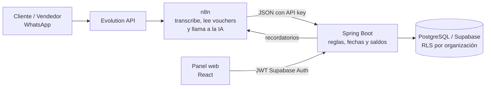

<p align="center">
  
</p>

<p align="center">
  <strong>La capa de caja de una confeccionista:</strong> captura pedidos y vouchers desde WhatsApp, concilia pagos,
  cobra a tiempo y muestra el margen real de cada pedido.
</p>

<p align="center">
  <a href="https://github.com/rod14x/KeptAI/actions/workflows/ci.yml"></a>
  · Piura Innova 2026 · Reto 6: Corpotex
</p>

---

## El problema

Corpotex fabrica uniformes corporativos, escolares y deportivos con dos marcas (Corpotex y UNICRACK). Produce en su
propio taller y también con terceros. Hoy los pedidos, pagos y acuerdos **circulan por grupos de WhatsApp** y no
siempre llegan a sus sistemas. Los pagos los anotan dos personas y a veces nadie los registra. Por eso los reportes
solo muestran lo anotado, y la empresa no conoce la rentabilidad real por pedido o línea ni puede medir su taller
como centro de resultados.
([Ficha del Reto 6](cerebro/conocimientos/decisiones/reto-6-corpotex-conciliacion-y-rentabilidad.md), §02)

El diagnóstico se resume en tres fugas de dinero
([idea de negocio](cerebro/conocimientos/empresa/idea-negocio-replanteada.md)):

| Fuga | Qué pasa hoy |
|---|---|
| **Plata que no se cobra** | Gran parte de las ventas es a crédito y la cobranza depende de que una persona esté atenta a WhatsApp. Algunos vencimientos quedan sin seguimiento. |
| **Plata que no sabes si ganas** | Los reportes muestran lo facturado, no el costo real por pedido, línea o marca, ni separan producción propia de tercerizada. |
| **Plata que no ves venir** | Sin un cronograma de cobros no se puede proyectar la caja de las próximas semanas. |

> Las cifras del negocio vienen de entrevistas y de la ficha del reto, y Corpotex no las ha contrastado con sus
> registros. Por ejemplo, la proporción de ventas a crédito sigue pendiente de verificar. Toda la demo usa **datos
> ficticios**.

## La solución

KeptAI **no es otro CRM ni un ERP**: es una capa que se pone encima de cómo ya trabaja la empresa (WhatsApp) y cumple
cuatro funciones:

1. **Captura.** Convierte la conversación de venta y la foto del voucher (Yape, Plin, transferencia) en un pedido y
   un pago estructurados, siempre con confirmación humana.
2. **Concilia.** Cada pago pasa por *Recibido → Verificado en banco → Aplicado* y solo el pago aplicado mueve el
   saldo. Detecta duplicados, pagos parciales, pagos sin pedido y montos que no cuadran.
3. **Cobra.** Envía recordatorios por WhatsApp 3 días antes del vencimiento, el día del vencimiento y 3 días después.
   A los +3 días abre una alerta interna, y todo se cancela cuando el pago se aplica completo.
4. **Muestra la verdad.** Calcula el margen por pedido, línea y marca, presenta el taller como centro de resultados
   con precio de transferencia interno y proyecta la caja a 4 semanas.

**Fase 1 (este MVP):** captura, conciliación, cobranza, rentabilidad y caja. **Fase 2:** stock, cotizaciones y
recompra. ([Decisiones D-003 y D-004](cerebro/conocimientos/decisiones/decisiones-del-proyecto.md))

## Cómo funciona



**Principio de diseño:** n8n solo mueve datos y llama a la IA, y todas las reglas de negocio viven en Spring y en la
base de datos ([D-005](cerebro/conocimientos/decisiones/decisiones-del-proyecto.md)).

### Quién hace qué

| Actor | Qué hace en KeptAI |
|---|---|
| **Cliente** | Hace el pedido y envía la foto del voucher por WhatsApp. |
| **Vendedor** | Cierra la venta (`/cerrar`), revisa la hoja de resumen que arma la IA, **aprueba el crédito** y confirma el pedido. |
| **Administración** | Verifica en su banca que el dinero llegó, aplica el pago y atiende la cobranza y la cola de revisión. |
| **Jefe de taller** | Ve solo los pedidos liberados, registra las etapas y los costos, y registra el despacho. |
| **Gerencia** | Ve el margen, la caja a 4 semanas y los resultados, y exporta CSV. |

### Reglas clave

- **Plazo de 15 a 30 días contado desde el despacho.** Cada pedido tiene una sola obligación de cobro.
- **Solo el vendedor aprueba el crédito.** La mora no bloquea la venta: el sistema muestra el aviso y registra que el
  vendedor lo vio.
- **Gatekeeper de producción.** Ningún pedido entra a producción sin crédito aprobado o anticipo verificado (lo
  refuerza un trigger en la base de datos).
- **KeptAI no se conecta al banco.** Administración verifica los fondos y el sistema concilia.
- **Privacidad (D-007).** No se guardan chats, transcripciones ni audios, solo los datos estructurados del negocio y
  los vouchers en almacenamiento privado.

## Cobertura de los criterios del Reto 6

| Criterio | Cómo lo aborda KeptAI | Estado |
|---|---|---|
| **C-01** Celular y computadora; empresas separadas y consolidadas | Panel web con diseño adaptable; marca por pedido y organizaciones aisladas por RLS | Demo (modo mock) |
| **C-02** Exportación compatible con facturación y contabilidad | CSV de pedidos y márgenes (`MotorResultados`) | Implementado y probado en local |
| **C-03** Captura de pedidos y pagos desde WhatsApp con IA | n8n extrae los datos; `POST /api/v1/ordenes/ingesta` crea el pedido y la hoja de resumen en borrador para un contacto registrado, y el vendedor la revisa en el panel | Backend probado en local; falta n8n real de punta a punta |
| **C-04** Lectura y conciliación de vouchers | `POST /api/v1/pagos/voucher` guarda el voucher en Storage privado; en el panel, administración verifica, aplica o marca duplicado | Implementado y probado en local; falta n8n real de punta a punta |
| **C-05** Costo y margen por pedido, línea y marca | Costos por etapa, reparto a ítems y margen (`MotorCostos`, `MotorResultados`, BD V9) | Implementado y probado en local |
| **C-06** Taller como centro de resultados | Transferencia interna y resultado de taller frente al comercial (BD V9) | Implementado y probado en local |
| **C-07** Proyección de caja y reporte automático | Caja a 4 semanas (`MotorCaja`); reporte automático pendiente | Parcial |

«Implementado y probado en local» significa que la lógica existe en Java y SQL, está expuesta por la API y la cubren
pruebas automáticas con PostgreSQL real y recorridos del panel contra Spring local. **Todavía no hay un despliegue
público** (ver la sección siguiente).

## Estado actual

Lo construido y verificado al 11/10/2026:

| Pieza | Qué funciona | Qué falta |
|---|---|---|
| **Backend** (Spring Boot 4.1 / Java 21) | 26 rutas de la API sobre los cinco motores financieros (pagos, cobranza, costos, resultados y caja): pedidos, decisión de crédito, despacho, verificación y aplicación de pagos, cobranza, alertas, resultados, caja y CSV. Las dos rutas de n8n guardan pedidos en borrador y vouchers en Storage privado. Seguridad: JWT de Supabase, API key para n8n, autorización por rol y ruta, contexto de organización por transacción. Imagen Docker. **335 pruebas** sin fallos. | Confirmación por WhatsApp, programador de cobranza y envíos reales, despliegue público. |
| **Base de datos** (PostgreSQL 17 / Supabase) | Migraciones V1–V11 (28 tablas) con RLS por organización, triggers de integridad financiera y autorización crítica por rol. Semilla demo y escenarios reiniciables. En Supabase están aplicadas V1–V9 y la semilla demo. | Revisión y aplicación de V10/V11 en Supabase; validaciones integradas de despliegue ([D-009](BD/validaciones-pre-supabase.md)). |
| **Frontend** (React 19 / Vite) | **Modo mock:** todas las pantallas con datos ficticios, sin backend. **Modo api:** panel conectado a Spring con login de Supabase Auth; todos los módulos salvo la carga manual de vouchers. **108 pruebas** y recorrido conectado en Chrome. | Carga manual desde el panel; probar el login con cuentas reales por rol. |
| **Integración** (n8n + Evolution API) | Cuatro workflows (WF0–WF3) versionados; las rutas de ingesta y voucher del backend están listas para recibirlos. | Probar con n8n y WhatsApp reales; la confirmación (WF0) y el callback (WF3) siguen cerrados. |

La **CI** de GitHub Actions ejecuta en cada push las pruebas del backend (con PostgreSQL real vía Testcontainers) y las
pruebas y el build del frontend.

## Ver la demo

La demo navegable usa el frontend en **modo mock**: simula la API con datos ficticios y no necesita backend ni base de
datos.

```bash
cd Frontend
npm install
npm run dev          # abre http://localhost:5173
```

Entra con cualquiera de estas cuentas (sirve cualquier contraseña de 6 caracteres o más; el modal de login también
tiene accesos directos por rol):

| Rol | Correo |
|---|---|
| Vendedor | `rosa.chunga@keptai.pe` |
| Administración | `carmen.ramos@keptai.pe` |
| Gerencia | `patricia.zapata@keptai.pe` |
| Jefe de taller | `jorge.ipanaque@keptai.pe` |

**Recorrido sugerido:**

1. **Vendedor:** abre un pedido en `/pedidos`, revisa la hoja de resumen extraída por la IA y aprueba el crédito
   (aparece el aviso si el cliente tiene mora).
2. **Jefe de taller:** en `/taller`, registra el despacho; el vencimiento se calcula desde esa fecha.
3. **Administración:** en `/conciliacion`, compara el voucher con lo leído por la IA, verifícalo y aplícalo; el
   duplicado queda en revisión.
4. **Administración:** en `/cobranza`, revisa la cartera por vencimiento y las alertas internas.
5. **Gerencia:** en `/resultado`, mira el margen por marca, línea y pedido y el taller como centro de resultados; en
   `/resumen`, los indicadores y la caja a 4 semanas.

«Reiniciar demo» vuelve a los datos iniciales. Más detalle de pantallas y reglas en
[Frontend/README.md](Frontend/README.md).

## Tecnología

| Capa | Tecnología |
|---|---|
| Backend | Spring Boot 4.1.1, Java 21, Spring Security (OAuth2 Resource Server), JDBC/JPA, Maven Wrapper |
| Base de datos | PostgreSQL 17, Supabase (Auth, Storage, Postgres), Flyway 12, Row Level Security |
| Frontend | React 19, TypeScript, Vite, Tailwind CSS 4, Motion, Recharts, Zod, supabase-js |
| Integración | n8n, Evolution API (WhatsApp), modelo de IA llamado desde n8n |
| Calidad | JUnit 5, Testcontainers, Vitest, recorridos e2e en Chrome, GitHub Actions |

## Estructura del repositorio

```
KeptAI/
├── Backend/      API Spring Boot: seguridad, contexto multi-organización y motores financieros
├── BD/           Migraciones Flyway V1–V11, semillas demo, entorno local Docker y guía de RLS
├── Frontend/     Panel web React (modo mock para demo, modo api contra Spring)
├── Middleware/   Workflows n8n (WhatsApp ↔ IA ↔ Spring)
├── cerebro/      Conocimiento del proyecto: entrevistas, decisiones, procesos y diagramas
├── assets/       Logos e isotipo
├── scripts/      Lanzador de agentes de desarrollo
└── .github/      CI
```

| Carpeta | Documentación |
|---|---|
| `Backend/` | [Backend/README.md](Backend/README.md) · [contrato API](Backend/docs/contrato-api.md) · [OpenAPI](Backend/docs/openapi.yaml) · [matriz de acceso](Backend/docs/matriz-acceso.md) · [motor de pagos](Backend/docs/motor-pagos.md) |
| `BD/` | [BD/README.md](BD/README.md) · [definición de la base](BD/definicion-base-datos.md) · [diccionario](BD/diccionario-datos.md) · [entorno local](BD/local/README.md) · [DER V9](cerebro/diagramas/keptai-der-v9.md) · [cambio V10](cerebro/diagramas/keptai-der-v10.md) |
| `Frontend/` | [Frontend/README.md](Frontend/README.md) · [integración con la API](Frontend/docs/integracion-api.md) · [dirección visual](Frontend/DESIGN.md) |
| `Middleware/` | [Middleware/n8n/README.md](Middleware/n8n/README.md) · [acuerdos con n8n](Backend/docs/integracion-n8n-isabella.md) |
| `cerebro/` | [Índice](cerebro/conocimientos/INDICE.md) · [decisiones](cerebro/conocimientos/decisiones/decisiones-del-proyecto.md) · [actores, flujos y DER](cerebro/conocimientos/decisiones/actores-flujos-y-der-mvp.md) |

## Para desarrolladores

**Requisitos:** Java 21 (JDK), Node 22 o superior, Docker con Compose y python3. Puertos locales: 5433 (PostgreSQL),
8080 (Spring) y 5173 (Vite).

Levantar todo en local, desde la raíz del repositorio (los scripts están pensados para bash/WSL):

```bash
./BD/local/db.sh up        # PostgreSQL 17 en 127.0.0.1:5433 (crea BD/local/.env con claves aleatorias)
./BD/local/db.sh migrate   # Flyway V1–V11 y login runtime de la aplicación
./BD/local/db.sh seed      # semilla ficticia (organizaciones DEMO)

cd Backend && ./scripts/run-local.sh          # Spring con perfil local en :8080
cd Frontend && npm install && npm run dev     # panel en :5173 (mock por defecto)
```

Pruebas:

```bash
cd Backend && ./mvnw test      # 335 pruebas; necesita Docker (Testcontainers)
cd Frontend && npm test        # esquemas del frontend contra openapi.yaml
cd Frontend && npm run build   # typecheck + build
```

Para el modo api del frontend, la conexión con Supabase Auth y las variables de entorno, ver
[Backend/README.md](Backend/README.md), [Frontend/README.md](Frontend/README.md) y
[la configuración de Supabase](Backend/docs/configuracion-supabase-local.md). Los archivos `.env` reales nunca se
versionan; cada carpeta tiene su `.env.example`.

## Privacidad y seguridad

- **Datos ficticios:** el repositorio y la demo no contienen registros reales de Corpotex.
- **Sin historial de conversaciones:** los chats y audios se procesan de forma transitoria en n8n y solo se guarda la
  extracción estructurada.
- **Aislamiento por organización:** RLS en PostgreSQL, con la organización y el usuario fijados por el backend en cada
  transacción. El rol de la aplicación no es propietario de las tablas ni puede saltarse RLS.
- **Autorización crítica en la base de datos:** solo el vendedor decide el crédito, y la autoría de cada operación es
  el usuario autenticado (no se puede suplantar).
- **Claves de servicio:** n8n se autentica con una API key de la que solo se guarda el hash SHA-256.

## Equipo

| Integrante | Rol |
|---|---|
| **Miguel** | Backend: API, seguridad, captura e integración |
| **Andrés** | Backend: base de datos, migraciones y motor financiero |
| **Germán** | Frontend: implementación técnica de la interfaz |
| **Isabella** | Frontend y lógica de negocio; workflows n8n |

Proyecto desarrollado para **Piura Innova 2026** (10 y 11 de octubre de 2026), Reto 6 propuesto por Corpotex.
