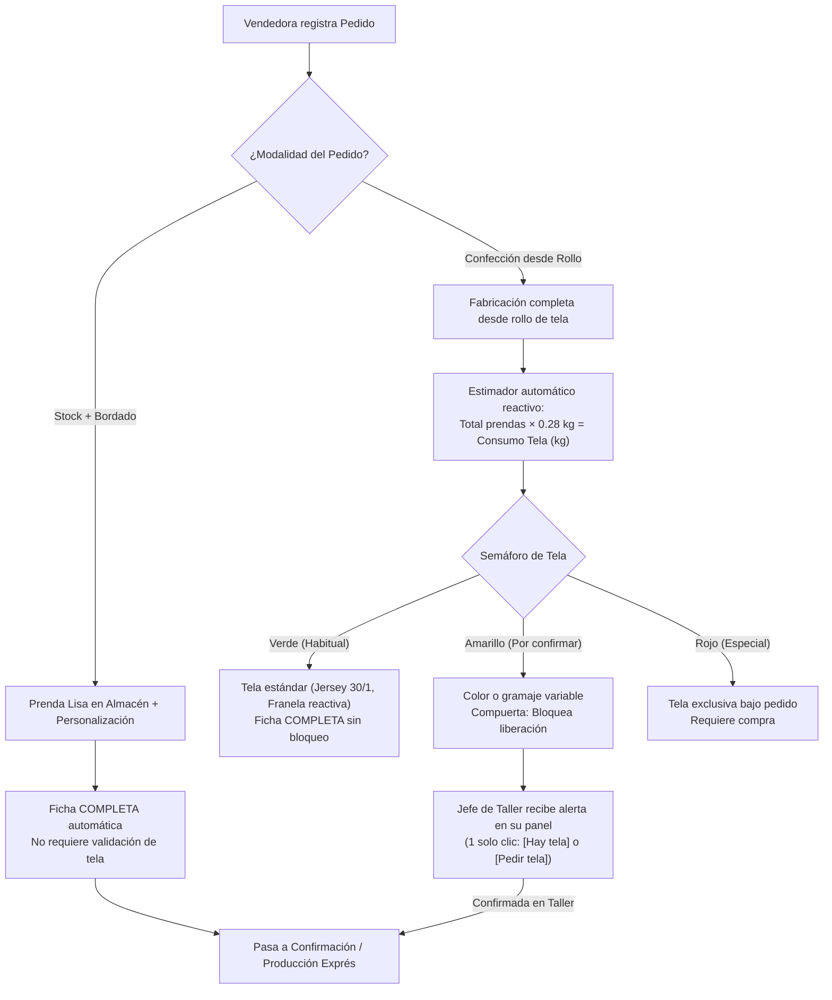

# Plan de Implementación de User Flows Ejecutado — Corpotex

> **Documento de Arquitectura y Flujos Operativos**  
> **Autora:** Isabel  
> **Fecha:** 19 de octubre de 2026  
> **Referencias:** `docs/auditoria-user-flows.md`, `docs/plan-implementacion-user-flows.md`, `BD/migrations/`

---

## 1. Diagnóstico: Por qué lo hicimos y qué problemas resolvimos

En la auditoría de flujos operativos de Corpotex (`docs/auditoria-user-flows.md`), se identificaron deficiencias críticas que bloqueaban la operación diaria de la empresa:

1. **Pantallas huérfanas sin dueño claro:** Existían vistas en el sistema, pero no tenían un punto de entrada intuitivo según el rol (vendedora, jefe de taller, administración).
2. **Imposibilidad de registrar clientes y pedidos a mano:** El sistema dependía exclusivamente de la extracción de chats de WhatsApp vía n8n. Si un cliente corporativo llegaba a la tienda física o pedía una cotización presencial, la vendedora no tenía cómo crear al cliente ni ingresar el pedido directamente.
3. **Ficha técnica textil sin responsable:** Nadie llenaba la ficha técnica en el software; se usaban cuadernos o mensajes dispersos.
4. **El gran cuello de botella del Jefe de Empresa (Problema Crítico de Negocio):**  
   Cuando un pedido requiere confección personalizada desde rollo de tela, el proceso se detenía porque el dueño/gerente de la empresa debía inspeccionar personalmente el almacén para confirmar si había tela disponible. Esto generaba retrasos de días en cotizaciones y pedidos urgentes.

---

## 2. La Decisión de Negocio: Semáforo Textil y Delegación al Jefe de Taller

Para resolver el cuello de botella del dueño sin perder el control de inventario, se implementó la siguiente arquitectura de decisión:

- **Stock + Bordado (`STOCK_BORDADO`):** Camino exprés instantáneo. No requiere comprobación de tela y la ficha se marca completa de inmediato.
- **Confección Personalizada (`CONFECCION_ROLLO`):**  
  - Se calcula automáticamente el peso estimado en kilogramos según la curva de tallas.
  - El **Jefe de Taller** es quien valida con un botón directo en su pantalla (`[Hay tela en almacén]` o `[Pedir tela (+días)]`).
  - **Resultado:** Se elimina al 100% la intervención manual del dueño en la comprobación cotidiana de stock.

---

## 3. Implementación Fase por Fase

### Fase 0 — Quick Wins de Navegación y Permisos
- **Sidebar y Enrutamiento Unificado:**
  - `Frontend/src/components/layout/Sidebar.tsx` y `Frontend/src/components/layout/nav.ts` unificados como única fuente de verdad.
  - `/taller` visible para `jefe_taller`, `administracion`, `vendedor`, `gerencia`.
  - `/captura` visible para `administracion` y `vendedor`.
- **Protección de Solo Lectura:** El rol `gerencia` tiene visualización completa pero los controles de mutación de taller y cambio de estación quedan deshabilitados.
- **Desbloqueo de API:** Se retiró `captura` de `API_PENDING` en `Frontend/src/lib/availability.ts`.

### Fase 1 — Directorio y Alta de Clientes
- **Base de Datos (Migración V15):**  
  `BD/migrations/V15__cliente_campos_contacto.sql`: Agrega columnas `telefono_principal`, `canal_origen` con valor por defecto `'MANUAL'`, e índice único `(organizacion_id, ruc_dni)`. Políticas RLS permiten a `VENDEDOR` insertar y actualizar contactos.
- **Backend Spring Boot:**  
  `Backend/src/main/java/pe/keptai/backend/web/CustomerController.java` y `CustomerService.java`:
  - `GET /api/v1/customers`: Directorio paginado por organización.
  - `POST /api/v1/customers`: Creación con validación de tipo (`PERSONA`, `EMPRESA`, `COLEGIO`).
  - `POST /api/v1/customers/{id}/contacts`: Alta de contactos asociados.
- **Frontend:**  
  `Frontend/src/components/CustomerModal.tsx`: Modal con validación anti-duplicados por RUC/DNI en tiempo real (`onBlur`). Integrado con botón `+ Nuevo cliente` en `Frontend/src/pages/ClientesPage.tsx`.

### Fase 2 — Alta de Pedidos Comercial
- **Backend Spring Boot:**  
  `Backend/src/main/java/pe/keptai/backend/web/OrdersController.java` y `OrderCreationService.java`:
  - `POST /api/v1/orders`: Recibe cliente, entrega solicitada, marca, canal e ítems. Genera automáticamente código secuencial (`ORD-YYYYMMDD-XXXX`), inicializa `hoja_resumen` en borrador y crea la `ficha_tecnica` vinculada.
- **Frontend:**  
  `Frontend/src/pages/CapturaPage.tsx` y `Frontend/src/pages/PedidosPage.tsx`:
  - Botón "Registrar pedido" habilitado en la lista de pedidos.
  - Selector de cliente enriquecido con opción `+ Crear nuevo cliente` al vuelo sin perder los datos ya digitados en el formulario del pedido.

### Fase 3 — Ficha Técnica Textil Persistente
- **Base de Datos (Migración V16):**  
  `BD/migrations/V16__tabla_ficha_tecnica.sql`: Tabla `ficha_tecnica` con columnas `modalidad`, `semaforo_tela`, `consumo_estimado_kg`, `validacion_tela`, `tela_validada_por`, curva de tallas en JSONB y políticas RLS.
- **Backend Spring Boot:**  
  `Backend/src/main/java/pe/keptai/backend/web/TechSheetController.java` y `TechSheetService.java`:
  - `GET /api/v1/orders/{id}/tech-sheet`
  - `PUT /api/v1/orders/{id}/tech-sheet`
  - `POST /api/v1/orders/{id}/tech-sheet/validate-fabric` (reservado para `JEFE_TALLER` y `ADMIN`).
- **Compuerta Técnica en Confirmación:**  
  `Backend/src/main/java/pe/keptai/backend/panel/DraftReviewService.java`: Si el pedido tiene ficha técnica, valida obligatoriamente que esté en estado `COMPLETA` y que cualquier tela en estado amarillo esté previamente confirmada por taller antes de permitir confirmar la orden.
- **Frontend:**  
  `Frontend/src/components/organisms/FichaTecnicaModal.tsx`: Modal completo con cálculo reactivo de kilogramos, selector de semáforo y tarjeta de validación de taller. Accesible desde la orden (`OrdenDetailPage.tsx`) y desde el panel de taller (`TallerPage.tsx`).

### Fase 4 — Taller Textil y Avance de Estaciones
- **Base de Datos (Migración V17):**  
  `BD/migrations/V17__inicializar_orden_etapa.sql`: Disparador `tg_inicializar_etapas` que genera las 4 etapas (`CORTE`, `SUBLIMADO_BORDADO`, `CONFECCION`, `CALIDAD`) tan pronto como la orden pasa a `LIBERADA`.
- **Backend Spring Boot:**  
  `Backend/src/main/java/pe/keptai/backend/web/ManufacturingController.java` y `ManufacturingService.java`:
  - `POST /api/v1/orders/{id}/station-advance`: Avanza las etapas y cambia automáticamente `orden.estado` a `EN_PRODUCCION` al ingresar a corte.
- **Frontend:**  
  `Frontend/src/pages/TallerPage.tsx`: Vista de planta interactiva que conecta los botones de avance con la API.

---

## 4. Auditoría de Calidad y Resultados

- **Compilación Backend:** `.\mvnw.cmd test-compile` completado con `BUILD SUCCESS` (0 errores).
- **Compilación Frontend:** `npm run build` completado con `✓ built in 934ms` (0 errores TypeScript en `tsc -b`).
- **Script Unificado Supabase:** `BD/migrations/ejecutar_en_supabase_v15_v16_v17.sql` preparado con `SET search_path = keptai, public;` para ejecución directa en el panel web.
