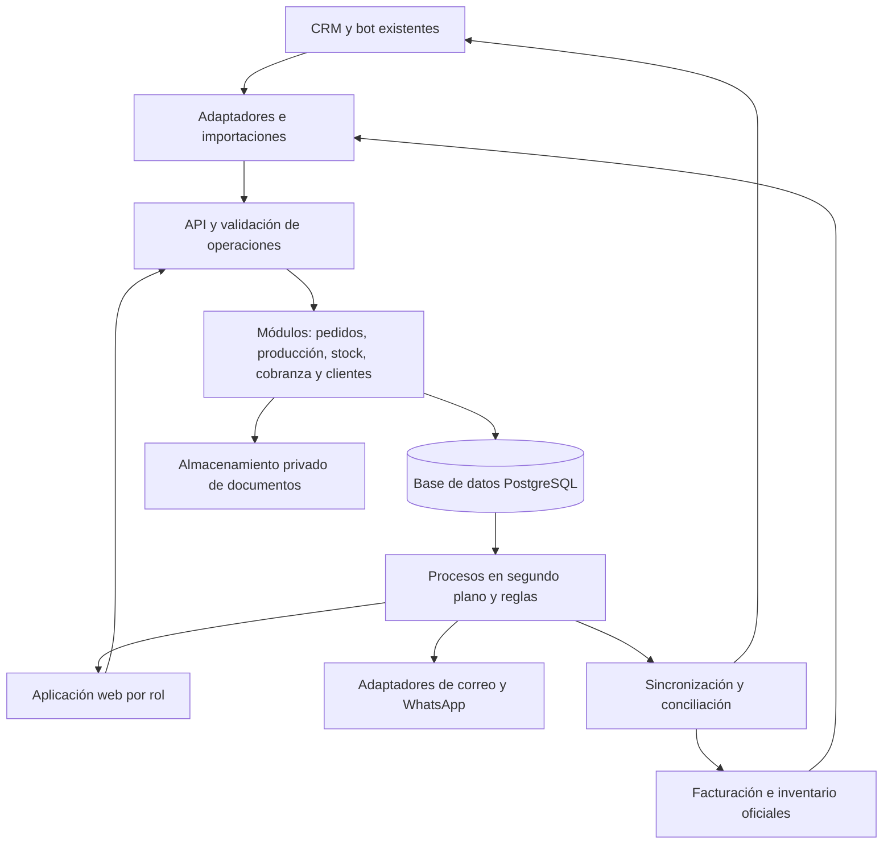

# Decisiones, propuestas y arquitectura del proyecto

> Corte documental: 10 de octubre de 2026. Versión: 1.0.
> Este registro distingue instrucciones del usuario, recomendaciones de diseño y decisiones pendientes. La organización de documentos no acredita aprobación empresarial de la arquitectura.

## Estados documentales

- Dirección del equipo: requisito expresado por el usuario.
- Propuesta: recomendación pendiente de validación.
- Pendiente: requiere información o acuerdo adicional.
- Implementado: exige evidencia de ejecución; estos documentos no acreditan implementación del software.

## Dirección expresada por el equipo

### D-001 — Herramienta postventa y trazabilidad

**Estado:** dirección del equipo. **Origen:** mensaje del usuario sobre postventa.

Construir una herramienta para seguir lo que sucede después de confirmar la venta. Priorizar producción, stock, cobranza y fidelización. Corpotex es el cliente inicial previsto; la solución debe poder utilizarse en otras empresas del sector.

### D-002 — Conocimiento organizado en seis archivos

**Estado:** dirección del equipo. **Origen:** solicitud actual.

La estructura conserva empresa/descripcion.md, empresa/objetivos.md, procesos/ventas.md, procesos/atencion-cliente.md, productos/catalogo.md y decisiones/decisiones-del-proyecto.md. Producción, inventario y cobranza se integran en ventas; arquitectura y datos se documentan aquí.

## Registro de propuestas

### P-001 — Pedido como eje

**Estado:** propuesta. Relacionar cliente, especificaciones, materiales, producción, entregas y cobros. Mantener estados operativos y financieros separados. Definir postventa desde confirmación del pedido.

### P-002 — Integración con infraestructura existente

**Estado:** propuesta condicionada a comprobación técnica. Reutilizar CRM, facturación y producción cuando sean adecuados. “COMO” y CRM podrían ser la misma plataforma; “Factura Ya” sigue siendo un nombre posible. [A01-Q04] 01_pedidos_whatsapp_crm.md, 00:39–00:57 [A02-Q05] 02_ventas_produccion_cobranza.md, 02:38–02:51

### P-003 — Autoridad por dato

**Estado:** propuesta. Acordar cuál sistema conserva clientes, pedidos, etapas, reservas, movimientos y pagos. Mantener procedencia y actualización en las copias. Una migración requiere conteo inicial, fecha de cambio y conciliación.

### P-004 — Aplicación modular con PostgreSQL

**Estado:** propuesta. Interfaz móvil, API, módulos de negocio, base transaccional, documentos privados y trabajador de segundo plano. TypeScript es una opción según capacidades del equipo. Framework, hosting y presupuesto permanecen pendientes.

### P-005 — Eventos y alertas confiables

**Estado:** propuesta. Guardar cambio y evento pendiente juntos, reconocer duplicados, controlar versiones y reintentar fallos. Toda alerta tiene responsable y resolución. Revalidar saldos antes de avisos externos.

### P-006 — Configuración y aislamiento por empresa

**Estado:** propuesta. Separar usuarios, datos, archivos, conectores y trabajos por empresa. Configurar etapas, unidades, mínimos, plazos y avisos. Comprobar el aislamiento usando una segunda empresa de demostración.

### P-007 — MVP acotado

**Estado:** propuesta. Completar pedido, producción, stock, entrega, cobro y seguimiento antes de ampliar a predicción, contabilidad, emisión fiscal, rentabilidad integral o un nuevo bot comercial.

### P-008 — Sostenibilidad comercial

**Estado:** hipótesis. Suscripción por empresa y posible incorporación según complejidad. Precio, disposición de pago y ahorros necesitan validación. Véase [objetivos](../empresa/objetivos.md).

## Decisiones abiertas y condiciones de cierre

- T-001: identificar sistemas, planes, propietarios y permisos con evidencia del administrador.
- T-002: probar conectores, eventos e identificadores; validar importaciones cuando falte API y precisar su periodicidad.
- T-003: acordar autoridad de cada dato, responsables y conciliación.
- T-004: obtener muestras de artículos, conteos, movimientos, pedidos, facturas y pagos con unidades y fecha de corte.
- T-005: validar cambios de pedido, crédito, vencimientos, disputas, devoluciones y comunicaciones. Los plazos relatados no constituyen una política general. [A02-Q06] 02_ventas_produccion_cobranza.md, 02:51–03:26 [A02-Q32] 02_ventas_produccion_cobranza.md, 17:34–17:44
- T-006: resolver el escenario de tres vendedores frente a tres presenciales y una online de la reformulación. [A02-Q15] 02_ventas_produccion_cobranza.md, 07:41–07:51
- T-007: acordar participantes, duración, presupuesto y criterios del piloto; no hay fechas comprometidas.
- T-008: obtener contactos y ciclos de compra de clientes frecuentes. La entrevista no entrega un directorio ni acredita autorización de campañas. [A02-Q28] 02_ventas_produccion_cobranza.md, 15:39–15:45 [A02-Q34] 02_ventas_produccion_cobranza.md, 18:10–19:26

## Consulta y actualización del cerebro

Cada afirmación empresarial conserva ID, archivo, tiempo y limitaciones. Los anexos contienen los textos completos editados y las restricciones de los 43 registros locales de evidencia. Las propuestas de arquitectura se mantienen identificadas.

Esta carpeta es una capa documental consultable. La búsqueda previa está en la base local corpotex; esta entrega no despliega por sí misma un sistema nuevo de recuperación ni incorpora movimientos operativos.

Para una nueva decisión registrar identificador, estado, fecha, responsable, motivo, opciones, impacto, evidencias y decisión reemplazada. Conservar historial. Esta es una convención documental propuesta.

## Fuentes de esta entrega

- Entrevistas: Corpotex_fuente_entrevistas.md, 01_pedidos_whatsapp_crm.md y 02_ventas_produccion_cobranza.md.
- Evidencias: corpotex/base/evidencias.jsonl, con 43 registros y limitaciones.
- Diseño: Corpotex_mapeo_postventa_arquitectura.md, de 10 de octubre de 2026.
- Contexto del equipo: mensajes del usuario sobre alcance y estructura.

Los audios y respaldos automáticos permanecen en sus ubicaciones originales. La fecha del nombre del audio no confirma la de grabación. Las referencias técnicas se conservan como parte del mapa previo.

## Cobertura

Los 43 registros se distribuyen una vez entre anexos. Las 15 secciones del mapeo se conservan completas: objetivos contiene 1, 12 y 13; ventas, 3 y 5; atención, 6; decisiones, 2, 4, 7, 8, 9, 10, 11, 14 y 15. El catálogo conserva familias y limitaciones de la entrevista, con los campos operativos aún pendientes.

## Anexo de diseño: secciones completas del mapeo

Las recomendaciones conservan su estado de propuesta salvo lo identificado como dirección explícita del equipo. Los números corresponden al mapeo original y no establecen un nuevo orden de aprobación.

### 2. Qué sabemos y qué estamos suponiendo

#### Base procedente de las entrevistas

- Hay un sistema de facturación conectado al inventario y un módulo reciente de producción. Se registran pedidos y se generan fichas técnicas que pasan por distintas áreas. Fuente: audio 2, 00:23–01:23 y 14:25–14:56.
- El CRM conversacional no está conectado al inventario, según la respuesta del audio breve. Fuente: audio 1, 00:57–01:26.
- Las cuentas por cobrar pueden quedar desactualizadas; el seguimiento depende de las personas y se revisa una vez al mes. Fuente: audio 2, 02:17–02:38 y 05:44–06:40.
- Se consideran importantes las alertas de producción, stock y cobranza. Fuente: audio 2, 14:25–15:39.
- Hay 40 clientes corporativos descritos como fidelizados o compradores constantes. Esto no equivale al total de clientes de la empresa. Fuente: audio 2, 18:10–19:26.
- Los costos y la rentabilidad se calculan manualmente. Fuente: audio 2, 03:53–04:35 y 10:04–10:17.

Estas referencias proceden de transcripción automática con revisión editorial y conservan las limitaciones señaladas en la fuente original.

#### Definiciones aportadas por el equipo para este proyecto

- Se toma como escenario de trabajo un equipo de tres vendedores asistidos por CRM y bot. La entrevista recoge “tres presenciales y una online”; confirmar el reparto antes de definir licencias y permisos. La arquitectura no depende de ese número.
- Se priorizan producción, alertas de stock, alertas de cobro y fidelización.
- Se busca vender a Corpotex una herramienta reutilizable en el sector, con sostenibilidad económica y operativa.
- “COMO” se interpreta provisionalmente como **Kommo**. Verificar si es el propio CRM mencionado o si existe otro CRM adicional. No asumir dos sistemas distintos sin comprobarlo.

#### Reformulación del problema

La hipótesis principal es que falta una **gestión conectada y verificable de lo que sucede después de confirmar la venta**. Ya existen registros parciales; el vacío está en que cada cambio llegue al responsable correcto, actualice los datos y permita comprobar la siguiente acción.

Un panel y un bot, por sí solos, no mantienen el inventario ni concilian los pagos. Hace falta acordar quién registra cada movimiento, cuál sistema conserva el dato oficial y cómo se detectan los registros pendientes.

### 4. Módulos y prioridades

#### Prioridad 1 — Pedido y producción

Cada pedido tiene un identificador único, cliente, responsable comercial, productos y variantes, cantidades, especificaciones, fecha comprometida y versión aprobada.

Desde él se consulta la ficha técnica, materiales, etapas, responsables, bloqueos, entregas y documentos de cobro. Para confección, las etapas iniciales pueden ser corte, personalización, confección, calidad y despacho; cada empresa configura su secuencia. Los productos terminados pueden pasar directamente a preparación y despacho.

Cada etapa registra inicio, finalización, cantidad procesada, incidencias y responsable. Si parte del trabajo se terceriza, se registra proveedor, cantidad enviada y cantidad recibida.

Una modificación del cliente genera una nueva versión con impacto en materiales, precio y fechas. La fecha anterior se conserva en el historial. La nueva fecha solo se comunica después de la validación correspondiente.

#### Prioridad 1 — Inventario y disponibilidad

Mostrar materiales y productos terminados por variante y ubicación: existencia física, cantidad reservada, disponible, stock bloqueado por calidad y última actualización.

Las necesidades de una orden se calculan con una lista de materiales o ficha de consumo. La primera versión puede permitir cargar esa lista manualmente. Los consumos estimados se diferencian de los reales registrados en producción.

Las alertas deben distinguir un nivel bajo general de un faltante concreto que impide cumplir un pedido.

#### Prioridad 1 — Cobranza

Conectar cada pedido con sus documentos de cobro, vencimientos, pagos aplicados y saldo. Los recordatorios se basan en obligaciones verificadas y vigentes, con un responsable de seguimiento.

Separar cuatro cosas: factura emitida, comprobante recibido, pago verificado y pago aplicado. Una captura enviada por el cliente no equivale a dinero conciliado.

#### Prioridad 2 — Fidelización

Crear una ficha de relación por cliente: compras, entregas, incidencias, contacto preferido, responsable comercial y próxima acción.

Los 40 clientes corporativos frecuentes sirven como grupo inicial del piloto. Una próxima compra se propone usando una fecha acordada o un ciclo histórico observado; no se presupone que todos compran mensualmente o cada año.

Comenzar con tareas para el vendedor: verificar satisfacción, resolver una incidencia o consultar una renovación. Si existe una reclamación abierta, priorizar su resolución antes de promover otra compra. Cada contacto debe dejar resultado y próxima acción, y respetar la preferencia de comunicación del cliente.

#### Prioridad 3 — Costos y rentabilidad

Capturar consumos, tiempos y servicios externos permite preparar una comparación entre costo estimado y real. Un margen completo requiere además criterios de costos indirectos, devoluciones y otros ajustes. Presentar inicialmente costos registrados, sin etiquetar como “rentabilidad real” un cálculo incompleto.

### 7. Arquitectura propuesta

#### Estructura inicial

- **Interfaz web adaptable al móvil:** vistas para ventas, producción, almacén y administración. Cada usuario ve sus tareas y puede abrir el expediente del pedido.
- **Backend modular:** una aplicación con límites claros entre pedidos, producción, inventario, cobranza, clientes e integraciones. Se despliega inicialmente como un conjunto pequeño de servicios: aplicación y trabajador de segundo plano.
- **PostgreSQL:** registros transaccionales, relaciones, historial de negocio y control de concurrencia. Las operaciones que deben suceder juntas se confirman en una transacción; los conflictos se manejan con reintentos controlados. Referencia: [aislamiento transaccional de PostgreSQL](https://www.postgresql.org/docs/18/transaction-iso.html).
- **Trabajador de segundo plano:** procesa sincronización, evaluación de alertas y envíos. Para el inicio puede usar trabajos persistidos en la misma base de datos; una cola separada se evalúa cuando lo exija el volumen.
- **Documentos privados:** fichas técnicas, evidencias de entrega y comprobantes, relacionados con el pedido y con acceso autorizado.
- **Operación:** métricas de errores, trabajos pendientes y retraso de sincronización; copias de seguridad y una prueba de restauración antes del uso productivo.

Como implementación de referencia se puede usar TypeScript para la interfaz y el backend si es el lenguaje que domina el equipo. La elección de framework y hosting debe seguir las capacidades del equipo y el presupuesto. El diseño no requiere adoptar microservicios ni añadir una plataforma de IA para empezar.

#### Contrato mínimo con el CRM

Un evento de venta ganada o una acción explícita de confirmar pedido inicia la importación. Se valida que existan cliente, líneas, cantidades, especificaciones, responsable y fecha. Una oportunidad ganada incompleta queda pendiente de validación; no debe generar producción automáticamente.

Si “COMO” corresponde a Kommo, su documentación ofrece API y webhooks. La disponibilidad de webhooks por API depende del plan; hay que comprobar el plan de Corpotex y los eventos disponibles antes de comprometer la integración. Referencias: [webhooks de Kommo](https://developers.kommo.com/docs/webhooks-general) y [autorización OAuth 2.0](https://developers.kommo.com/docs/oauth-20).

Kommo conserva la relación comercial y recibe estados resumidos o enlaces al pedido. El bot puede consultar información validada a través de un servicio autorizado; no obtiene acceso directo a la base de datos ni cambia saldos o estados de producción por interpretación libre.

#### Contrato mínimo con facturación e inventario

Confirmar proveedor, versión, accesos, exportaciones, identificadores y mecanismos de actualización. El posible nombre “Factura Ya” de la entrevista no acredita que exista una API utilizable.

El conector debe leer documentos, vencimientos, pagos aplicados y movimientos o saldos de inventario según lo que ofrezca el proveedor. La escritura se habilita solo para operaciones soportadas y acordadas. Si no hay API, comenzar con archivos CSV/Excel validados, una conciliación de totales y una cadencia operativa explícita.

Una importación diaria puede servir para un piloto supervisado, pero no permite prometer stock en tiempo real ni enviar cobros sin verificación adicional.

#### Entrega confiable de eventos

Guardar cada cambio de negocio y su evento pendiente en la misma transacción. Un trabajador entrega el evento y registra el resultado: este patrón evita perder una alerta cuando el cambio se guarda pero el proceso se interrumpe antes del envío.

Cada consumidor reconoce identificadores ya procesados, controla versiones y tolera eventos repetidos o fuera de orden. Los fallos van a una bandeja de revisión con reintento. No se presupone entrega exactamente una vez entre proveedores.

No se necesita reconstruir todo el sistema desde eventos: registros normales más historial y cola persistente son suficientes para el alcance inicial.

### 8. Datos centrales y propiedad de la información

#### Entidades de negocio

- **Empresa y usuarios:** configuración, roles, zona horaria y conexiones.
- **Cliente y contacto:** identidad, referencias externas, canales y preferencias. Conservar el vínculo con el CRM; definir cuál sistema edita los datos maestros.
- **Pedido y versión:** líneas, cantidades, especificaciones y fechas aprobadas.
- **Orden y etapa de producción:** trabajo, responsable, fechas, cantidades e incidencias.
- **Artículo, variante y ubicación:** identificación y unidad de medida.
- **Reserva y movimiento:** compromisos y cambios de stock, enlazados al pedido.
- **Entrega y detalle:** cantidades efectivamente despachadas o recibidas.
- **Documento por cobrar, pago y aplicación:** obligación, evidencia verificada y distribución del pago. Un pago puede aplicarse a varios documentos y uno puede recibir varios pagos.
- **Incidencia y tarea de fidelización:** problema, resolución, próxima acción y resultado.
- **Alerta, notificación y auditoría:** motivo, destinatario, estado, acciones y registro de cambios.

#### Autoridad propuesta por dominio

**CRM:** oportunidades y datos comerciales acordados. **Sistema de facturación:** documentos fiscales y pagos aplicados, si actualmente es el registro oficial. **Inventario existente:** movimientos físicos hasta que se acuerde una migración. **Nueva herramienta:** tareas, etapas, alertas e historial operativo que no estén ya gobernados por otro sistema.

Si el módulo de producción existente ya conserva las etapas, reutilizarlo como autoridad y sincronizarlo; evitar obligar a registrar el mismo avance dos veces.

La aplicación conserva referencias externas, origen y hora de actualización. Los documentos oficiales no se modifican silenciosamente desde una copia local. Los pagos capturados en la herramienta quedan pendientes hasta la aprobación y confirmación en el registro oficial.

### 9. Producto reutilizable y separación entre empresas

El primer segmento propuesto son pymes de confección que venden por pedido y tienen materiales, producción y crédito. La ampliación a otros sectores se valida después; cubrir cualquier industria desde la primera versión introduciría procesos todavía desconocidos.

Configurar por empresa: etapas, variantes, unidades, ubicaciones, responsables, mínimos, plazos, plantillas de aviso, conectores y ciclos de recompra. No incorporar nombres, reglas o códigos de Corpotex dentro de la lógica común.

Todos los registros llevan empresa de pertenencia. Las relaciones, claves únicas, consultas, archivos y trabajos en segundo plano deben respetarla. El servidor obtiene la empresa de la sesión autorizada y valida que el usuario pertenezca a ella.

Usar permisos por rol y políticas de acceso por fila como defensa adicional. PostgreSQL permite restringir acceso por fila; su configuración debe contemplar los privilegios del usuario con que se conecta la aplicación. Referencia: [políticas de seguridad por fila](https://www.postgresql.org/docs/18/ddl-rowsecurity.html).

Probar expresamente que un usuario, archivo o tarea de una empresa no puede leer ni modificar información de otra. Los secretos de los conectores se guardan fuera de los archivos del proyecto y se separan por empresa.

### 10. MVP: qué debe demostrar primero

#### Alcance del piloto

1. Importar o registrar un pedido confirmado con un identificador estable.
2. Crear su ficha y seguir un conjunto pequeño de etapas productivas.
3. Vincular materiales, registrar o sincronizar movimientos y mostrar disponible y última actualización.
4. Mostrar bloqueos, faltantes y retrasos con un responsable asignado.
5. Asociar una obligación por cobrar, vencimiento y pagos verificados; generar tareas de cobranza.
6. Registrar la entrega y abrir una tarea de seguimiento o recompra para un cliente frecuente.
7. Consultar el historial completo desde una sola pantalla.

El piloto empieza con un grupo acotado de pedidos y los contactos validados de los clientes recurrentes. Los avisos externos se revisan antes de habilitar reglas automáticas. Esto es un control de puesta en marcha, no una limitación permanente del producto.

#### Fuera de la primera versión

Predicción de demanda, planificación automática avanzada de planta, cálculo completo de rentabilidad, contabilidad, emisión fiscal propia, concesión automática de crédito y un nuevo bot comercial. Pueden estudiarse después de validar el flujo principal.

#### Prueba de demostración, con datos ficticios identificados

Crear un pedido, detectar un faltante, registrar una reposición, reservar materiales, actualizar producción, registrar entrega parcial, aplicar un pago y cancelar su aviso de cobro. Al finalizar la entrega, programar una tarea de renovación.

La demostración debe poder ejecutarse con una segunda empresa configurada de manera diferente y sin acceso a los datos de Corpotex. Eso comprueba que se está construyendo un producto reutilizable.

### 11. Orden de ejecución y criterios de aceptación

#### Etapa A — Validar la operación

Revisar un pedido real de principio a fin, identificar responsables y obtener una muestra autorizada de clientes, artículos, movimientos y documentos pendientes. Confirmar sistemas, accesos, unidades y calidad del saldo inicial.

**Salida:** mapa validado, dueño de cada dato, lista de campos e integración viable o alternativa de importación. No fijar calendario o costo de integración antes de esta comprobación.

#### Etapa B — Construir un recorrido completo

Implementar pedido, etapas, historial y usuarios; incorporar stock y cobranza con una muestra controlada. Priorizar completar un recorrido antes que construir módulos aislados muy extensos.

**Salida:** el mismo pedido puede seguirse desde confirmación hasta entrega y saldo, con responsables visibles.

#### Etapa C — Asegurar consistencia y alertas

Verificar que importar dos veces no duplique pedidos ni pagos; que las reservas concurrentes no excedan existencias; que corregir un movimiento deje historial; y que un pago confirmado cancele avisos pendientes. Probar entregas parciales, cambios de pedido, cancelaciones y fallos de integración.

**Salida:** diferencias visibles y recuperables, avisos sin duplicación lógica y separación comprobada entre empresas.

#### Etapa D — Piloto supervisado y fidelización

Comparar el sistema con registros reales, medir adopción y revisar las alertas con sus responsables. Incorporar tareas de recompra y registrar resultados. Ajustar la configuración con lo aprendido.

**Salida:** un ciclo operativo validado y evidencia de utilidad. La extensión comercial se decide con resultados del piloto, no solo con la demostración.

### 14. Decisiones que faltan antes de desarrollar

1. ¿“COMO” es Kommo? ¿Qué plan y conectores tienen, y quién administra el bot?
2. ¿Cuál es el proveedor exacto de facturación e inventario? ¿Permite API, exportación y registro de movimientos?
3. ¿Qué partes del módulo productivo actual ya funcionan y cuáles necesitan seguimiento adicional?
4. ¿Quién registra hoy recepción, consumo, merma, terminación, despacho y pago? ¿En qué momento?
5. ¿Qué sistema será la autoridad de stock, reservas, etapas y pagos durante el piloto?
6. ¿Las unidades y variantes están normalizadas? ¿Existe un conteo inicial confiable?
7. ¿Cómo se aprueban cambios de pedido y cómo se calculan fechas comprometidas?
8. ¿Qué documento origina la cuenta por cobrar, quién verifica el pago y quién atiende una disputa?
9. ¿Qué información y ciclos de compra existen para los 40 clientes frecuentes?
10. ¿Qué presupuesto, tiempo y equipo técnico hay para el piloto? ¿Qué segunda empresa permitirá comprobar la reutilización?

Se puede preparar la interfaz y el modelo de datos mientras se resuelven estas preguntas. La promesa de sincronización automática y el alcance de los conectores dependen de sus respuestas.

### 15. Fuentes y trazabilidad del documento

**Fuente del negocio:** [Índice de fuentes y límites](../empresa/descripcion.md), junto con las prioridades y aclaraciones del equipo aportadas en esta conversación. Las marcas de tiempo remiten a los audios originales; los textos depurados se conservan en los anexos de esta carpeta.

**Referencias técnicas consultadas el 10 de octubre de 2026:** documentación oficial de [webhooks de Kommo](https://developers.kommo.com/docs/webhooks-general), [OAuth 2.0 de Kommo](https://developers.kommo.com/docs/oauth-20), [transacciones de PostgreSQL](https://www.postgresql.org/docs/18/transaction-iso.html) y [seguridad por fila](https://www.postgresql.org/docs/18/ddl-rowsecurity.html).

Las prioridades, módulos, reglas, diagramas, fases y métricas de este documento son propuestas de diseño. Las referencias técnicas demuestran capacidades generales de las plataformas, no que estén disponibles o configuradas en las cuentas de Corpotex.
