# Auditoría de User Flows — Corpotex / KeptAI

**Fecha:** 2026-10-18  
**Rama auditada:** `frontend-isabel`  
**Modo:** Auditoría de solo lectura (sin modificaciones de código)  
**Etiquetas de evidencia:** `[CÓDIGO archivo:línea]`, `[CEREBRO ID]`, `[INFERENCIA]`, `[FALTA INFO]`  

> [!NOTE]  
> Las entrevistas del cerebro son transcripciones automáticas sin verificación humana. Lo que el cerebro marca como pendiente (nombre del CRM "Kommo", distribución exacta "tres presenciales y una online", flujo completo de la ficha técnica) se conserva estrictamente como pendiente y no como hecho comprobado.

---

## 1. Resumen ejecutivo

1. **No existe "crear cliente" en ninguna capa** (UI, API, BD) y **"crear pedido" solo existe en mock**; en modo API está deshabilitado y los pedidos solo ingresan por WhatsApp/n8n requiriendo que el cliente ya exista como contacto.
2. **La ficha técnica carece de dueño y persistencia**: se autogenera mediante heurísticas de texto y reside únicamente en `localStorage` del navegador; no existe tabla, endpoint ni rol que la complete formalmente.
3. **No existe espacio ni flujo para subir, versionar o aprobar el diseño**: el archivo de arte es un texto plano simulado y no existe el rol de Diseño en el sistema.
4. **Taller y Carga manual están huérfanas fuera del menú principal**, conviven dos fuentes de navegación discordantes y cualquier usuario con acceso a Taller altera estaciones sin validación de rol; el sistema solo implementa 4 roles genéricos.
5. **No hay compuerta técnica de validación antes de fabricar**: solo existe un gate financiero; el estado `EN_PRODUCCION` nunca es escrito por el backend y las 6 estaciones del frontend discrepan con las 4 etapas del esquema de base de datos.

---

## 2. Inventario actual

Inventario de rutas, componentes, campos y roles activos en el frontend ([CÓDIGO Frontend/src/App.tsx:106-122], [CÓDIGO Frontend/src/components/layout/Sidebar.tsx:31-36]):

| Pantalla | Ruta / Archivo | Campos y Contenido | Rol que la usa |
|---|---|---|---|
| Inicio (Redirección) | `/` — [App.tsx:71-78](file:///C:/Users/isabe/Documents/Hackathon/worktrees/KeptAI/thick-beam/KeptAI/Frontend/src/App.tsx#L71-L78) | Sin campos; redirige según rol (jefe_taller a `/taller`, [App.tsx:73](file:///C:/Users/isabe/Documents/Hackathon/worktrees/KeptAI/thick-beam/KeptAI/Frontend/src/App.tsx#L73)) | Todos |
| Pendientes | `/` (Home) — [PendientesPage.tsx](file:///C:/Users/isabe/Documents/Hackathon/worktrees/KeptAI/thick-beam/KeptAI/Frontend/src/pages/PendientesPage.tsx) | Lista de pedidos y pagos por atender; accesos directos a Taller y Captura ([PendientesPage.tsx:145-146](file:///C:/Users/isabe/Documents/Hackathon/worktrees/KeptAI/thick-beam/KeptAI/Frontend/src/pages/PendientesPage.tsx#L145-L146)) | vendedor, administracion |
| Pedidos | `/pedidos` — [PedidosPage.tsx](file:///C:/Users/isabe/Documents/Hackathon/worktrees/KeptAI/thick-beam/KeptAI/Frontend/src/pages/PedidosPage.tsx) | Kanban 5 columnas (por_confirmar, retenida, en_produccion, por_cobrar, cobrada) y tabla: Pedido/Cliente, Vencimiento, Venta, Saldo, Estado; botón "Registrar pedido" ([PedidosPage.tsx:43-44](file:///C:/Users/isabe/Documents/Hackathon/worktrees/KeptAI/thick-beam/KeptAI/Frontend/src/pages/PedidosPage.tsx#L43-L44)) | vendedor, administracion, gerencia |
| Detalle de pedido | `/pedidos/:ref` — [OrdenDetailPage.tsx](file:///C:/Users/isabe/Documents/Hackathon/worktrees/KeptAI/thick-beam/KeptAI/Frontend/src/pages/OrdenDetailPage.tsx) | Solo lectura: ítems {descripción, cantidad, detalle, precio} ([OrdenDetailPage.tsx:529-557](file:///C:/Users/isabe/Documents/Hackathon/worktrees/KeptAI/thick-beam/KeptAI/Frontend/src/pages/OrdenDetailPage.tsx#L529-L557)), Hoja resumen con faltantes ([OrdenDetailPage.tsx:464-527](file:///C:/Users/isabe/Documents/Hackathon/worktrees/KeptAI/thick-beam/KeptAI/Frontend/src/pages/OrdenDetailPage.tsx#L464-L527)); formulario de condición de pago crédito/contado/anticipo ([OrdenDetailPage.tsx:565-589](file:///C:/Users/isabe/Documents/Hackathon/worktrees/KeptAI/thick-beam/KeptAI/Frontend/src/pages/OrdenDetailPage.tsx#L565-L589)); acción rechazo | vendedor (lectura), administracion (decisión) |
| Clientes / Detalle | `/clientes`, `/clientes/:id` — [ClientesPage.tsx](file:///C:/Users/isabe/Documents/Hackathon/worktrees/KeptAI/thick-beam/KeptAI/Frontend/src/pages/ClientesPage.tsx) | Lista y ficha de cliente derivadas exclusivamente de pedidos existentes; cabecera sin botones de acción ([ClientesPage.tsx:89-97](file:///C:/Users/isabe/Documents/Hackathon/worktrees/KeptAI/thick-beam/KeptAI/Frontend/src/pages/ClientesPage.tsx#L89-L97)) | vendedor, gerencia |
| Estado de cuenta | `/estado-cuenta` — `EstadoCuentaPage.tsx` | Tabla de saldos y compromisos pendientes por cliente | administracion, vendedor |
| Conciliación | `/conciliacion`, `/conciliacion/:id` — `ConciliacionPage.tsx` | Lista y detalle de comprobantes/vouchers para verificar y aplicar pagos | administracion |
| Cobranza | `/cobranza` — `CobranzaPage.tsx` | Cartera vencida, compromisos y gestiones de cobranza | administracion |
| Taller (Producción e Inventario) | `/taller` — [TallerPage.tsx](file:///C:/Users/isabe/Documents/Hackathon/worktrees/KeptAI/thick-beam/KeptAI/Frontend/src/pages/TallerPage.tsx) | Pestañas de producción e inventario ([TallerPage.tsx:51](file:///C:/Users/isabe/Documents/Hackathon/worktrees/KeptAI/thick-beam/KeptAI/Frontend/src/pages/TallerPage.tsx#L51)); selectores de estación ([TallerPage.tsx:398-418](file:///C:/Users/isabe/Documents/Hackathon/worktrees/KeptAI/thick-beam/KeptAI/Frontend/src/pages/TallerPage.tsx#L398-L418)); modal de despacho con fecha y acta ([TallerPage.tsx:446-563](file:///C:/Users/isabe/Documents/Hackathon/worktrees/KeptAI/thick-beam/KeptAI/Frontend/src/pages/TallerPage.tsx#L446-L563)) | jefe_taller (y usuarios con `ver_resultado` como gerencia) |
| Ficha técnica (Modal) | Modal en Taller — [FichaTecnicaModal.tsx](file:///C:/Users/isabe/Documents/Hackathon/worktrees/KeptAI/thick-beam/KeptAI/Frontend/src/components/FichaTecnicaModal.tsx) | prendaTipo, tela, gramaje, colorPrincipal, colorContraste, tipoCuello, curva de tallas (XS–XXL), técnica de personalización, ubicaciones de arte (ubicación, medidas, descripción), archivoArte (string de solo lectura), ítem inventario, stock descontado, notas costura ([tallerManufacturing.ts:32-69](file:///C:/Users/isabe/Documents/Hackathon/worktrees/KeptAI/thick-beam/KeptAI/Frontend/src/lib/tallerManufacturing.ts#L32-L69)) | jefe_taller |
| Carga manual (Voucher) / Registro de pedido | `/captura` — [CapturaPage.tsx](file:///C:/Users/isabe/Documents/Hackathon/worktrees/KeptAI/thick-beam/KeptAI/Frontend/src/pages/CapturaPage.tsx) | **Voucher:** marca, orden (opcional), monto, N.° operación, remitente, banco/billetera, fecha/hora, imagen ([CapturaPage.tsx:70-202](file:///C:/Users/isabe/Documents/Hackathon/worktrees/KeptAI/thick-beam/KeptAI/Frontend/src/pages/CapturaPage.tsx#L70-L202)). **Pedido (solo mock):** cliente (select), fecha entrega solicitada, "Qué pidió" (descripción), cantidad, total S/ ([CapturaPage.tsx:204-273](file:///C:/Users/isabe/Documents/Hackathon/worktrees/KeptAI/thick-beam/KeptAI/Frontend/src/pages/CapturaPage.tsx#L204-L273)) | administracion (voucher); vendedor (pedido en mock) |
| Resumen / Resultado | `/resumen`, `/resultado` | Métricas financieras, operativas y de rentabilidad | gerencia |
| Perfil / Sesión | `/perfil`, `/sesion` | Configuración y cierre de sesión ([App.tsx:121](file:///C:/Users/isabe/Documents/Hackathon/worktrees/KeptAI/thick-beam/KeptAI/Frontend/src/App.tsx#L121)) | Todos |

**Validaciones de formularios existentes:**
- Formulario de pedido manual (solo mock): valida descripción ≥ 3 caracteres, cantidad > 0, total > 0 ([CÓDIGO Frontend/src/api/mock/store.ts:395-437]).
- Formulario de voucher: valida monto > 0, N.° de operación no vacío, archivo de imagen presente ([CÓDIGO Frontend/src/pages/CapturaPage.tsx:120-145]).
- **Formulario de cliente:** no existe en ninguna pantalla ([CÓDIGO Frontend/src/pages/ClientesPage.tsx:89-97]).

**Contexto del cerebro contrastado:**
- Clientes corporativos y de a pie; canales tienda, WhatsApp, Facebook, Instagram ([CEREBRO A01-Q01]); campañas dirigidas hacia WhatsApp ([CEREBRO A01-Q03]).
- Roles reportados: "administrativo" y "ventas", sin cantidad ni matriz de permisos exacta ([CEREBRO A02-Q14]); vendedoras consultan stock ([CEREBRO A02-Q14 continuación]).
- El equipo comercial está compuesto por "tres vendedoras presenciales y una online" según reformulación no confirmada ([CEREBRO A02-Q15]); mantener limitación.
- CRM de WhatsApp ("Kommo" nombre no confirmado) no conectado al inventario ([CEREBRO A01-Q04, A01-Q05]).
- Ficha técnica: se extrae del pedido y fluye hacia áreas como corte y sublimado, pero el flujo formal completo no se encuentra acreditado ([CEREBRO A02-Q26]).

---

## 3. Hallazgos

| ID | Problema | Evidencia | Impacto | Severidad |
|---|---|---|---|---|
| H-01 | Inexistencia absoluta de la funcionalidad "crear cliente". La cabecera de Clientes carece de acciones; no existe método `createCustomer`; el backend no posee endpoint ni sentencias INSERT para cliente/contacto en código de producción | [CÓDIGO Frontend/src/pages/ClientesPage.tsx:89-97], [CÓDIGO Backend/src/main/java/pe/keptai/backend/n8n/N8nIngestaService.java:77], [CÓDIGO BD/semilla/semilla_demo.sql:88] | No se pueden registrar clientes nuevos; un pedido nuevo de WhatsApp de un cliente no registrado falla con código 422 `CONTACT_NOT_REGISTERED` | Alta |
| H-02 | "Crear pedido" solo funciona en entorno mock. En modo API está explícitamente desactivado (`manualOrderCapture:false`, `captureOrder: unavailable`). El backend no tiene `POST /orders`; los pedidos solo ingresan mediante n8n | [CÓDIGO Frontend/src/api/contract/source.ts:699], [CÓDIGO Frontend/src/api/contract/source.ts:1341], [CÓDIGO Frontend/src/pages/CapturaPage.tsx:41-58], [CÓDIGO Backend/src/main/java/pe/keptai/backend/orders/OrdersController.java:46-75] | Las vendedoras físicas o por catálogo no pueden registrar ventas directamente; el botón "Registrar pedido" conduce a una función no operativa en producción | Alta |
| H-03 | En modo API los clientes se deducen de órdenes y recibos existentes (`customerDirectory:false`). Un cliente sin órdenes previas nunca se lista en el sistema | [CÓDIGO Frontend/src/api/contract/source.ts:1048-1052], [CÓDIGO Frontend/src/api/contract/source.ts:1326-1334], [CÓDIGO Frontend/src/api/dto.ts:51-52] | Imposibilidad estructural de emitir un primer pedido para un cliente nuevo, pues el selector de pedidos solo ofrece clientes que ya tienen órdenes registradas | Alta |
| H-04 | La ficha técnica carece de persistencia y responsable asignado: se autogenera mediante heurísticas de texto y se almacena en el `localStorage` del navegador; no existe tabla en BD ni endpoint en backend | [CÓDIGO Frontend/src/lib/tallerManufacturing.ts:168-205], [CÓDIGO Frontend/src/lib/tallerManufacturing.ts:208-289], [CÓDIGO BD/migrations/V1__esquema_inicial.sql] (sin tabla de ficha) | Nadie asume la autoría de la ficha técnica; los datos técnicos se pierden entre sesiones/dispositivos y taller opera sobre inferencias | Alta |
| H-05 | No existe mecanismo para subir, versionar o aprobar archivos de diseño: el campo `archivoArte` es un string simulado de solo lectura y no hay entidades de diseño en BD | [CÓDIGO Frontend/src/lib/tallerManufacturing.ts:275], [CÓDIGO Frontend/src/components/FichaTecnicaModal.tsx:317] | Riesgo crítico de confeccionar o sublimar prendas con versiones de logotipo erróneas o no autorizadas por el cliente | Alta |
| H-06 | Pantallas operativas críticas sin visibilidad ni dueño en la navegación: Taller (`/taller`) y Carga manual (`/captura`) están excluidas del menú `NAV_BY_ROLE` de todos los roles (jefe_taller posee un menú vacío) | [CÓDIGO Frontend/src/components/layout/Sidebar.tsx:31-36], [CÓDIGO Frontend/src/App.tsx:73], [CÓDIGO Frontend/src/pages/OrdenDetailPage.tsx:312-318], [CÓDIGO Frontend/src/pages/PendientesPage.tsx:145-146] | Los operadores no encuentran sus bandejas de trabajo; se depende de enlaces fortuitos en tarjetas de detalle | Alta |
| H-07 | Duplicidad e inconsistencia en los menús de navegación: coexisten `Sidebar.NAV_BY_ROLE` y `nav.ts` (este último utilizado de forma aislada por `InicioPage`) | [CÓDIGO Frontend/src/components/layout/nav.ts:7-16], [CÓDIGO Frontend/src/pages/InicioPage.tsx:5-14] | Discrepancias en la experiencia de navegación del usuario y sobrecosto de mantenimiento | Media |
| H-08 | Ausencia de control de permisos en el módulo de Taller: la actualización de estación y modalidad no invoca `can()`; la ruta permite acceso a roles con permiso `ver_resultado` (Gerencia) | [CÓDIGO Frontend/src/pages/TallerPage.tsx:57-63], [CÓDIGO Frontend/src/pages/TallerPage.tsx:380], [CÓDIGO Frontend/src/pages/TallerPage.tsx:398-418], [CÓDIGO Frontend/src/components/FichaTecnicaModal.tsx:51-79], [CÓDIGO Frontend/src/App.tsx:116] | Usuarios de solo lectura (como Gerencia) pueden alterar arbitrariamente las fases productivas del taller | Media |
| H-09 | Desconexión entre las 6 estaciones productivas del frontend (corte, sublimación, bordado, confección, control_calidad, listo_despacho) y las 4 etapas modeladas en BD (`orden_etapa`: CORTE, SUBLIMADO_BORDADO, CONFECCION, CALIDAD). Ningún servicio de backend actualiza `orden_etapa` | [CÓDIGO Frontend/src/lib/tallerManufacturing.ts:3-9], [CÓDIGO BD/migrations/V1__esquema_inicial.sql:377-396] | El avance operativo no queda registrado en la base de datos central y no es visible entre distintas áreas o terminales | Alta |
| H-10 | El estado `EN_PRODUCCION` no es emitido por ningún flujo de backend (solo en scripts de semilla); en el frontend se enmascara el estado `LIBERADA` mostrándolo como "en producción". El estado `CERRADA` tampoco tiene emisor | [CÓDIGO Frontend/src/api/contract/source.ts:121-125], [CÓDIGO Backend/src/main/java/pe/keptai/backend/payments/PaymentCommands.java:100-105], [CÓDIGO BD/semilla/semilla_demo.sql:141]; [INFERENCIA] sobre grep acotado; emisor de CERRADA: [FALTA INFO] | Visibilidad errónea del estado del pedido; se reporta que el pedido está confeccionándose cuando en realidad solo fue aprobado financieramente | Media |
| H-11 | Modelo de roles insuficiente para la realidad textil: la base de datos y la aplicación solo reconocen 4 roles (VENDEDOR, ADMIN, GERENTE, JEFE_TALLER), omitiendo Diseño, corte, sublimado y segregación de ventas por canal | [CÓDIGO BD/migrations/V1__esquema_inicial.sql:29-42], [CÓDIGO Frontend/src/lib/permissions.ts:65-72], [CÓDIGO Backend/src/main/java/pe/keptai/backend/security/AccessPolicy.java:52-88]; [CEREBRO A02-Q15] reparto 3+1 sin confirmación | Imposible asignar responsabilidades exclusivas por estación o canal; los permisos resultan o excesivos o nulos | Alta |
| H-12 | Contradicción respecto a la autorización de crédito: D-005 asignaba la aprobación al vendedor, pero D-014 la trasladó a Administración para el MVP. El código en API lo refleja (`vendedor: []`), pero `ROLE_SUMMARY` y `NextStep` en mock continúan asignando la tarea al VENDEDOR | [CEREBRO D-005, D-014], [CÓDIGO Frontend/src/lib/permissions.ts:57-58], [CÓDIGO Frontend/src/lib/permissions.ts:82], [CÓDIGO Frontend/src/pages/OrdenDetailPage.tsx:300] | Confusión operativa en las vendedoras al alternar entre el prototipo de prueba y el sistema integrado | Media |
| H-13 | El rol VENDEDOR carece totalmente de permisos de escritura en la API: `AccessPolicy` solo le concede lectura de pedidos, alertas y cartera, impidiéndole registrar clientes, pedidos o fichas | [CÓDIGO Backend/src/main/java/pe/keptai/backend/security/AccessPolicy.java:52-88], [CÓDIGO Backend/docs/matriz-acceso.md:32-47], [CÓDIGO Frontend/src/lib/permissions.ts:57] | Bloqueo absoluto para que las vendedoras puedan operar como punto de entrada de la información al sistema | Alta |
| H-14 | Ausencia de compuerta de aseguramiento técnico (Ficha completa / Diseño aprobado) previa a producción: solo se valida la cobertura financiera (`fn_validar_liberacion`) y la revisión de borrador de Admin no audita ficha técnica | [CÓDIGO BD/migrations/V5:91-104], [CÓDIGO Backend/src/main/java/pe/keptai/backend/orders/DraftReviewService.java:127], [CÓDIGO BD/migrations/V4:34] | Un pedido con anticipo pagado puede pasar a taller sin especificaciones de tela, tallas o logotipo confirmados ([CEREBRO ventas.md:44-66] propuesta no ejecutada) | Alta |
| H-15 | Discrepancia interna en Carga manual: `API_PENDING={"captura"}` bloquea el formulario en API a pesar de que el backend ya implementa `POST /api/v1/evidences/files` y el contrato frontend contiene la lógica de subida | [CÓDIGO Frontend/src/api/availability.ts:26], [CÓDIGO Backend/src/main/java/pe/keptai/backend/evidence/EvidenceController.java:20], [CÓDIGO Frontend/src/api/contract/source.ts:1451] | Funcionalidad ya desarrollada que permanece inutilizable en la interfaz | Baja |
| H-16 | Control de duplicados deficiente: la BD cuenta con índice único para `(org, ruc_dni)` pero el campo es opcional y no existe teléfono en la entidad cliente; solo `whatsapp_jid` es único en contacto | [CÓDIGO BD/migrations/V1__esquema_inicial.sql:76], [CÓDIGO BD/migrations V10:15-26] | Riesgo de proliferación de clientes duplicados en mostrador (personas naturales sin RUC/DNI formalizado) | Media |
| H-17 | Disparidad en la asignación comercial: el mock asigna vendedores por marca (Corpotex vs. Unicrack), mientras que el cerebro documenta atención por canal (tienda vs. online) y ejecutivos asignados por empresa | [CÓDIGO Frontend/src/pages/CapturaPage.tsx:65-68], [CÓDIGO Frontend/src/api/mock/seed.ts:79-84], [CEREBRO A02-Q15], [CEREBRO IMG-RETO6-001 §01] | El diseño de bandejas de entrada no coincide con la operativa real de ventas; [FALTA INFO] criterio unificado | Media |
| H-18 | Gestión de inventario desconectada: el cerebro describe consultas de stock por vendedoras ([A02-Q14]), pero el stock se postergó a fase 2 ([CEREBRO objetivos.md, D-003]); el módulo de taller opera con inventario ficticio en `localStorage` | [CÓDIGO Frontend/src/lib/tallerManufacturing.ts:71-166], [CÓDIGO BD/migrations] | Las vendedoras no pueden prometer stock con certeza; las deducciones de prendas base en taller son virtuales | Media |

---

## 4. Matriz de responsabilidades

**Convenciones:**  
- **C** = Crea (autor original del registro).  
- **E** = Edita (modifica o hace avanzar el registro).  
- **V** = Solo ve (lectura en su bandeja).  
- **—** = Sin acceso a la sección.  
- **Regla estricta:** Exactamente **una sola C o E por fila/sección**.  
- Las secciones con origen en mostrador y virtual se separan por canal para garantizar una única autoría. Los roles que no existen actualmente en el código se etiquetan como **[FALTA INFO]** (Hallazgo H-11).

| Sección / Tarea operativa | Vendedora presencial [FALTA INFO] | Vendedora online [FALTA INFO] | Diseño [FALTA INFO] | Prod. / corte [FALTA INFO] | Prod. / sublimado [FALTA INFO] | Admin |
|---|:---:|:---:|:---:|:---:|:---:|:---:|
| Cliente — Alta en tienda física | **C** | V | — | — | — | V |
| Cliente — Alta por WhatsApp / Redes | V | **C** | — | — | — | V |
| Pedido — Registro inicial en tienda | **C** | V | — | — | — | V |
| Pedido — Registro inicial WhatsApp / Redes | V | **C** | — | — | — | V |
| Ficha técnica — Llenado técnico inicial (Tienda) | **E** | V | V | V | V | V |
| Ficha técnica — Llenado técnico inicial (Online) | V | **E** | V | V | V | V |
| Archivo de diseño — Carga y versionado de artes | V | V | **C** | V | V | V |
| Aprobación de diseño — Registro visto bueno cliente (Tienda) [INFERENCIA] | **E** | V | V | V | V | V |
| Aprobación de diseño — Registro visto bueno cliente (Online) [INFERENCIA] | V | **E** | V | V | V | V |
| Validación de borrador y condición de crédito [D-013, D-014] | — | — | — | — | — | **E** |
| Conciliación de comprobantes y aplicación de pagos [D-012] | — | — | — | — | — | **E** |
| Avance de producción — Estación de Corte | V | V | V | **E** | V | V |
| Avance de producción — Estación de Sublimado / Bordado | V | V | V | V | **E** | V |
| Despacho — Registro de salida de mercadería y acta | V | V | — | **E**¹ | V | V |

¹ *Nota de auditoría:* En la actualidad el despacho lo ejecuta el rol unificado `JEFE_TALLER` (con respaldo técnico del rol `ADMIN`, [CÓDIGO Backend/src/main/java/pe/keptai/backend/security/AccessPolicy.java:84]). Al no existir en código la división entre corte y sublimado, se sitúa transitoriamente en la columna de corte para respetar la restricción de una sola potestad `E` por fila; [FALTA INFO] respecto a si el despacho corresponde a corte, a un almacén central o a control de calidad. Las etapas de confección y control de calidad quedan bajo el mismo paraguas de taller hasta la apertura de roles nominales.

---

## 5. Puntos de entrada faltantes

### 5.1 Crear cliente

1. **Ubicación del botón de entrada:**  
   - En la vista de Clientes: botón primario `+ Nuevo cliente` en la cabecera vacía de [ClientesPage.tsx:89-97](file:///C:/Users/isabe/Documents/Hackathon/worktrees/KeptAI/thick-beam/KeptAI/Frontend/src/pages/ClientesPage.tsx#L89-L97).  
   - En el selector de pedidos: enlace directo `+ Crear nuevo cliente` como primera opción del desplegable de selección en [CapturaPage.tsx:237-245](file:///C:/Users/isabe/Documents/Hackathon/worktrees/KeptAI/thick-beam/KeptAI/Frontend/src/pages/CapturaPage.tsx#L237-L245).
2. **Campos mínimos obligatorios:**  
   - Tipo de persona: selector `PERSONA`, `EMPRESA`, `COLEGIO` (enum ya existente en [CÓDIGO BD/migrations/V1__esquema_inicial.sql:63]).  
   - Razón social / Nombre completo.  
   - Tipo y número de documento: RUC (11 dígitos numéricos) para empresas/colegios; DNI (8 dígitos numéricos) para personas de mostrador.  
   - Canal de origen: selector `TIENDA`, `WHATSAPP`, `INSTAGRAM`, `FACEBOOK` ([CEREBRO A01-Q01]).  
   - Teléfono / WhatsApp de contacto principal (con código de país normalizado, ej. `+51`).  
   - Nombre del contacto directo y correo electrónico (opcional).  
3. **Estrategia para evitar duplicados:**  
   - Validación pre-envío (*onBlur* del campo documento o teléfono): búsqueda reactiva de coincidencias exactas en la base de datos. Si existe coincidencia, el formulario bloquea la creación y ofrece el botón `Usar cliente existente`.  
   - Restricciones en base de datos: el índice único `(organizacion_id, ruc_dni)` ([CÓDIGO BD/migrations/V1__esquema_inicial.sql:76]) debe complementarse haciendo obligatorio el campo documento para clientes jurídicos.  
   - Se debe crear un índice único para el teléfono/JID en la tabla de contactos ([CÓDIGO BD/migrations V10:15-26]).  
   - Para clientes de a pie sin RUC/DNI formal, es mandatorio requerir el DNI de 8 dígitos para evitar homónimos no trazables; [FALTA INFO] sobre excepciones de mostrador.
4. **Vínculo Pedido ↔ Cliente:**  
   - Cuando la vendedora pincha `+ Crear nuevo cliente` desde el selector del pedido, se despliega un modal superpuesto. Tras guardar con éxito, el nuevo cliente queda automáticamente seleccionado en el formulario de pedido sin recargar ni perder los ítems cargados.  
   - Todo cliente creado en el sistema debe registrar en el mismo acto su entidad `contacto` vinculada, permitiendo que las conversaciones posteriores de WhatsApp se sincronicen con n8n sin disparar el error `CONTACT_NOT_REGISTERED` ([CÓDIGO Backend/src/main/java/pe/keptai/backend/n8n/N8nIngestaService.java:77]).

### 5.2 Crear pedido

1. **Ubicación del botón de entrada:**  
   - Botón primario existente en la cabecera de Pedidos: `Registrar pedido` ([CÓDIGO Frontend/src/pages/PedidosPage.tsx:43-44]), el cual debe activarse en modo API quitando la excepción `unavailable` de [CÓDIGO Frontend/src/api/contract/source.ts:1341].
2. **Campos mínimos del formulario:**  
   - Cliente: selector con búsqueda predictiva y botón de alta rápida.  
   - Fecha de entrega comprometida/solicitada.  
   - Marca comercial: Corpotex o Unicrack ([CEREBRO IMG-RETO6-001 §01]).  
   - Modalidad de fabricación: selector entre `Stock + Personalización` o `Confección completa` ([CÓDIGO Frontend/src/lib/tallerManufacturing.ts:11-13]).  
   - Grilla de prendas / ítems: descripción, tipo de prenda, tela base, desglose de cantidades por curva de tallas (XS a XXL) y precio unitario pactado.  
   - Observaciones iniciales de personalización (si requiere bordado o sublimado).  
3. **Vínculo y ciclo de vida:**  
   - El pedido se registra estrictamente en estado `BORRADOR` con su ficha técnica en sub-estado `BORRADOR`.  
   - Se asigna de forma automática el `vendedor_id` autenticado y el `cliente_id` seleccionado.  
   - Se reutiliza el flujo de revisión de borrador implementado en [DraftReviewService.java](file:///C:/Users/isabe/Documents/Hackathon/worktrees/KeptAI/thick-beam/KeptAI/Backend/src/main/java/pe/keptai/backend/orders/DraftReviewService.java), evitando crear pipelines paralelos.

---

## 6. Ficha técnica y diseño

> [!IMPORTANT]  
> Las especificaciones de esta sección constituyen la **propuesta arquitectónica** para resolver los problemas (b) y (c) reportados por el equipo, integrando lo hallado en el código con las propuestas no consolidadas del cerebro ([CEREBRO decisiones-del-proyecto.md:223-231], [CEREBRO catalogo.md:43]).

### 6.1 Campos que llena la vendedora
La vendedora es la dueña del dato comercial y técnico inicial. Pasa de un esquema de inferencia ciega a un formulario estructurado con:
- **Datos morfológicos de la prenda:** tipo de prenda (polo camisero, casaca, chaleco, buzo), tela específica, gramaje exacto, color principal de cuerpo, color secundario/contraste, tipo de cuello y puños.
- **Curva de tallaje:** desglose matricial por ítem (cantidades exactas en XS, S, M, L, XL, XXL).
- **Parámetros de personalización:** indicación de técnica (sublimado digital, bordado computarizado, estampado, ninguno).
- **Detalle de ubicación de artes:** lista de posiciones (pecho izquierdo, espalda alta, manga derecha, etc.), medidas máximas en centímetros y breve descripción conceptual dada por el cliente.
- **Modalidad productiva y Semáforo de Telas Base (Desacople del Dueño):**
  * **Vía Rápida Express (Prenda de Stock + Bordado/Sublimado - `STOCK_BORDADO`):** La prenda base terminada ya existe en almacén. No requiere metraje de tela ni consultas; la vendedora confirma directamente.
  * **Vía Confección desde Rollo (`CONFECCION_ROLLO`):** El sistema calcula automáticamente el consumo estimado de tela (kg/metros según curva de tallas). Si la tela es habitual de alta rotación (🟢 Semáforo Verde), pasa directo. Si la tela requiere confirmación (🟡 Semáforo Amarillo), la validación se delega al **Jefe de Taller** en su panel con un clic (`[Hay tela en almacén]` / `[Pedir a proveedor]`), eliminando definitivamente la intervención física del dueño o gerente general en el conteo de rollos de tela.
- **Estado de ficha técnica:** inicia en `BORRADOR` y pasa a `COMPLETA` únicamente cuando todos los campos morfológicos y de tallaje están validados. La ficha `COMPLETA` es requisito bloqueante para que Administración apruebe el borrador.

### 6.2 Dónde sube el archivo el diseñador
- **Punto de interacción:** en la pantalla de detalle de pedido ([OrdenDetailPage.tsx](file:///C:/Users/isabe/Documents/Hackathon/worktrees/KeptAI/thick-beam/KeptAI/Frontend/src/pages/OrdenDetailPage.tsx)), dentro de una nueva tarjeta operativa denominada `Arte y Diseño`, contigua a la tarjeta de hoja resumen.
- **Acceso:** visible en modo edición exclusivamente para el rol `DISEÑO`.
- **Mecanismo técnico:** componente de subida de archivos binarios (formatos vectoriales PDF, AI, CDR o previsualizaciones PNG de alta resolución) conectado al endpoint seguro de evidencias de backend (`POST /api/v1/evidences/files`, [CÓDIGO EvidenceController.java:20]), almacenando los binarios en almacenamiento seguro privado y no como texto plano.

### 6.3 Versionado de diseño
- Cada carga de archivo genera de forma inmutable una versión correlativa (`v1`, `v2`, `v3...`) con fecha, hora y usuario responsable.
- Si el cliente solicita ajustes en colores o dimensiones, el diseñador carga una nueva versión que pasa a ser la `versión vigente`, archivando la anterior para trazabilidad ([CEREBRO decisiones-del-proyecto.md:223-231]).
- El sistema mantiene el historial de cambios y observaciones técnicas entre el diseñador y la vendedora.

### 6.4 Aprobación del diseño
- **Quién aprueba:** el cliente es quien da el visto bueno final del boceto. [INFERENCIA]: la vendedora que atiende el canal (tienda u online) es la encargada de presentar el arte al cliente y accionar el botón `Registrar aprobación del cliente` en el sistema tras recibir la confirmación formal (por chat o firma presencial). Si Corpotex dispone de una jefatura de diseño con facultad de aprobación interna previa, se clasifica como [FALTA INFO] (ver Pregunta 3).
- **Estados del diseño:** `PENDIENTE` → `EN_REVISION_CLIENTE` → `APROBADO` (o `RECHAZADO`, lo cual devuelve la tarea a Diseño para versión correctiva).
- Si un pedido no contiene prendas personalizadas, el diseño se marca automáticamente como `NO_APLICA`.

---

## 7. Estados del pedido

Se conservan los 8 estados existentes en la base de datos ([CÓDIGO BD/migrations/V1__esquema_inicial.sql:131-133]): `BORRADOR`, `PENDIENTE_APROBACION`, `RETENIDA`, `LIBERADA`, `EN_PRODUCCION`, `DESPACHADA`, `CERRADA`, `CANCELADA`. Se acoplan como compuertas los sub-estados de Ficha (`BORRADOR`, `COMPLETA`) y Diseño (`PENDIENTE`, `EN_REVISION_CLIENTE`, `APROBADO`, `RECHAZADO`, `NO_APLICA`).

| Transición | De Estado | A Estado | Actor responsable | Condición indispensable |
|---|---|---|---|---|
| **T1: Registro** | — | `BORRADOR` | Vendedora (tienda u online) / n8n | Cliente formalmente vinculado con contacto verificado |
| **T2: Ficha técnica** | `BORRADOR` | `BORRADOR` (Ficha `COMPLETA`) | Vendedora responsable | Registro de prendas, curvas de tallas y especificaciones de tela |
| **T3: Confirmación de borrador** | `BORRADOR` | `PENDIENTE_APROBACION` | Administración (D-013) | Hoja resumen cuadrada, ítems consistentes y **Ficha técnica en estado COMPLETA** |
| **T4: Decisión de pago / crédito** | `PENDIENTE_APROBACION` | `RETENIDA` / `LIBERADA` / `CANCELADA` | Administración (D-014) | - Si es crédito aprobado → pasa a `LIBERADA` (crea obligación por cobrar). - Si es contado/anticipo sin cubrir → pasa a `RETENIDA`. - Si no califica o se descarta → pasa a `CANCELADA`. |
| **T5: Cobertura de pago** | `RETENIDA` | `LIBERADA` | Administración (D-012: concilia y aplica) | Registro de comprobante verificado que cubre el anticipo pactado o saldo contado |
| **T6: Carga de arte** | (Cualquier estado previo a prod.) | Sub-estado Diseño `EN_REVISION_CLIENTE` | Diseñador asignado | Archivo gráfico cargado bajo versión correlativa |
| **T7: Aprobación de arte** | Sub-estado Diseño | Sub-estado Diseño `APROBADO` | Vendedora de canal [INFERENCIA] | Confirmación expresa del cliente sobre el boceto digital |
| **T8: Inicio de taller** | `LIBERADA` | `EN_PRODUCCION` (Etapa `CORTE`) | Jefe de taller / Operador de corte | Pedido en estado `LIBERADA` **Y** Ficha `COMPLETA` **Y** Diseño `APROBADO` (o `NO_APLICA`) |
| **T9: Avance de manufactura** | `EN_PRODUCCION` | `EN_PRODUCCION` (Etapa subsiguiente) | Operador del área respectiva | Etapa previa en estado `TERMINADA` en tabla `orden_etapa` (Corte → Sublimado/Bordado → Confección → Calidad) |
| **T10: Despacho** | `EN_PRODUCCION` | `DESPACHADA` | Jefe de taller / Administración | Etapa Calidad terminada; fecha despacho ≥ fecha inicio producción ([V8:45-61](file:///C:/Users/isabe/Documents/Hackathon/worktrees/KeptAI/thick-beam/KeptAI/BD/migrations/V8__fix_trigger_despacho.sql#L45-L61)) |
| **T11: Cierre operativo** | `DESPACHADA` | `CERRADA` | [FALTA INFO] | Mercadería recibida a satisfacción y saldo financiero 100% cobrado |

---

## 8. Flujo actual vs. propuesto

### 8.1 Flujo actual (Fragmentado y con datos en memoria local)

```mermaid
flowchart LR
    A["Cliente contacta por chat<br/><b>Rol:</b> n8n / WhatsApp<br/><b>Estado:</b> Sin pedido"] --> B["Ingesta automatica genera pedido<br/><b>Rol:</b> Sistema (requiere seed previa)<br/><b>Estado:</b> BORRADOR"]
    B --> C["Revision de borrador por hoja<br/><b>Rol:</b> Administracion<br/><b>Estado:</b> PENDIENTE_APROBACION"]
    C --> D["Decision de condicion comercial<br/><b>Rol:</b> Administracion<br/><b>Estado:</b> RETENIDA o LIBERADA"]
    D --> E["Pago de anticipo o contado<br/><b>Rol:</b> Administracion<br/><b>Estado:</b> LIBERADA"]
    E --> F["UI proyecta LIBERADA como en produccion<br/><b>Rol:</b> Sin responsable<br/><b>Estado:</b> LIBERADA (enmascarado)"]
    F --> G["Ficha simulada en navegador<br/><b>Rol:</b> Sin dueno (localStorage)<br/><b>Estado:</b> LIBERADA"]
    G --> H["Cambio de estacion en Taller sin permisos<br/><b>Rol:</b> Cualquiera con acceso<br/><b>Estado:</b> LIBERADA"]
    H --> I["Registro de despacho<br/><b>Rol:</b> Jefe taller o Admin<br/><b>Estado:</b> DESPACHADA"]
    I --> J["Cierre solo en base de datos<br/><b>Rol:</b> [FALTA INFO]<br/><b>Estado:</b> CERRADA"]
```

### 8.2 Flujo propuesto (Con compuertas de aseguramiento y trazabilidad)

```mermaid
flowchart LR
    P1["T1: Alta de cliente y pedido<br/><b>Rol:</b> Vendedora de canal<br/><b>Estado:</b> BORRADOR"] --> P2["T2: Completar ficha tecnica<br/><b>Rol:</b> Vendedora de canal<br/><b>Estado:</b> BORRADOR (Ficha COMPLETA)"]
    P2 --> P3["T3: Validar borrador con ficha<br/><b>Rol:</b> Administracion<br/><b>Estado:</b> PENDIENTE_APROBACION"]
    P3 --> P4["T4: Evaluacion de credito / condicion<br/><b>Rol:</b> Administracion<br/><b>Estado:</b> RETENIDA o LIBERADA"]
    P4 --> P5["T5: Conciliacion y aplicacion de anticipo<br/><b>Rol:</b> Administracion<br/><b>Estado:</b> LIBERADA"]
    P3 -.-> P6["T6: Carga de boceto vectorial vN<br/><b>Rol:</b> Diseno<br/><b>Estado:</b> Diseno EN_REVISION"]
    P6 --> P7["T7: Registro de visto bueno cliente<br/><b>Rol:</b> Vendedora de canal<br/><b>Estado:</b> Diseno APROBADO"]
    P5 --> P8["T8: Validacion de compuertas e inicio de corte<br/><b>Rol:</b> Produccion / Corte<br/><b>Estado:</b> EN_PRODUCCION"]
    P7 --> P8
    P8 --> P9["T9: Avance por etapas (Corte, Sublimado, Confeccion, Calidad)<br/><b>Rol:</b> Operadores de area<br/><b>Estado:</b> EN_PRODUCCION"]
    P9 --> P10["T10: Despacho con acta de entrega<br/><b>Rol:</b> Jefe de taller<br/><b>Estado:</b> DESPACHADA"]
    P10 --> P11["T11: Cierre comercial y operativo<br/><b>Rol:</b> [FALTA INFO]<br/><b>Estado:</b> CERRADA"]
```

---

## 9. Plan de implementación

Plan ordenado estrictamente de menor a mayor esfuerzo técnico:

| Fase / Cambio | Esfuerzo | Impacto | Archivos a modificar |
|---|:---:|---|---|
| **1. Unificación y corrección de navegación principal** | Bajo | Resuelve el extravío de pantallas; incorpora Taller y Carga manual en el menú lateral para los roles pertinentes y retira menús en blanco. | `Frontend/src/components/layout/Sidebar.tsx` `Frontend/src/components/layout/nav.ts` `Frontend/src/pages/InicioPage.tsx` `Frontend/src/App.tsx` |
| **2. Corrección de directrices de rol en interfaces** | Bajo | Homologa textos del sistema con la decisión D-014 (Administración aprueba crédito, no el vendedor). | `Frontend/src/lib/permissions.ts` `Frontend/src/pages/OrdenDetailPage.tsx` |
| **3. Protección de acciones en Taller** | Bajo | Bloquea el salto de estaciones y cambio de modalidad a usuarios de consulta (Gerencia); exige validación de permisos en componentes interactivos. | `Frontend/src/pages/TallerPage.tsx` `Frontend/src/components/FichaTecnicaModal.tsx` `Frontend/src/lib/permissions.ts` |
| **4. Desbloqueo de Carga Manual en API** | Bajo | Remueve `captura` de `API_PENDING` conectando la interfaz de comprobantes con el endpoint funcional existente. | `Frontend/src/api/availability.ts` `Frontend/src/pages/CapturaPage.tsx` |
| **5. Implementación de Alta de Clientes y Contactos** | Medio | Agrega el botón "Nuevo cliente" en Clientes y selector de pedidos; valida duplicados por RUC/DNI y teléfono; expone endpoints en backend con seguridad y migración BD. | `Frontend/src/pages/ClientesPage.tsx` `Frontend/src/pages/CapturaPage.tsx` `Frontend/src/api/contract/source.ts` `Frontend/src/api/dto.ts` `Backend/src/main/java/pe/keptai/backend/orders/` (CustomerController) `Backend/src/main/java/pe/keptai/backend/security/AccessPolicy.java` `Backend/docs/openapi.yaml` `BD/migrations/V15__alta_clientes_contactos.sql` |
| **6. Habilitación de Creación Manual de Pedidos** | Medio | Habilita `captureOrder` en contrato API; implementa `POST /orders` en backend enlazado al flujo de `DraftReviewService`. | `Frontend/src/api/contract/source.ts` `Frontend/src/pages/PedidosPage.tsx` `Backend/src/main/java/pe/keptai/backend/orders/OrdersController.java` `Backend/src/main/java/pe/keptai/backend/orders/DraftReviewService.java` `Backend/docs/openapi.yaml` |
| **7. Persistencia y Gestión Formal de Ficha Técnica** | Alto | Crea la tabla relacional de ficha técnica asociada al ítem/pedido; formulario estructurado para vendedora; compuerta obligatoria en confirmación de borrador. | `BD/migrations/V16__ficha_tecnica.sql` `Backend/src/main/java/pe/keptai/backend/orders/DraftReviewService.java` `Frontend/src/lib/tallerManufacturing.ts` `Frontend/src/components/FichaTecnicaModal.tsx` `Frontend/src/pages/OrdenDetailPage.tsx` `Frontend/src/api/contract/source.ts` |
| **8. Módulo de Diseño y Versionado de Artes** | Alto | Tabla de artes con histórico de versiones; servicio de carga de archivos; interfaz para el diseñador e hito de visto bueno del cliente. | `BD/migrations/V17__arte_diseno.sql` `Backend/src/main/java/pe/keptai/backend/evidence/` `Backend/src/main/java/pe/keptai/backend/security/AccessPolicy.java` `Frontend/src/pages/OrdenDetailPage.tsx` `Frontend/src/lib/permissions.ts` |
| **9. Sincronización de Taller con `orden_etapa` y Roles Operativos** | Alto | Homologa las estaciones del frontend con las 4 etapas de BD; registra transiciones persistentes; actualiza el pedido a `EN_PRODUCCION` de forma fehaciente. | `BD/migrations/V18__etapas_taller.sql` `Backend/src/main/java/pe/keptai/backend/payments/PaymentCommands.java` `Frontend/src/pages/TallerPage.tsx` `Frontend/src/api/contract/source.ts` |

---

## 10. Preguntas abiertas para Corpotex

1. **Estructura comercial y segregación de visibilidad:**  
   ¿Cuántas vendedoras operan de forma efectiva en tienda física y cuántas en canales digitales ([CEREBRO A02-Q15] sin confirmar), y debe cada una ver únicamente su propia cartera de pedidos o la totalidad de ventas de la marca?
2. **Autoría de Ficha Técnica y Control de Stock de Tela (Resuelta 2026-10-18):**  
   Se definió el flujo bifurcado para eliminar el cuello de botella del dueño verificando rollos de tela: en Stock + Bordado la vendedora confirma directo (prenda base en almacén); en Confección personalizada se aplica un semáforo de telas base (telas habituales pasan directo y telas por confirmar las valida el Jefe de Taller con un clic, no el dueño). El dueño solo interviene por excepción financiera (> S/ 10,000 o crédito atípico).
3. **Rol de Diseño y protocolo de aprobación:**  
   ¿El equipo de diseño interactuará directamente con el sistema para subir los artes vectoriales, y la aprobación del diseño la registra la vendedora tras la confirmación del cliente o existe un supervisor de diseño que emite una aprobación técnica previa?
4. **Sincronización de Diseño con la compuerta financiera:**  
   ¿El proceso de diseño y aprobación del arte debe iniciarse inmediatamente tras registrar el borrador (en paralelo a la cobranza del anticipo) o queda estrictamente suspendido hasta que Administración confirme el pago inicial?
5. **Segregación de roles en manufactura y cierre de pedido:**  
   ¿Las áreas de corte, sublimado, confección y control de calidad cuentan con responsables independientes que registrarán sus avances por separado en terminales del taller, y qué área y evento oficial detona el cambio al estado final `CERRADA`? (Incluyendo la confirmación del documento de identidad para ventas menores de mostrador).
