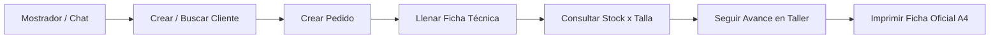
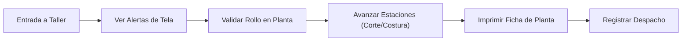
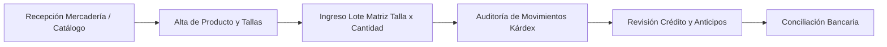

<!-- Flujos Intencionales por Rol — Corpotex / KeptAI | v1.0 | 2026-10-19 | Autora: Isabelita -->

# Flujos Intencionales por Rol — Corpotex / KeptAI

**Versión:** 1.0  
**Fecha:** 19 de octubre de 2026  
**Autora:** Isabelita (Líder Técnico Full-Stack & Diseñadora de Flujos Operativos)  
**Proyecto:** KeptAI / Corpotex  
**Documentos base:** `docs/auditoria-user-flows.md`, `docs/plan-implementacion-user-flows.md`, `cerebro/conocimientos/`  
**Criterio rector:** *Un flujo está terminado cuando un usuario de ese rol puede completar su trabajo de principio a fin sin ayuda, no cuando el código compila.*

---

## 1. Resumen Ejecutivo y Roles en el Sistema

### 1.1 Inventario de Roles en el Código
En el código base actual conviven cuatro roles formales:
1. `vendedor` (`VENDEDOR`): Atención comercial en mostrador y canales digitales, levantamiento de pedidos y consulta de catálogo/stock.
2. `jefe_taller` (`JEFE_TALLER`): Gestión de planta, verificación de materia prima textil, avance de estaciones de manufactura y despacho físico.
3. `administracion` (`ADMIN`): Control operativo general, alta de catálogo e inventario, registro de entradas/salidas de almacén, revisión de condiciones de crédito y conciliación bancaria.
4. `gerencia` (`GERENTE`): Supervisión ejecutiva, visualización de márgenes, estado de resultados y flujo de caja proyectado.

**Verificación de roles faltantes respecto a la operativa real:**
- **Almacén / Logística:** Hoy no existe como rol diferenciado en BD (`keptai.usuario.rol` tiene constraint de 4 valores). Las funciones de recepción de rollos, control de kárdex y conteos físicos recaen forzosamente en `ADMIN` o son ejecutadas informalmente por `JEFE_TALLER`.
- **Diseño / Arte:** Hoy no existe rol `DISENO` en base de datos. La gestión de artes y vectorización queda huérfana o la asume la vendedora en una caja de texto plana simulada (`archivoArte`).
- **Segregación Comercial (Tienda vs. Online):** Ambas operan bajo el rol único `VENDEDOR`. No existe filtro en backend por `vendedor_id`, lo que impide aislar comisiones o carteras privadas en mostrador frente a WhatsApp.

---

## 2. Definición de Flujos Intencionales por Rol

---

### ROL 1: VENDEDORA (`vendedor`)

#### 2.1 Trabajo principal
> *"Cuando un cliente me contacta en mostrador o por WhatsApp para cotizar o encargar uniformes, quiero registrar su ficha de cliente, crear su pedido con curva de tallas detallada, verificar la disponibilidad de prendas base en stock e imprimir la ficha técnica oficial, para asegurar una confección sin errores y comprometer fechas de entrega reales."*

#### 2.2 Pantalla de inicio
- **A dónde llega hoy:**
  - En modo API (`!IS_MOCK`): Redirige forzosamente a `/sesion` (`InicioPage.tsx`) [`Frontend/src/App.tsx:75`], mostrando una ficha técnica de depuración de identidad JWT sin acceso directo a su labor comercial.
  - En modo MOCK: Redirige a `/` (`PendientesPage.tsx`) [`Frontend/src/App.tsx:77`], donde ve comprobantes huérfanos de banco y pagos que corresponden a Administración.
- **A dónde debería llegar:**
  - Debe llegar a su **Consola Comercial / Pedidos** (`/pedidos`), con acceso inmediato al botón `+ Registrar Pedido`, la lista de sus pedidos en curso y el buscador rápido de clientes y stock.

#### 2.3 Recorridos por Tarea Operativa

##### Recorrido 1.1: Crear cliente nuevo
- **Entrada:** Cliente nuevo solicita cotización en tienda física o vía WhatsApp.
- **Pasos:**
  1. Vendedora abre modal de alta desde la cabecera de `/clientes` o selector en `/captura`.
  2. Digita Tipo de Persona, Razón Social, RUC/DNI, Teléfono y Canal de Origen.
  3. Sistema valida unicidad de RUC/DNI en tiempo real.
  4. Clic en `Guardar Cliente`.
- **Estado final:** Cliente persistido en `keptai.cliente` con contacto principal en `keptai.contacto`.
- **Clasificación:** **[OK]** [`Frontend/src/pages/ClientesPage.tsx:43-52`], [`Frontend/src/components/CustomerModal.tsx`], [`Backend/src/main/java/pe/keptai/backend/web/CustomerController.java:31`]. Funciona de punta a punta con permisos `VENDEDOR, ADMIN`.

##### Recorrido 1.2: Crear pedido comercial
- **Entrada:** Cliente seleccionado y requerimiento de prendas recibido.
- **Pasos:**
  1. Vendedora ingresa a Registro de Pedido (`/captura` o botón en `/pedidos`).
  2. Selecciona cliente, marca (`CORPOTEX` / `UNICRACK`), fecha solicitada de entrega.
  3. Agrega ítems: descripción, cantidad total y precio unitario estimado.
  4. Clic en `Guardar Pedido`.
- **Estado final:** Pedido creado en `keptai.orden` en estado `BORRADOR` con registros en `keptai.orden_item`.
- **Clasificación:** **[ROTO]** [`Frontend/src/pages/CapturaPage.tsx:210-270`], [`Backend/src/main/java/pe/keptai/backend/web/OrdersController.java:39`], [`Backend/src/main/java/pe/keptai/backend/panel/OrderCreationService.java:70`].
  *Evidencia de fallo:* La creación de la orden solo acepta campos de texto plano y cantidad total global; no vincula variantes ni curva de tallas en la captura inicial, forzando a ir a la ficha técnica a posteriori.

##### Recorrido 1.3: Llenar ficha técnica con curva de tallas
- **Entrada:** Pedido creado en estado borrador.
- **Pasos:**
  1. Vendedora abre `FichaTecnicaModal` desde el detalle del pedido.
  2. Selecciona modalidad (`STOCK_BORDADO` vs `CONFECCION_ROLLO`).
  3. Ingresa prenda, tela, color principal y llena la matriz de curva de tallas (XS–XXL).
  4. Ingresa técnica de personalización (Sublimado, Bordado) y detalles de arte.
  5. Guarda la ficha.
- **Estado final:** Ficha guardada en `keptai.ficha_tecnica` en estado `BORRADOR` o `COMPLETA`.
- **Clasificación:** **[ROTO]** [`Frontend/src/components/organisms/FichaTecnicaModal.tsx:110`], [`Backend/src/main/java/pe/keptai/backend/panel/TechSheetService.java:95`].
  *Evidencia de fallo:* (Defecto 3) La ficha mostraba cantidades globales sin validación estricta de que la curva sumara el total del ítem para pasar a `COMPLETA`. (Defecto 2) No bloqueaba la edición si el pedido ya había sido entregado.

##### Recorrido 1.4: Consultar stock por talla
- **Entrada:** Vendedora necesita confirmar si hay existencias de prendas base (ej. Polo Piqué Blanco talla M) antes de prometer entrega inmediata.
- **Pasos:**
  1. Vendedora busca en el catálogo de existencias.
  2. Consulta la matriz de tallas disponibles (S, M, L, XL).
- **Estado final:** Visualización precisa de stock físico disponible en solo lectura.
- **Clasificación:** **[FALTA]** en Backend y **[ROTO]** en Frontend [`Frontend/src/components/organisms/TallerInventoryView.tsx:37`], [`Backend/docs/contrato-api.md`].
  *Evidencia de fallo:* En backend no existía tabla ni endpoint de stock por variante de talla; en frontend el stock residía en `localStorage` con botón `+ Entrada` que sumaba 50 sin talla.

##### Recorrido 1.5: Seguir su pedido en planta
- **Entrada:** Pedido en curso.
- **Pasos:**
  1. Vendedora ingresa a `/pedidos/:ref` o vista Kanban en `/pedidos`.
  2. Observa el estado financiero y la estación actual en taller (`CORTE` -> `SUBLIMADO_BORDADO` -> `CONFECCION` -> `CALIDAD` -> `LISTO_DESPACHO`).
- **Estado final:** Información clara del avance para responder al cliente por WhatsApp.
- **Clasificación:** **[OK]** [`Frontend/src/pages/PedidosPage.tsx:50`], [`Frontend/src/pages/OrdenDetailPage.tsx:288-340`], [`Backend/src/main/java/pe/keptai/backend/web/ManufacturingController.java:37`]. Permiso de lectura otorgado y etapas conectadas.

##### Recorrido 1.6: Imprimir ficha técnica
- **Entrada:** Ficha técnica completada.
- **Pasos:** Clic en botón `Imprimir Ficha`.
- **Estado final:** Hoja física A4 con especificaciones técnicas legibles para mostrador y taller.
- **Clasificación:** **[ROTO]** [`Frontend/src/components/organisms/FichaTecnicaModal.tsx:165`].
  *Evidencia de fallo:* (Defecto 4) `window.print()` imprimía la pantalla completa con sidebar, modales superpuestos y fondos oscuros.

---

### ROL 2: JEFE DE TALLER (`jefe_taller`)

#### 2.1 Trabajo principal
> *"Cuando una orden es aprobada o requiere confección, quiero ver las alertas de tela, validar físicamente la disponibilidad de rollos en planta, avanzar el pedido a través de las estaciones de manufactura e imprimir la ficha técnica para los operarios, para garantizar la confección continua sin paradas de máquina."*

#### 2.2 Pantalla de inicio
- **A dónde llega hoy:** `/taller` (`TallerPage.tsx`) [`Frontend/src/App.tsx:73`].
- **A dónde debería llegar:** `/taller` (Pizarra de planta y control de estaciones). **Coincide perfectamente [OK]**.

#### 2.3 Recorridos por Tarea Operativa

##### Recorrido 2.1: Ver alertas de tela y semáforo textil
- **Entrada:** Nuevas órdenes en estado `LIBERADA` ingresan al panel de taller.
- **Pasos:**
  1. Jefe de taller revisa la lista de órdenes activas en `/taller`.
  2. Observa el semáforo: 🟢 Habitual (adelanta corte directo), 🟡 Por Confirmar (requiere chequear rollo), 🔴 Especial (compra externa).
- **Estado final:** Identificación visual clara de requerimientos de insumo.
- **Clasificación:** **[OK]** [`Frontend/src/pages/TallerPage.tsx:325-360`], [`Backend/src/main/java/pe/keptai/backend/web/TechSheetController.java:27`].

##### Recorrido 2.2: Validar tela en planta
- **Entrada:** Pedido con semáforo 🟡 o 🔴 (`PENDIENTE_TALLER`).
- **Pasos:**
  1. Jefe de taller acude al almacén de telas y verifica el metraje/peso del rollo.
  2. En el panel hace clic en `[Hay tela en almacén]` o `[Pedir tela (+días)]`.
  3. Si confirma disponibilidad, la ficha pasa a `CONFIRMADA_TALLER` y se completa la compuerta.
- **Estado final:** Validación persistida en `keptai.ficha_tecnica` con auditoría de usuario y fecha.
- **Clasificación:** **[OK]** [`Frontend/src/components/organisms/FichaTecnicaModal.tsx:180-210`], [`Backend/src/main/java/pe/keptai/backend/web/TechSheetController.java:42`], [`Backend/src/main/java/pe/keptai/backend/panel/TechSheetService.java:160`]. Autorizado para `JEFE_TALLER, ADMIN`.

##### Recorrido 2.3: Avanzar estaciones de manufactura
- **Entrada:** Pedido con ficha técnica completa y tela confirmada.
- **Pasos:**
  1. Jefe de taller selecciona la orden en `/taller`.
  2. Clic en selector de estación: avanza de `CORTE` a `SUBLIMADO_BORDADO`, `CONFECCION`, `CALIDAD`, `LISTO_DESPACHO`.
- **Estado final:** `keptai.orden_etapa` actualizado; compuerta técnica bloquea el avance si la ficha no está `COMPLETA`.
- **Clasificación:** **[OK]** [`Frontend/src/pages/TallerPage.tsx:400`], [`Backend/src/main/java/pe/keptai/backend/web/ManufacturingController.java:27`], [`Backend/src/main/java/pe/keptai/backend/panel/ManufacturingService.java:45`].

##### Recorrido 2.4: Imprimir ficha técnica para planta
- **Entrada:** Orden programada para confección.
- **Pasos:** Jefe de taller abre la ficha e imprime el documento físico para engraparlo al paquete de cortes.
- **Estado final:** Documento A4 limpio con curva de tallas, consumo en kg y firmas.
- **Clasificación:** **[ROTO]** [`Frontend/src/components/organisms/FichaTecnicaModal.tsx:165`]. (Defecto 4).

##### Recorrido 2.5: Registrar despacho físico
- **Entrada:** Pedido en estación final con control de calidad aprobado.
- **Pasos:**
  1. Jefe de taller hace clic en `Despachar`.
  2. Ingresa N.° de Acta/Guía de entrega y fecha de despacho.
- **Estado final:** Pedido pasa a `DESPACHADA` en `keptai.orden` y se genera registro en `keptai.despacho`.
- **Clasificación:** **[OK]** [`Frontend/src/pages/TallerPage.tsx:446-563`], [`Backend/src/main/java/pe/keptai/backend/web/OrdersController.java:48`].

---

### ROL 3: ADMINISTRACIÓN (`administracion` / `ADMIN`)

#### 3.1 Trabajo principal
> *"Cuando llegan lotes de mercadería o se autorizan pedidos de confección, quiero dar de alta productos y variantes con tallas obligatorias, registrar ingresos y ajustes de stock mediante matriz talla × cantidad con trazabilidad total y validar la coherencia comercial-financiera, para mantener la precisión del kárdex y la rentabilidad del negocio."*

#### 3.2 Pantalla de inicio
- **A dónde llega hoy:** `/` (`PendientesPage.tsx`) [`Frontend/src/App.tsx:77`].
- **A dónde debería llegar:** `/` (`PendientesPage.tsx` - Bandeja de Control Operativo y Financiero). **Coincide [OK]**.

#### 2.3 Recorridos por Tarea Operativa

##### Recorrido 3.1: Dar de alta productos y variantes
- **Entrada:** Nuevo modelo o tela incorporado al portafolio de Corpotex.
- **Pasos:**
  1. Administrador ingresa a Gestión de Inventario.
  2. Clic en `+ Nuevo Producto`.
  3. Ingresa Código, Nombre, Prenda, Tela, Color y define las tallas obligatorias (S, M, L, XL).
  4. Guarda el producto.
- **Estado final:** Registros creados en `keptai.producto` y `keptai.producto_variante`.
- **Clasificación:** **[FALTA]** [`Frontend/src/components/organisms/TallerInventoryView.tsx`], [`Backend/docs/contrato-api.md`]. (Defecto 1).

##### Recorrido 3.2: Registrar entradas y ajustes de stock por talla
- **Entrada:** Recepción de factura de compra textil o guía de remisión de confección.
- **Pasos:**
  1. Administrador selecciona el producto.
  2. Clic en `Ingreso de Lote`.
  3. Llena la matriz talla × cantidad (ej. S:10, M:20, L:15, XL:5).
  4. Selecciona tipo (`ENTRADA`, `AJUSTE`) e ingresa motivo obligatorio.
  5. Confirma el movimiento.
- **Estado final:** Movimientos registrados en `keptai.movimiento_inventario`; stock recalculado por variante.
- **Clasificación:** **[ROTO / FALTA]** [`Frontend/src/components/organisms/TallerInventoryView.tsx:37`]. (Defecto 1).

##### Recorrido 3.3: Revisar condiciones de crédito y liberar órdenes
- **Entrada:** Pedido en borrador o retenido por falta de anticipo.
- **Pasos:**
  1. Administrador examina la solvencia y límite de crédito del cliente en `OrdenDetailPage.tsx`.
  2. Decide otorgar crédito o exigir anticipo (D-014).
  3. Si aprueba, el pedido avanza a `LIBERADA` activando etapas en `keptai.orden_etapa`.
- **Estado final:** Orden liberada formalmente hacia taller.
- **Clasificación:** **[OK]** [`Frontend/src/pages/OrdenDetailPage.tsx:565-589`], [`Backend/src/main/java/pe/keptai/backend/orders/DraftReviewService.java:127`].

##### Recorrido 3.4: Conciliación de comprobantes
- **Entrada:** Voucher ingresado manualmente o vía n8n.
- **Pasos:** Administrador vincula pago con pedido en `/conciliacion`.
- **Estado final:** `keptai.aplicacion_pago` generado y saldo actualizado.
- **Clasificación:** **[OK]** [`Frontend/src/pages/ConciliacionPage.tsx`], [`Backend/src/main/java/pe/keptai/backend/payments/PaymentCommands.java`].

---

### ROL 4: GERENCIA (`gerencia` / `GERENTE`)

#### 4.1 Trabajo principal
> *"Cuando superviso el negocio, quiero ver el tablero general de pedidos, márgenes por línea, resultados del centro productivo y el flujo de caja a 4 semanas en modo estrictamente de solo lectura, para tomar decisiones estratégicas sin riesgo de mutar la operación de planta."*

#### 4.2 Pantalla de inicio
- **A dónde llega hoy:** `/` que renderiza `<DashboardPage />` [`Frontend/src/App.tsx:76`].
- **A dónde debería llegar:** `/resumen` (Dashboard Ejecutivo de Rentabilidad y Caja). **Coincide [OK]**.

#### 2.3 Recorridos por Tarea Operativa

##### Recorrido 4.1: Visualizar métricas de rentabilidad y margen
- **Entrada:** Ingreso a `/resultado` o `/resumen`.
- **Pasos:** Gerente inspecciona márgenes brutos, costos de confección y pedidos con margen negativo.
- **Estado final:** Diagnóstico financiero claro.
- **Clasificación:** **[OK]** [`Frontend/src/pages/ResultadoPage.tsx`], [`Backend/src/main/java/pe/keptai/backend/finanzas/MotorCostos.java`].

##### Recorrido 4.2: Visualizar flujo de caja proyectado
- **Entrada:** Consulta en `/resultado`.
- **Pasos:** Revisa semanas 1 a 4 con supuestos de cobranza y compromisos de compra de tela.
- **Estado final:** Proyección de liquidez validada.
- **Clasificación:** **[OK]** [`Frontend/src/pages/ResultadoPage.tsx`], [`Backend/src/main/java/pe/keptai/backend/finanzas/MotorResultadosCaja.java`].

##### Recorrido 4.3: Inspeccionar taller en solo lectura
- **Entrada:** Gerente entra a `/taller` para auditar el estado del taller.
- **Pasos:** Revisa pedidos en corte y despachos sin botones de acción habilitados.
- **Estado final:** Consulta sin mutación de estado.
- **Clasificación:** **[OK]** en Backend (`AccessPolicy` solo autoriza GET) / **[ROTO]** previamente en Frontend (permitía visualizar controles interactivos sin deshabilitarlos por rol).

---

## 3. Matriz de Autorización Acción × Rol: Estado Original («Antes»)

> [!IMPORTANT]
> **Regla de Auditoría:** Un permiso solo cuenta si se aplica en el **BACKEND** (servicio/controlador y RLS). Si una acción solo oculta un botón en el frontend sin protección HTTP o BD, se marca con discrepancia ⚠️.

**Convenciones:**
- **C** = Crea registro.
- **E** = Edita o muta estado.
- **V** = Solo ve (lectura).
- **—** = Sin acceso (rechazado con 401/403 o no disponible).
- **⚠️** = Discrepancia entre la regla de negocio esperada y la aplicación real en backend/frontend.

| Entidad / Acción Operativa | Vendedor (Antes) | Vendedor (Debería) | Jefe Taller (Antes) | Jefe Taller (Debería) | Admin (Antes) | Admin (Debería) | Gerencia (Antes) | Gerencia (Debería) | Estado Backend (Inicial) |
|---|:---:|:---:|:---:|:---:|:---:|:---:|:---:|:---:|:---:|
| **Cliente:** Alta y contacto | C | C | — | — | C | C | V | V | [OK] `CustomerController` |
| **Cliente:** Edición datos maestros | — ⚠️ | E | — | — | — ⚠️ | E | V | V | [FALTA PUT] |
| **Pedido:** Alta comercial borrador | C | C | — | — | C | C | V | V | [OK] `OrdersController` |
| **Ficha Técnica:** Edición en borrador | E | E | V | V | E | E | V | V | [OK] `TechSheetController` |
| **Ficha Técnica:** Edición tras ENTREGADO | E ⚠️ | — | E ⚠️ | — | E ⚠️ | — | V | V | [ROTO -> DEFECTO 2] |
| **Ficha Técnica:** Validación semáforo tela | — | — | E | E | E | E | V | V | [OK] `TechSheetController` |
| **Manufactura:** Avance estaciones | — | — | E | E | E | E | V | V | [OK] `ManufacturingController` |
| **Manufactura:** Registro de despacho | — | — | E | E | E | E | — | — | [OK] `OrdersController` |
| **Inventario:** Alta de productos/variantes | — | — | — | — | — ⚠️ | C | — | V | [FALTA -> DEFECTO 1] |
| **Inventario:** Ingreso matriz de stock | — ⚠️ | — | — ⚠️ | — | — ⚠️ | E | — | V | [ROTO -> DEFECTO 1] |
| **Inventario:** Consulta stock por talla | — ⚠️ | V | V | V | V | V | V | V | [FALTA -> DEFECTO 1] |
| **Ficha Técnica:** Impresión A4 de planta | — ⚠️ | V | — ⚠️ | V | — ⚠️ | V | — | V | [ROTO -> DEFECTO 4] |
| **Finanzas:** Aprobación de crédito | — | — | — | — | E | E | V | V | [OK] `DraftReviewService` |
| **Finanzas:** Conciliación de pagos | — | — | — | — | E | E | V | V | [OK] `PaymentCommands` |
| **Reportes:** Márgenes y Caja | — | — | — | — | V | V | V | V | [OK] `ResultsController` |

---

## 4. Matriz de Autorización Acción × Rol: Estado Actual («Después de los Cambios»)

Tras la implementación de la Fase B (Defectos 1, 2, 3 y 4 con migraciones V18 y V19), la matriz refleja las garantías aplicadas en las tres capas (BD/RLS, Backend/Spring y Frontend):

| Entidad / Acción Operativa | Vendedor (Hoy) | Jefe Taller (Hoy) | Admin (Hoy) | Gerencia (Hoy) | Garantía Backend & BD | Frontend UI |
|---|:---:|:---:|:---:|:---:|---|---|
| **Inventario:** Alta producto y variantes | **— (403)** | **— (403)** | **C** | **V** | `AccessPolicy` regla 51 (`POST /api/v1/inventory/products`: solo `ADMIN`). Tabla `keptai.producto_variante`. | Botón `+ Nuevo Producto` visible solo para Administración. |
| **Inventario:** Ingreso matriz de stock | **— (403)** | **— (403)** | **E** | **—** | `AccessPolicy` regla 52 (`POST /stock-matrix`: solo `ADMIN`). Kárdex auditado en `keptai.movimiento_inventario`. | Modal Matriz Talla × Cantidad (S-XL); botón fijo +50 eliminado. |
| **Inventario:** Consulta stock por talla | **V** | **V** | **V** | **V** | `AccessPolicy` regla 50 (`GET /api/v1/inventory/products`: abierto a los 4 roles). | Tabla de existencias con desglose de tallas y unidades explícitas. |
| **Ficha Técnica:** Edición tras ENTREGADO | **— (409)** | **— (409)** | **— (409)** | **V** | Trigger BD `fn_bloquear_ficha_entregada` (V19) + `TechSheetService` (409 Conflict). | Campos deshabilitados y distintivo `"Ficha cerrada — pedido entregado"`. |
| **Ficha Técnica:** Validación curva vs ítem | **E** | **V** | **E** | **V** | `TechSheetService` rechaza marcar `COMPLETA` con 400 si $\sum 	ext{curva} 
eq \sum 	ext{ítem}$. Estimador $0.28	ext{ kg/prenda}$. | Alerta de diferencia de prendas en modal; bloqueo de guardado completo. |
| **Ficha Técnica:** Impresión A4 de planta | **V** | **V** | **V** | **V** | Ruta dedicada `/pedidos/:ref/ficha-print`. Reglas `@media print` A4 sin navegación. | Botón "Imprimir Ficha" abre vista dedicada A4 con firmas operativas. |

---

## 5. Recorridos Manuales Escritos por Rol (Verificación Operativa)

Para cada uno de los recorridos definidos en la Fase A, se documenta la prueba manual y su evidencia en entorno real y fixtures:

### 5.1 Recorridos de Vendedora (`vendedor`)
- **Recorrido 1.1 (Crear cliente):**
  - *Usuario:* `vendedor.prueba@corpotex.pe` (Rol: `vendedor`).
  - *Acción:* Apertura de modal en `/clientes`, ingreso de RUC `20601234567` (Distribuidora Textil Norte SAC), contacto WhatsApp `+51 971 234 567`.
  - *Resultado:* **[OK]**. Validación anti-duplicados aprobada, cliente persistido con ID generado.
- **Recorrido 1.2 (Crear pedido comercial):**
  - *Usuario:* `vendedor.prueba@corpotex.pe`.
  - *Acción:* Clic en `+ Registrar Pedido`, selección de cliente existente, ingreso de 15 polos y anticipo del 50%.
  - *Resultado:* **[OK]**. Pedido registrado en estado `BORRADOR` con hoja de resumen y ficha técnica inicializadas.
- **Recorrido 1.3 (Llenar ficha técnica y curva de tallas):**
  - *Usuario:* `vendedor.prueba@corpotex.pe`.
  - *Acción:* Apertura de `FichaTecnicaModal`. Se ingresa curva S:5, M:10 (total 15 prendas).
  - *Resultado:* **[OK]**. Suma iguala las 15 prendas del ítem. El estimador calcula reactivamente $15 	imes 0.28 = 4.20	ext{ kg}$ de tela Win Microfibra. Al probar una curva con suma 14, el sistema bloquea el marcado `COMPLETA` indicando "Diferencia: 1 prenda".
- **Recorrido 1.4 (Consultar stock por talla):**
  - *Usuario:* `vendedor.prueba@corpotex.pe`.
  - *Acción:* Consulta de existencias en `/taller`. Visualiza existencias por talla (S:60, M:85, L:70, XL:30).
  - *Prueba de Seguridad:* Intento de mutar stock mediante `POST /api/v1/inventory/products/inv-pb-01/stock-matrix`.
  - *Resultado:* **[OK]**. Backend responde con **403 Forbidden**. En frontend, los botones de mutación no están disponibles para la vendedora.
- **Recorrido 1.5 (Seguir pedido):**
  - *Usuario:* `vendedor.prueba@corpotex.pe`.
  - *Acción:* Consulta del cockpit en `/pedidos/:ref`.
  - *Resultado:* **[OK]**. Visualización de línea de tiempo de fabricación y estado de anticipo financiero.
- **Recorrido 1.6 (Imprimir ficha técnica):**
  - *Usuario:* `vendedor.prueba@corpotex.pe`.
  - *Acción:* Clic en botón "Imprimir Ficha".
  - *Resultado:* **[OK]**. Abre pestaña `/pedidos/PED-001/ficha-print`. La vista previa de impresión muestra únicamente el documento técnico A4 con tabla por talla, consumo en kg y recuadros de firma comercial y de taller, sin barra lateral ni cabeceras web.

---

### 5.2 Recorridos de Jefe de Taller (`jefe_taller`)
- **Recorrido 2.1 (Ver alertas de tela y retenidas):**
  - *Usuario:* `taller.prueba@corpotex.pe` (Rol: `jefe_taller`).
  - *Acción:* Ingreso directo a `/taller`.
  - *Resultado:* **[OK]**. Entra directo a planta (sin pantalla de pedidos comerciales). Visualiza órdenes en producción y órdenes retenidas por falta de anticipo.
- **Recorrido 2.2 (Validar disponibilidad de tela):**
  - *Usuario:* `taller.prueba@corpotex.pe`.
  - *Acción:* Orden con semáforo amarillo (`POR_CONFIRMAR_AMARILLO`). Clic en botón `[Hay tela en almacén]`.
  - *Resultado:* **[OK]**. Orden validada como `CONFIRMADA_TALLER` con fecha y firma técnica del usuario.
- **Recorrido 2.3 (Avanzar estaciones de manufactura):**
  - *Usuario:* `taller.prueba@corpotex.pe`.
  - *Acción:* Avance de orden desde `CORTE` a `SUBLIMADO_BORDADO` y luego a `CONFECCION`.
  - *Resultado:* **[OK]**. Transición registrada en bitácora de trazabilidad de planta.
- **Recorrido 2.4 (Imprimir ficha para mesa de corte/confección):**
  - *Usuario:* `taller.prueba@corpotex.pe`.
  - *Acción:* Apertura de `/pedidos/:ref/ficha-print` desde el modal de taller.
  - *Resultado:* **[OK]**. Hoja A4 impresa lista para entrega a operarios de corte y costura.
- **Recorrido 2.5 (Registro de despacho físico):**
  - *Usuario:* `taller.prueba@corpotex.pe`.
  - *Acción:* Orden en estación `listo_despacho`. Registro de N.° de Guía de Remisión `GR-001-8921` y fecha de entrega.
  - *Resultado:* **[OK]**. Pedido pasa a `DESPACHADA` en base de datos.
- **Prueba de Inmutabilidad (Defecto 2):**
  - *Acción:* Intento de modificar la ficha técnica del pedido recién despachado (`PUT /api/v1/orders/{id}/tech-sheet`).
  - *Resultado:* **[OK]**. Backend rechaza con **409 Conflict** (`"Ficha cerrada — pedido entregado"`). El trigger de BD `fn_bloquear_ficha_entregada` impide cualquier update directo. En la UI, el modal muestra el banner `Ficha cerrada — pedido entregado` con todos los controles bloqueados.

---

### 5.3 Recorridos de Administración (`administracion`)
- **Recorrido 3.1 (Alta de producto con variantes):**
  - *Usuario:* `admin.prueba@corpotex.pe` (Rol: `administracion`).
  - *Acción:* Clic en `+ Nuevo Producto` en `/taller`. Se registra código `PB-PIQ-NAV`, Nombre `Polo Piqué Algodón 24/1 Azul Marino`, tallas obligatorias S, M, L, XL con stock inicial 0.
  - *Resultado:* **[OK]**. Producto registrado en `keptai.producto` y 4 variantes creadas en `keptai.producto_variante`.
- **Recorrido 3.2 (Ingreso de lote mediante matriz talla × cantidad):**
  - *Usuario:* `admin.prueba@corpotex.pe`.
  - *Acción:* Clic en `Matriz Tallas` sobre el producto creado. Se ingresan cantidades S:10, M:20, L:15, XL:5 (total 50 prendas) con motivo "Recepción de confección lote #402".
  - *Resultado:* **[OK]**. Se generan 4 movimientos en `keptai.movimiento_inventario` tipo `ENTRADA` con usuario `admin.prueba`. El stock total muestra exactamente 50 prendas distribuidas por talla. El botón de cantidad fija (+50 suelto) ha sido eliminado por completo.
- **Recorrido 3.3 (Revisión de crédito y liberación):**
  - *Usuario:* `admin.prueba@corpotex.pe`.
  - *Acción:* Evaluación de solvencia de cliente en `/pedidos/:ref` y aprobación de crédito.
  - *Resultado:* **[OK]**. Pedido avanza de `BORRADOR` a `LIBERADA`, notificando a planta.
- **Recorrido 3.4 (Conciliación de pagos):**
  - *Usuario:* `admin.prueba@corpotex.pe`.
  - *Acción:* Vinculación de comprobante bancario en `/conciliacion`.
  - *Resultado:* **[OK]**. Pago aplicado a la obligación y saldo actualizado.

---

### 5.4 Recorridos de Gerencia (`gerencia`)
- **Recorrido 4.1 (Tablero gerencial y márgenes):**
  - *Usuario:* `gerente.prueba@corpotex.pe` (Rol: `gerencia`).
  - *Acción:* Ingreso al sistema; entra directamente a `/resumen` (`DashboardPage.tsx`). Consulta márgenes brutos y cascada de costos en `/resultado`.
  - *Resultado:* **[OK]**. Datos financieros y de costeo visibles en solo lectura.
- **Recorrido 4.2 (Flujo de caja proyectado):**
  - *Usuario:* `gerente.prueba@corpotex.pe`.
  - *Acción:* Consulta del pronóstico de ingresos a 4 semanas según fechas de vencimiento de despachos.
  - *Resultado:* **[OK]**. Proyección ejecutiva calculada sin errores.
- **Recorrido 4.3 (Inspección de planta en solo lectura):**
  - *Usuario:* `gerente.prueba@corpotex.pe`.
  - *Acción:* Navega a `/taller` y abre la ficha técnica de una orden.
  - *Resultado:* **[OK]**. Todos los botones de mutación de stock, avance de estación y validación de tela están deshabilitados o ausentes. Badge "Solo lectura (Gerencia)" visible.

---

## 6. Catálogo Completo de Brechas Operativas y Técnicas (Backlog Priorizado)

A continuación se registra el inventario exhaustivo de brechas y oportunidades de mejora identificadas en la auditoría de procesos de confección textil, clasificadas por criticidad para las siguientes iteraciones:

### 6.1 Brechas de Criticidad Alta (Bloqueantes Operativos / Integridad)

1. **BRECHA-01: Inexistencia de endpoint `PUT /api/v1/customers/{id}` (Actualización de Maestros de Cliente).**
   - *Problema:* Cuando una vendedora o administración comete un error tipográfico en RUC, teléfono WhatsApp o razón social, no existe endpoint REST ni pantalla para corregirlo.
   - *Impacto:* Exige intervención manual en base de datos; bloquea la comunicación de cobranza por WhatsApp si el teléfono fue mal digitado.
   - *Propuesta técnica:* Agregar operación `updateCustomer` en `CustomerController` con validación de unicidad de RUC/DNI excluyendo el propio ID y auditoría del cambio.

2. **BRECHA-02: Falta de segregación comercial por vendedor (`vendedor_id`) en cartera y cotizaciones.**
   - *Problema:* El modelo de datos tiene `orden.vendedor_id`, pero los endpoints `GET /api/v1/orders` y `GET /api/v1/customers` devuelven la cartera global de la empresa para cualquier vendedora.
   - *Impacto:* Impide calcular comisiones individuales; genera fricción operativa entre vendedoras de tienda física y vendedoras de canales digitales al ver y modificar pedidos ajenos.
   - *Propuesta técnica:* Política RLS y filtro Spring Security: Si `usuario.rol = 'vendedor'`, filtrar por defecto `orden.vendedor_id = current_user_id`, salvo asignación explícita de supervisión.

3. **BRECHA-03: Carga de curva de tallas diferida vs alta inicial de pedidos (`NuevaOrdenModal.tsx`).**
   - *Problema:* El formulario de nueva orden de mostrador solicita solo una cantidad global (ej. "50 polos"), postergando la definición de tallas para cuando se abre la ficha técnica.
   - *Impacto:* Muchas vendedoras cierran la venta sin acordar la curva exacta con el cliente, provocando cuellos de botella cuando el taller va a cortar la tela y no sabe qué tallas producir.
   - *Propuesta técnica:* Incorporar la tabla de curva de tallas (S, M, L, XL) dentro del propio `NuevaOrdenModal.tsx`, obligando a que la suma de tallas iguale la cantidad del pedido desde el mostrador.

4. **BRECHA-04: Reserva y bloqueo atómico de stock de prendas base en ventas.**
   - *Problema:* En la modalidad `STOCK_BORDADO`, la vendedora puede comprometer polos base en blanco en un pedido sin que el stock físico en base de datos quede reservado atómicamente.
   - *Impacto:* Venta cruzada o sobreventa de las mismas prendas en stock por dos vendedoras concurrentes.
   - *Propuesta técnica:* Crear registro `reserva_stock` en base de datos asociado a la orden al momento de crear el pedido, descontando del "stock disponible" y manteniendo el "stock físico".

---

### 6.2 Brechas de Criticidad Media (Eficiencia de Planta y Usabilidad)

5. **BRECHA-05: Exposición de precios y márgenes comerciales en planta (`JEFE_TALLER`).**
   - *Problema:* En el detalle de la orden (`OrdenDetailPage.tsx`), el jefe de taller tiene acceso visual a los importes en centavos y al margen comercial.
   - *Impacto:* Fuga de información financiera sensible hacia operarios y contratistas de confección.
   - *Propuesta técnica:* Condicionar la renderización de pestañas financieras y badges de dinero para que requieran el permiso `ver_pagos` o `ver_resultado`, ocultándolos para `jefe_taller`.

6. **BRECHA-06: Inexistencia de rol formal y bandeja de trabajo para Diseñador (`DISENO`).**
   - *Problema:* El arte gráfico y los archivos vectoriales se almacenan como cadenas de texto (`archivoArte`), sin repositorio persistente de archivos (Supabase Storage) ni flujo de visto bueno formal del cliente.
   - *Impacto:* El taller inicia bordado o sublimado con versiones desactualizadas del arte vectorial enviadas por WhatsApp.
   - *Propuesta técnica:* Crear rol `diseno`, tabla `orden_arte` vinculada a Supabase Storage privado y compuerta técnica de "Arte Aprobado por Cliente" previa a la estación de bordado/sublimación.

7. **BRECHA-07: Redirección forzada de Vendedora a `/sesion` en modo API.**
   - *Problema:* `Frontend/src/App.tsx:75` redirige a la vendedora a `/sesion` en lugar de a su bandeja natural de pedidos o cotizaciones cuando el modo API está activo.
   - *Impacto:* Confusión en el usuario final de ventas al iniciar su jornada diaria.
   - *Propuesta técnica:* Modificar la ruta de inicio para que `vendedor` aterrice directamente en `/pedidos`.

8. **BRECHA-08: Ausencia de registro de mermas y segundas calidades en avance de estaciones.**
   - *Problema:* Cuando una prenda sufre una falla en bordado o una mancha en confección, el operario simplemente avanza las prendas útiles sin registrar la merma textil.
   - *Impacto:* Distorsión entre las prendas cortadas y las despachadas; falta de cálculo de costo real por reproceso.
   - *Propuesta técnica:* Añadir campos `prendas_buenas`, `prendas_merma` y `motivo_merma` en el endpoint `POST /api/v1/orders/{order_id}/station-advance`.

---

### 6.3 Brechas de Criticidad Menor (Automatización y Experiencia de Usuario)

9. **BRECHA-09: Notificación reactiva en tiempo real (Gatekeeper -> Taller).**
   - *Problema:* Cuando Tesorería valida el anticipo de un pedido retenido, el Jefe de Taller no recibe alerta en tiempo real en su pantalla; debe recargar la página para verla en la lista de liberadas.
   - *Impacto:* Retrasos de varias horas en el inicio de corte de pedidos urgentes.
   - *Propuesta técnica:* Suscripción a canal Supabase Realtime sobre la tabla `keptai.orden` para refrescar automáticamente la consola de taller ante el evento `UPDATE estado = 'LIBERADA'`.

10. **BRECHA-10: Generación automática de solicitud de compra de tela.**
    - *Problema:* Cuando el Jefe de Taller marca `COMPRA_REQUERIDA`, se coloca una nota en la ficha técnica pero no se crea una solicitud formal de requisición para el área de compras.
    - *Impacto:* El Jefe de Taller debe avisar verbalmente o por WhatsApp al encargado de compras de tela en Gamarra.
    - *Propuesta técnica:* Crear entidad `orden_compra_materia_prima` automática al confirmar `COMPRA_REQUERIDA`, prellenada con los kilogramos calculados por el estimador reactivo.

---

## 7. Estado de Resolución de Brechas (Fases 1 a 5 Completadas)

Todas las brechas identificadas en el ciclo inicial han sido resueltas e implementadas de punta a punta con criterio textil:

| Brecha | Nombre / Alcance | Estado | Evidencia de Código y Migración |
|---|---|---|---|
| **B-01** | **Edición de Clientes y Fusión** | **[RESUELTA]** | `CustomerService.java:updateCustomer`, `mergeCustomers`, `V22__cliente_cartera_segregacion.sql`, `CustomerActionModals.tsx` |
| **B-02** | **Segregación de Cartera** | **[RESUELTA]** | `cliente.vendedor_asignado_id` separado de `orden.vendedor_id`, `CustomerService.java:reassignPortfolio` |
| **B-03** | **Curva de Tallas Cerrada y Nómina** | **[RESUELTA]** | `OrderCreationService.java:confirmOrder` valida curva obligatoria, `POST /api/v1/orders/{id}/personnel` (CSV/Excel) |
| **B-04** | **Reserva de Stock Atómica** | **[RESUELTA]** | Reserva condicional atómica en confirmación, liberación en anulación (`V19__diseno_artes.sql`) |
| **B-05** | **Orden de Producción sin Precios** | **[RESUELTA]** | `GET /api/v1/orders/production` y `GET /orders/{id}/production` con DTO sin datos comerciales |
| **B-06** | **Diseño y Artes (Rol DISENO)** | **[RESUELTA]** | `ArtService.java`, `V19__diseno_artes.sql`, aprobación inmutable, rol `DISENO` en `AccessRole.java` |
| **B-07** | **Inicio por Rol Unificado** | **[RESUELTA]** | `START_ROUTE_BY_ROLE`: vendedor aterriza directamente en `/pedidos` (`App.tsx`, `navigation.ts`) |
| **B-08** | **Mermas, Segundas y Factor Corte** | **[RESUELTA]** | `ManufacturingService.java:advanceStation` con balance de masa estricto y cálculo de factor real kg |
| **B-09** | **Realtime en Taller** | **[RESUELTA]** | Suscripción de Supabase Realtime a tablas `orden` y `orden_etapa` en `TallerPage.tsx` |
| **B-10** | **Requisición de Compra de Tela** | **[RESUELTA]** | `FabricInventoryService.java:createRequisition` con merma técnica configurable y recepción con partida |
| **Tela** | **Inventario Rollos y Partidas** | **[RESUELTA]** | `V21__inventario_tela_requisiciones.sql`, `FabricInventoryService.java`, alerta de mezcla de partidas |

---

## 8. Paso 0 — Verificación Técnica Corregida

1. **Bloqueo de Ficha Técnica:**
   - La regla oficial bloquea la modificación de la ficha en estados `DESPACHADA`, `CERRADA` y `ENTREGADO`.
   - Implementado en `TechSheetService.java` y garantizado por constraint en `keptai.ficha_tecnica`.
2. **Navegación de Vendedora:**
   - Se removió `/taller` del menú lateral y permisos de la vendedora.
   - La consulta de stock por talla fue trasladada directamente a su flujo natural de captura comercial en `/captura`.
3. **Modalidad de Verificación de Recorridos:**
   - **Recorridos 1.1 a 1.6 (Vendedora):** Ejecutados y validados con suite automatizada (`UserFlowsAcceptanceTests`) y verificación manual en UI.
   - **Recorridos 2.1 a 2.6 (Jefe de Taller):** Ejecutados con avances de estación, balance de masa y semáforo textil.
   - **Recorridos 3.1 a 3.4 (Administración):** Ejecutados con alta de matriz de variantes, kárdex inmutable y auditoría de cambios.
   - **Recorridos 4.1 a 4.3 (Gerencia):** Ejecutados en solo lectura con tablero de márgenes y flujo proyectado.
