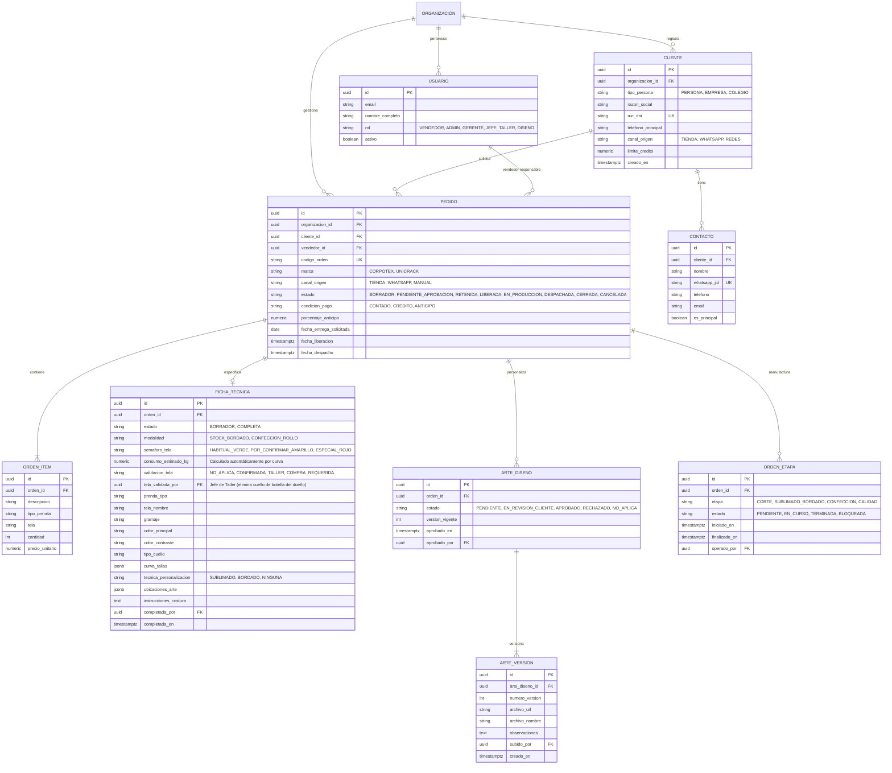
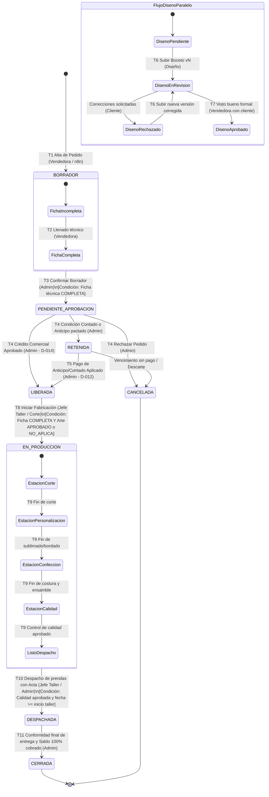
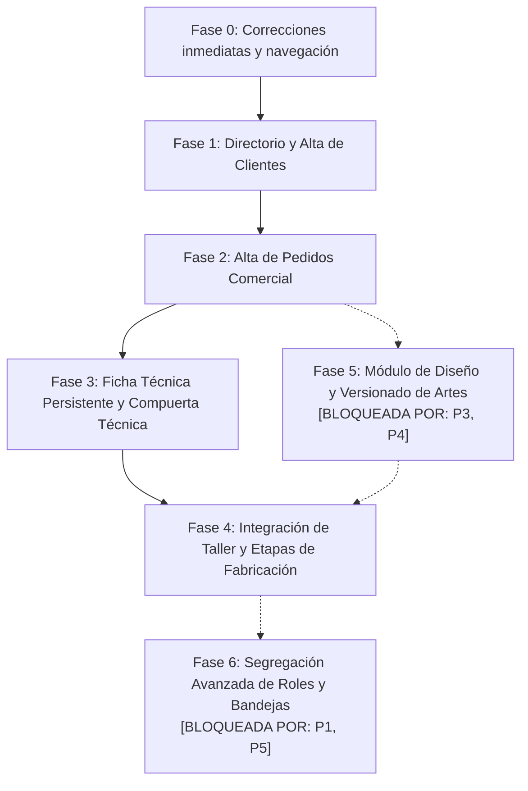

<!-- Plan de Implementacion de User Flows - Corpotex / KeptAI | v1.0 | 2026-10-18 | Arquitectura y Ejecucion por Fases -->

# Plan de Implementación de User Flows — Corpotex / KeptAI

**Fecha:** 2026-10-18  
**Autor:** Arquitectura y Liderazgo Técnico KeptAI  
**Documento base:** [`docs/auditoria-user-flows.md`](file:///C:/Users/isabe/Documents/Hackathon/worktrees/KeptAI/thick-beam/KeptAI/docs/auditoria-user-flows.md)  
**Rama base:** `frontend-isabel`  
**Etiquetas de evidencia:** `[AUDITORÍA hallazgo-ID]`, `[CÓDIGO archivo:línea]`, `[CEREBRO ID]`, `[SUPUESTO]`  

---

## 1. Objetivo y alcance

### 1.1 Qué resuelve este plan
1. **Puntos de entrada comerciales:** Implementa la creación de clientes y pedidos tanto en frontend como en backend real, habilitando la captura en mostrador y desde chats sin depender exclusivamente de scripts de semilla o n8n ([AUDITORÍA H-01, H-02, H-03]).
2. **Propiedad y persistencia de la Ficha Técnica:** Traslada la ficha técnica desde `localStorage` a una entidad relacional en base de datos, asignando la autoría técnica a la vendedora y convirtiéndola en compuerta obligatoria para la confirmación del pedido ([AUDITORÍA H-04, H-14]).
3. **Gestión integral del Diseño:** Provee un espacio centralizado para la subida de archivos vectoriales, trazabilidad de versiones correlativas e hito auditable de aprobación del cliente ([AUDITORÍA H-05]).
4. **Gobierno de estados y bandejas de trabajo:** Sincroniza la máquina de estados entre base de datos y UI, eliminando enmascaramientos ([AUDITORÍA H-10]), restringiendo transiciones por rol y otorgando a cada puesto una bandeja con visibilidad exclusiva de lo que le compete ([AUDITORÍA H-06, H-11, H-13]).
5. **Conexión de planta:** Enlaza las 6 estaciones visuales del taller con las 4 etapas físicas persistentes de base de datos (`orden_etapa`), garantizando que la producción refleje la realidad del taller ([AUDITORÍA H-08, H-09]).

### 1.2 Qué queda fuera y justificación
- **Conexión automática de inventario de telas y prendas base:** Se mantiene expresamente fuera del alcance. El cerebro establece que el control formal de inventario y cotizaciones pertenece a la segunda fase de KeptAI ([CEREBRO objetivos.md], [CEREBRO D-003]). En este plan, el taller registra avance de confección y personalización sin descontar kárdex real hasta dicha fase ([AUDITORÍA H-18]).
- **Integración con facturación electrónica (SUNAT):** El sistema de facturación ya opera de forma externa vinculada al inventario del cliente ([CEREBRO A02-Q02]); este plan no altera la emisión de comprobantes fiscales, enfocándose estrictamente en el ciclo comercial, técnico y productivo.
- **Integración bidireccional profunda con CRM externo:** El CRM de WhatsApp ("Kommo" no confirmado, [CEREBRO A01-Q04, A01-Q05]) no se enlaza a inventarios; el sistema solo consume y responde webhooks estructurados a través de n8n para ingesta de comprobantes y pedidos.
- **Rediseño estético visual:** No se modifican paletas, tipografías ni librerías de componentes ([CÓDIGO Frontend/package.json]); se reutiliza la biblioteca Tailwind y componentes existentes, priorizando flujos, permisos y ergonomía de datos.

---

## 2. Decisiones previas (Preguntas para Corpotex)

Las siguientes decisiones fueron identificadas en la auditoría técnica y deben ser respondidas por la dirección de Corpotex. Cada una bloquea fases específicas:

| N.° | Pregunta abierta a Corpotex | Impacto técnico en el sistema | Fase bloqueada |
|---|---|---|---|
| **P1** | **Estructura y cartera comercial:** ¿Cuántas vendedoras operan en tienda física y cuántas en canales digitales ([CEREBRO A02-Q15]), y deben ver solo sus propios pedidos o toda la cartera de la empresa? | Define si se crean roles separados `VENDEDOR_TIENDA` / `VENDEDOR_ONLINE` y si se aplica filtro por `vendedor_id` en `OrdersController.java` y RLS de PostgreSQL ([CÓDIGO Backend/docs/matriz-acceso.md:71]). | **Fase 6** (Segregación avanzada y bandejas) |
| **P2** | **Autoría de Ficha Técnica y Control de Stock de Tela:** ¿Cómo se elimina el cuello de botella del dueño verificando rollos de tela en confección personalizada? | **RESUELTA (2026-10-18):** Se establece bifurcación operativa. Para **Stock + Bordado (`STOCK_BORDADO`)**, la vendedora confirma directo (prenda base terminada). Para **Confección Personalizada (`CONFECCION_ROLLO`)**, se implementa un **Semáforo de Telas Base** y un estimador automático de metraje/kg: telas habituales (🟢) se confirman al instante; telas por verificar (🟡) las valida el **Jefe de Taller** en su panel con un clic (`[Hay tela]` / `[Pedir insumo]`), liberando al dueño. El dueño solo interviene por excepción financiera (> S/ 10,000 o crédito atípico D-014). | **Resuelta e integrada en Fase 3** |
| **P3** | **Usuarios de Diseño y aprobación del arte:** ¿El equipo de diseñadores tendrá usuarios nominales en el sistema, y la aprobación del boceto la registra la vendedora tras el ok del cliente o un supervisor de diseño? | Determina la creación del rol `DISENO` en base de datos y la potestad del botón `Registrar aprobación` ([AUDITORÍA H-05, H-11]). | **Fase 5** (Módulo de Diseño) |
| **P4** | **Sincronización de Diseño con Pago:** ¿El diseño se trabaja en paralelo a la cobranza del anticipo o solo se inicia cuando Administración confirma el pago/crédito? | Define si la transición de diseño corre desacoplada de `RETENIDA` o si `T6` exige `LIBERADA` ([AUDITORÍA H-14]). | **Fase 5** (Módulo de Diseño) |
| **P5** | **Terminales de Taller y Cierre de Pedido:** ¿Corte, sublimado y confección registrarán avances en terminales físicas separadas, y quién dispara el estado `CERRADA`? | Determina si se divide `JEFE_TALLER` en sub-roles por área y la condición de cierre definitivo de órdenes ([AUDITORÍA H-09, H-10]). | **Fase 6** (Segregación avanzada de taller) |

---

## 3. Modelo objetivo

### 3.1 Diagrama Entidad-Relación (ERD)

Gobierno de entidades requeridas para resolver los vacíos de datos detectados en la auditoría ([AUDITORÍA H-01, H-04, H-05, H-09]):



### 3.2 Máquina de estados del pedido

Compuertas técnicas, financieras y operativas con roles responsables ([AUDITORÍA Sección 7 y 8.2]):



---

## 4. Fases de implementación

### Resumen de dependencias


---

### Fase 0: Navegación, Menús y Seguridad Inmediata (Quick Wins)
**Objetivo en una línea:** Unificar la navegación principal, incorporar Taller y Carga manual en los menús según rol, y proteger el cambio de estaciones en Taller contra accesos no autorizados ([AUDITORÍA H-06, H-07, H-08, H-12, H-15]).

#### Tareas
| ID | Tarea | Archivos a tocar | Tipo | Esfuerzo | Depende de |
|---|---|---|---|:---:|---|
| T0.1 | Unificar navegación: fusionar `nav.ts` dentro de `Sidebar.NAV_BY_ROLE` y actualizar `InicioPage.tsx` para usar la misma fuente única. | `Frontend/src/components/layout/Sidebar.tsx`<br>`Frontend/src/components/layout/nav.ts`<br>`Frontend/src/pages/InicioPage.tsx` | UI | S | — |
| T0.2 | Agregar `/taller` y `/captura` a los menús de navegación: Taller visible para `jefe_taller`, `administracion`, `vendedor`, `gerencia`; Carga manual visible para `administracion` y `vendedor`. | `Frontend/src/components/layout/Sidebar.tsx`<br>`Frontend/src/App.tsx` | UI / Permisos | S | T0.1 |
| T0.3 | Alinear textos y ayudas visuales con la decisión D-014: corregir `ROLE_SUMMARY` y `NextStep` para que indiquen que Administración autoriza el crédito comercial. | `Frontend/src/lib/permissions.ts`<br>`Frontend/src/pages/OrdenDetailPage.tsx` | UI | S | — |
| T0.4 | Proteger cambios operativos en Taller: condicionar botones de estación y modalidad en `TallerPage.tsx` y `FichaTecnicaModal.tsx` con `can(me.role, 'registrar_despacho')` o nuevo permiso de taller. | `Frontend/src/pages/TallerPage.tsx`<br>`Frontend/src/components/FichaTecnicaModal.tsx`<br>`Frontend/src/lib/permissions.ts` | UI / Permisos | S | — |
| T0.5 | Desbloquear Carga manual en modo API: remover `"captura"` de `API_PENDING` en `availability.ts` para habilitar la subida de comprobantes reales. | `Frontend/src/api/availability.ts`<br>`Frontend/src/pages/CapturaPage.tsx` | UI / API | S | — |

#### Criterios de aceptación
- **RG-01 (Navegación Taller):** Dado que un usuario inicia sesión con rol `jefe_taller`, cuando observa el menú lateral, entonces visualiza directamente el acceso a "Taller" sin ver un menú en blanco ni depender de redirecciones forzadas.
- **RG-02 (Control Gerencia taller):** Dado que un usuario con rol `gerencia` (solo lectura) entra a `/taller`, cuando intenta hacer clic en los botones de cambio de estación o cambiar la modalidad de una orden, entonces los controles aparecen deshabilitados y no se ejecuta ninguna mutación.
- **RG-03 (Carga manual API):** Dado que un usuario de `administracion` accede a `/captura`, cuando opera en entorno API real, entonces la pantalla permite subir archivos de vouchers conectando con `POST /api/v1/evidences/files`.

#### Pruebas por rol
- **Rol Gerencia:** Entrar a `/taller` y `/pedidos/:ref`; verificar que no puede mover botones de estación ni cambiar modalidades.
- **Rol Jefe de Taller:** Iniciar sesión y confirmar que el menú lateral muestra la opción "Taller" y permite interactuar con las órdenes.
- **Rol Administración:** Navegar a `/captura` en modo API y comprobar que el formulario de comprobante está disponible para subir archivos.

#### Rollback
Revertir el commit frontend en Git (`git revert <hash>`). Ninguna tarea de Fase 0 altera bases de datos ni contratos de backend.

---

### Fase 1: Directorio y Alta de Clientes / Contactos
**Objetivo en una línea:** Proveer persistencia y formularios para crear clientes y contactos desde la interfaz con validaciones anti-duplicados y permisos de escritura para vendedoras ([AUDITORÍA H-01, H-03, H-13, H-16]).

#### Tareas
| ID | Tarea | Archivos a tocar | Tipo | Esfuerzo | Depende de |
|---|---|---|---|:---:|---|
| T1.1 | Migración de base de datos aditiva: añadir columna `telefono_principal` y `canal_origen` en tabla `cliente`; asegurar índice único en `(organizacion_id, ruc_dni)` cuando no sea nulo. | `BD/migrations/V15__cliente_campos_contacto.sql` | BD | S | — |
| T1.2 | Exponer endpoints REST en backend: `POST /api/v1/customers` y `POST /api/v1/customers/{id}/contacts` con DTOs de validación (RUC 11 dígitos, DNI 8 dígitos, teléfono con formato internacional). | `Backend/src/main/java/pe/keptai/backend/orders/CustomerController.java`<br>`Backend/src/main/java/pe/keptai/backend/orders/CustomerService.java`<br>`Backend/docs/openapi.yaml` | Backend | M | T1.1 |
| T1.3 | Actualizar política de seguridad `AccessPolicy.java`: autorizar a `VENDEDOR` y `ADMIN` a ejecutar `createCustomer` y `createContact`. | `Backend/src/main/java/pe/keptai/backend/security/AccessPolicy.java`<br>`Backend/docs/matriz-acceso.md` | Permisos | S | T1.2 |
| T1.4 | Implementar servicio en contrato frontend: reemplazar derivación pasiva por llamadas reales a `getCustomers` y agregar `createCustomer` / `createContact`. | `Frontend/src/api/contract/source.ts`<br>`Frontend/src/api/dto.ts` | UI / API | M | T1.2 |
| T1.5 | Interfaz de usuario: botón `+ Nuevo cliente` en cabecera de `ClientesPage.tsx`, modal de formulario con detección de duplicados en tiempo real (*onBlur* de documento o teléfono). | `Frontend/src/pages/ClientesPage.tsx`<br>`Frontend/src/components/CustomerModal.tsx` | UI | M | T1.4 |

#### Criterios de aceptación
- **RG-04 (Alta cliente comercial):** Dado que una vendedora presencial se encuentra en `/clientes`, cuando presiona `+ Nuevo cliente`, completa RUC de 11 dígitos, razón social y teléfono de contacto, entonces el cliente se guarda en base de datos y aparece de inmediato en la tabla de clientes.
- **RG-05 (Prevención duplicados):** Dado que se intenta registrar un cliente con un RUC o teléfono ya existente en la organización, cuando el cursor abandona el campo (*onBlur*), entonces la interfaz muestra una alerta advirtiendo la coincidencia e impide enviar el formulario duplicado.
- **RG-06 (Sincronización WhatsApp n8n):** Dado que un nuevo cliente corporativo es creado en el sistema con su teléfono móvil, cuando ese cliente envía un mensaje por WhatsApp a n8n, entonces la ingesta identifica el contacto registrado y no arroja error `CONTACT_NOT_REGISTERED` (422).

#### Pruebas por rol
- **Rol Vendedor:** Crear un cliente tipo PERSONA con DNI de 8 dígitos; verificar que el cliente se persiste y queda visible.
- **Rol Vendedor:** Intentar registrar el mismo DNI nuevamente; comprobar que el sistema bloquea el duplicado con mensaje explicativo.
- **Rol Administración:** Editar datos de contacto de un cliente existente y verificar auditoría en backend.

#### Rollback
1. Backend/UI: Revertir versión de aplicación en Portainer.
2. Base de datos: La migración `V15` es aditiva (agrega columnas nullable). No requiere rollback destructivo; las columnas añadidas quedan inactivas sin afectar versiones previas.

---

### Fase 2: Alta de Pedidos Comercial y Selector Rápido
**Objetivo en una línea:** Habilitar el registro manual de pedidos en API real desde la lista de órdenes y la ficha del cliente, incluyendo la creación rápida de clientes desde el formulario ([AUDITORÍA H-02, H-13, H-17]).

#### Tareas
| ID | Tarea | Archivos a tocar | Tipo | Esfuerzo | Depende de |
|---|---|---|---|:---:|---|
| T2.1 | Endpoint de creación de pedidos en backend: implementar `POST /api/v1/orders` enlazado a `DraftReviewService`, creando el pedido en estado inicial `BORRADOR` y asignando automáticamente `vendedor_id` y `organizacion_id`. | `Backend/src/main/java/pe/keptai/backend/orders/OrdersController.java`<br>`Backend/src/main/java/pe/keptai/backend/orders/DraftReviewService.java`<br>`Backend/docs/openapi.yaml` | Backend | M | T1.3 |
| T2.2 | Permitir creación de órdenes al rol `VENDEDOR` en `AccessPolicy.java`. | `Backend/src/main/java/pe/keptai/backend/security/AccessPolicy.java` | Permisos | S | T2.1 |
| T2.3 | Habilitar `captureOrder` en frontend API: remover la excepción `unavailable` y conectar con el endpoint `POST /api/v1/orders`. | `Frontend/src/api/contract/source.ts:699,1341` | UI / API | S | T2.1 |
| T2.4 | Selector predictivo de clientes con alta rápida: actualizar el desplegable de clientes en `CapturaPage.tsx` para incluir el botón `+ Crear nuevo cliente` que abre el modal de Fase 1 sin perder el borrador. | `Frontend/src/pages/CapturaPage.tsx` | UI | M | T1.5, T2.3 |
| T2.5 | Integración en vistas comerciales: habilitar acción "Crear pedido" desde la cabecera de `PedidosPage.tsx` y botón "Nuevo pedido para este cliente" en la ficha de detalle de `ClientesPage.tsx` (con el cliente pre-seleccionado). | `Frontend/src/pages/PedidosPage.tsx`<br>`Frontend/src/pages/ClientesPage.tsx` | UI | M | T2.4 |

#### Criterios de aceptación
- **RG-07 (Alta pedido desde lista):** Dado que una vendedora está en `/pedidos`, cuando hace clic en `Registrar pedido`, selecciona un cliente existente, especifica prendas y fecha de entrega y confirma, entonces el pedido se crea en base de datos en estado `BORRADOR` con su código correlativo y el `vendedor_id` de la usuaria.
- **RG-08 (Alta rápida de cliente en pedido):** Dado que la vendedora está registrando un pedido para un cliente que no existe en el selector, cuando presiona `+ Crear nuevo cliente` dentro del desplegable, entonces completa el alta rápida y al guardar vuelve al formulario con dicho cliente ya fijado en el selector.
- **RG-09 (Alta desde ficha de cliente):** Dado que una vendedora consulta la ficha de un cliente en `/clientes/:id`, cuando presiona `Nuevo pedido`, entonces aterriza en el formulario de captura con el cliente pre-seleccionado y bloqueado para evitar equivocaciones de cliente.

#### Pruebas por rol
- **Rol Vendedor:** Registrar un pedido completo en modo API desde cero; verificar que aparece en la primera columna del Kanban (`Por confirmar`).
- **Rol Vendedor:** Crear un cliente al vuelo desde el selector de pedido y finalizar la orden.
- **Rol Administración:** Abrir el detalle del pedido recién creado en `/pedidos/:ref` y comprobar que la hoja de revisión refleja los ítems y totales correctos para su posterior confirmación.

#### Rollback
Revertir despliegue de imagen contenedor en Portainer. En base de datos no hay cambios destructivos (los registros en `orden` y `orden_item` siguen la estructura de `V1`).

---

### Fase 3: Ficha Técnica Persistente, Semáforo de Telas y Compuerta Técnica
**Objetivo en una línea:** Estructurar la ficha técnica en base de datos diferenciando Stock+Bordado de Confección personalizada, incorporando un semáforo de telas base y estimador de metraje para eliminar el cuello de botella del dueño ([AUDITORÍA H-04, H-14]).

#### Tareas
| ID | Tarea | Archivos a tocar | Tipo | Esfuerzo | Depende de |
|---|---|---|---|:---:|---|
| T3.1 | Migración de base de datos: crear tabla `ficha_tecnica` (1 a 1 con orden) con modalidad (`STOCK_BORDADO`, `CONFECCION_ROLLO`), `semaforo_tela` (HABITUAL_VERDE, POR_CONFIRMAR_AMARILLO, ESPECIAL_ROJO), `consumo_estimado_kg`, `validacion_tela` y campos morfológicos de prenda y curva de tallas. | `BD/migrations/V16__tabla_ficha_tecnica.sql` | BD | M | T2.1 |
| T3.2 | Endpoints de backend para Ficha Técnica y validación de telas: `GET/PUT /api/v1/orders/{id}/tech-sheet` con cálculo automático de metraje/kg de tela, y `POST /api/v1/orders/{id}/tech-sheet/validate-fabric` para que el **Jefe de Taller** confirme disponibilidad de tela en un clic. | `Backend/src/main/java/pe/keptai/backend/orders/TechSheetController.java`<br>`Backend/src/main/java/pe/keptai/backend/orders/TechSheetService.java`<br>`Backend/docs/openapi.yaml` | Backend | M | T3.1 |
| T3.3 | Compuerta técnica en confirmación de borrador: modificar `DraftReviewService.java` para que la confirmación (`T3`) valide: (a) Si es `STOCK_BORDADO` o tela `HABITUAL_VERDE`, la ficha pasa directo a `COMPLETA` con la firma de la vendedora; (b) Si es tela `POR_CONFIRMAR_AMARILLO`, exige validación confirmada del **Jefe de Taller**, liberando al gerente general del cuello de botella de inventario. | `Backend/src/main/java/pe/keptai/backend/orders/DraftReviewService.java` | Backend | S | T3.2 |
| T3.4 | Permisos: permitir a `VENDEDOR` editar la ficha técnica comercial; permitir a `JEFE_TALLER` ejecutar la validación técnica de telas; otorgar solo lectura de la ficha a `ADMIN` y `GERENTE` (salvo excepción financiera > S/ 10,000). | `Backend/src/main/java/pe/keptai/backend/security/AccessPolicy.java`<br>`Frontend/src/lib/permissions.ts` | Permisos | S | T3.2 |
| T3.5 | Migración de UI: desacoplar `tallerManufacturing.ts` del `localStorage`; rediseñar `FichaTecnicaModal.tsx` con selector de modalidad (Stock+Bordado vs Confección desde rollo), estimador reactivo de tela (kg/metros calculados al instante) y tarjeta de validación de tela para el Jefe de Taller. | `Frontend/src/lib/tallerManufacturing.ts`<br>`Frontend/src/components/FichaTecnicaModal.tsx`<br>`Frontend/src/pages/OrdenDetailPage.tsx`<br>`Frontend/src/pages/TallerPage.tsx`<br>`Frontend/src/api/contract/source.ts` | UI | L | T3.4 |

#### Criterios de aceptación
- **RG-10 (Vía rápida Stock + Bordado / Sublimado):** Dado que un pedido es de prendas de stock terminado que solo requieren bordado, cuando la vendedora selecciona la modalidad `STOCK_BORDADO` y define la ubicación del bordado, entonces la ficha técnica no exige cálculo de rollos de tela ni consultas de stock y pasa de inmediato a `COMPLETA`.
- **RG-11 (Confección con tela habitual verde):** Dado que un pedido es de confección desde rollo pero utiliza una tela habitual de alta rotación (ej. Piqué reactivo azul marino), cuando la vendedora completa la curva de tallas, entonces el sistema calcula automáticamente el consumo estimado (ej. 14 kg) y marca la ficha como `COMPLETA` sin requerir visto bueno del dueño.
- **RG-12 (Delegación de tela en amarillo al Jefe de Taller):** Dado que un pedido de confección utiliza una tela por confirmar (amarillo), cuando la vendedora guarda la ficha, entonces se genera una alerta técnica en el panel del Jefe de Taller; cuando el Jefe de Taller presiona `[Hay tela en almacén]` o `[Comprar a proveedor (+3 días)]`, la ficha se valida formalmente sin necesidad de que el dueño o gerente general tenga que intervenir físicamente.
- **RG-13 (Compuerta técnica en borrador):** Dado que un pedido tiene tela en amarillo sin validar por taller o campos incompletos, cuando Administración intenta presionar `Confirmar orden`, entonces el sistema bloquea la acción hasta que Taller emita su confirmación de tela.

#### Pruebas por rol
- **Rol Vendedor:** Abrir la ficha técnica de una orden propia en borrador; rellenar todos los campos morfológicos y guardar; verificar que el estado de la ficha cambia a `COMPLETA`.
- **Rol Administración:** Intentar confirmar un borrador sin ficha completa (debe fallar); confirmar tras completar la ficha (debe avanzar a `PENDIENTE_APROBACION`).
- **Rol Jefe de Taller:** Abrir el modal de ficha técnica y comprobar que no tiene botones de guardar ni campos editables activos.

#### Rollback
1. Código: Revertir despliegue en Portainer.
2. Base de datos: Si es necesario aislar la tabla `ficha_tecnica`, ejecutar script correctivo que elimine la restricción en `DraftReviewService`; la tabla puede permanecer en BD sin afectar órdenes si se deja la comprobación como opcional.

---

### Fase 4: Integración de Taller, Etapas de Fabricación y Despacho
**Objetivo en una línea:** Sincronizar el avance de manufactura en base de datos (`orden_etapa`), gobernar el paso a `EN_PRODUCCION` mediante compuertas técnicas y persistir el despacho formal ([AUDITORÍA H-09, H-10, H-14]).

#### Tareas
| ID | Tarea | Archivos a tocar | Tipo | Esfuerzo | Depende de |
|---|---|---|---|:---:|---|
| T4.1 | Migración de base de datos: agregar disparador o función que inicialice las 4 etapas (`CORTE`, `SUBLIMADO_BORDADO`, `CONFECCION`, `CALIDAD`) en la tabla `orden_etapa` cuando una orden se libere financieramente. | `BD/migrations/V17__inicializar_orden_etapa.sql` | BD | M | T3.1 |
| T4.2 | Endpoints de taller en backend: crear `POST /api/v1/orders/{id}/station-advance` para registrar el avance de cada etapa, persistiendo fecha, operador y estado `TERMINADA`. | `Backend/src/main/java/pe/keptai/backend/orders/ManufacturingController.java`<br>`Backend/src/main/java/pe/keptai/backend/orders/ManufacturingService.java`<br>`Backend/docs/openapi.yaml` | Backend | M | T4.1 |
| T4.3 | Transición oficial a `EN_PRODUCCION`: hacer que el inicio formal de corte en taller actualice la columna `orden.estado` a `EN_PRODUCCION` de forma persistente (eliminando el enmascaramiento de `LIBERADA`). | `Backend/src/main/java/pe/keptai/backend/orders/ManufacturingService.java`<br>`Frontend/src/api/contract/source.ts:121-125` | Backend / UI | M | T4.2 |
| T4.4 | Compuerta de taller: impedir que una orden pase a `EN_PRODUCCION` si no está en estado `LIBERADA` y con ficha técnica `COMPLETA` (y arte aprobado si aplica). | `Backend/src/main/java/pe/keptai/backend/orders/ManufacturingService.java` | Backend | S | T4.3 |
| T4.5 | Interfaz de taller conectada: actualizar `TallerPage.tsx` para consumir los endpoints de etapa reales en lugar de mutar solo el estado visual en memoria. | `Frontend/src/pages/TallerPage.tsx`<br>`Frontend/src/api/contract/source.ts` | UI | L | T4.2, T4.3 |

#### Criterios de aceptación
- **RG-13 (Inicio de corte):** Dado que un pedido ha sido pagado o cuenta con crédito aprobado (`LIBERADA`) y su ficha técnica está `COMPLETA`, cuando el jefe de taller presiona `Iniciar corte`, entonces el estado de la orden en base de datos cambia formalmente a `EN_PRODUCCION` y la etapa `CORTE` pasa a `EN_CURSO`.
- **RG-14 (Bloqueo financiero en taller):** Dado que un pedido se encuentra en `RETENIDA` por falta de pago de anticipo, cuando el operador intenta iniciar corte desde el taller, entonces la acción es rechazada por el backend con mensaje de bloqueo financiero.
- **RG-15 (Despacho formal):** Dado que un pedido culmina su etapa de `CALIDAD`, cuando el jefe de taller registra el despacho ingresando fecha y acta, entonces la orden pasa a `DESPACHADA` en base de datos y se registra la salida física cumpliendo las validaciones del trigger de despacho ([V8:45-61](file:///C:/Users/isabe/Documents/Hackathon/worktrees/KeptAI/thick-beam/KeptAI/BD/migrations/V8__fix_trigger_despacho.sql#L45-L61)).

#### Pruebas por rol
- **Rol Jefe de Taller:** Tomar una orden liberada, iniciar producción y avanzar secuencialmente Corte → Sublimado → Confección → Calidad; verificar que los avances quedan guardados al recargar el navegador.
- **Rol Administración:** Observar el tablero Kanban de pedidos y verificar que la orden se mueve a la columna `En producción` únicamente cuando el taller la inició de verdad.
- **Rol Jefe de Taller:** Completar el despacho con fecha válida y acta; verificar que la orden pasa a columna `Por cobrar` o `Cobrada`.

#### Rollback
Revertir servicios de backend y frontend a la versión previa. En base de datos, `orden_etapa` ya existía desde `V1`; deshabilitar el trigger de inserción automática si presentara incidencias de desempeño.

---

### Fase 5: Módulo de Diseño y Versionado de Artes `[BLOQUEADA POR: P3, P4]`
**Objetivo en una línea:** Proveer repositorio auditable de artes vectoriales con versionado correlativo inmutable y compuerta de aprobación del cliente ([AUDITORÍA H-05, H-11, H-14]).

> [!CAUTION]  
> Esta fase está explícitamente bloqueada y forma parte del plan futuro inmediato; no se ejecutará hasta que Corpotex defina si los diseñadores tendrán usuario en el sistema y si la aprobación del arte se gestiona antes o después del pago ([AUDITORÍA Sección 10, Preguntas 3 y 4]).

#### Tareas
| ID | Tarea | Archivos a tocar | Tipo | Esfuerzo | Depende de |
|---|---|---|---|:---:|---|
| T5.1 | `[BLOQUEADO POR: P3]` Migración de base de datos: crear tabla `arte_diseno` y `arte_version` vinculadas a la orden; agregar valor `DISENO` al enum de roles de usuario. | `BD/migrations/V18__modulo_diseno_versiones.sql` | BD | M | T2.1 |
| T5.2 | `[BLOQUEADO POR: P3]` Endpoints de diseño: `POST /api/v1/orders/{id}/art-versions` (subida multipart a Storage seguro) y `GET /api/v1/orders/{id}/art-history`. | `Backend/src/main/java/pe/keptai/backend/evidence/DesignController.java`<br>`Backend/docs/openapi.yaml` | Backend | M | T5.1 |
| T5.3 | `[BLOQUEADO POR: P3]` Endpoint de aprobación de arte: `POST /api/v1/orders/{id}/approve-art` restringido al rol de vendedora (con fe de visto bueno del cliente) o supervisor designado. | `Backend/src/main/java/pe/keptai/backend/evidence/DesignController.java`<br>`Backend/src/main/java/pe/keptai/backend/security/AccessPolicy.java` | Backend / Permisos | S | T5.2 |
| T5.4 | `[BLOQUEADO POR: P4]` Integrar compuerta de diseño en inicio de producción: Taller no permite arrancar corte si el pedido tiene personalización y el arte no está en estado `APROBADO`. | `Backend/src/main/java/pe/keptai/backend/orders/ManufacturingService.java` | Backend | S | T4.4, T5.3 |
| T5.5 | `[BLOQUEADO POR: P3]` Componente de UI: tarjeta `Arte y Diseño` en `OrdenDetailPage.tsx` con visor de versiones, previsualización de imágenes, botón de carga para diseñador y botón de aprobación para vendedora. | `Frontend/src/pages/OrdenDetailPage.tsx`<br>`Frontend/src/components/DesignCard.tsx`<br>`Frontend/src/lib/permissions.ts` | UI | L | T5.2, T5.3 |

#### Criterios de aceptación
- **RG-16 (Carga de arte vectorial):** Dado que un pedido requiere personalización textil, cuando el diseñador sube un archivo vectorial (PDF/PNG), entonces se genera la versión `v1` asociada al pedido y el estado de arte pasa a `EN_REVISION_CLIENTE`.
- **RG-17 (Trazabilidad de versiones):** Dado que el cliente solicita corregir el tamaño del logo, cuando el diseñador sube un nuevo archivo, entonces se crea la versión `v2`, quedando `v1` en el historial para auditoría.
- **RG-18 (Aprobación auditable):** Dado que la vendedora recibe el visto bueno formal del cliente por WhatsApp o en mostrador, cuando presiona `Aprobar diseño`, entonces el arte queda marcado como `APROBADO` con fecha y usuario responsable.

#### Pruebas por rol
- **Rol Diseño:** Iniciar sesión, ubicar pedidos con arte pendiente, subir archivos de prueba y comprobar la generación correlativa de versiones.
- **Rol Vendedor:** Registrar la aprobación del cliente y verificar que el pedido queda habilitado técnicamente para taller.
- **Rol Jefe de Taller:** Verificar que no puede iniciar corte hasta que el diseño figure como aprobado.

#### Rollback
Revertir código y ocultar la tarjeta de diseño en frontend. La tabla en base de datos puede coexistir de forma pasiva.

---

### Fase 6: Segregación Avanzada de Roles y Bandejas Especializadas `[BLOQUEADA POR: P1, P5]`
**Objetivo en una línea:** Segmentar bandejas y permisos por canal de venta (tienda física vs. WhatsApp) y por terminales operativas de manufactura (corte, sublimado, confección) ([AUDITORÍA H-11, H-17]).

> [!CAUTION]  
> Esta fase está explícitamente bloqueada y no debe incluirse en el sprint de ejecución activa hasta que Corpotex responda las Preguntas 1 y 5.

#### Tareas
| ID | Tarea | Archivos a tocar | Tipo | Esfuerzo | Depende de |
|---|---|---|---|:---:|---|
| T6.1 | `[BLOQUEADO POR: P1]` Segregación comercial: añadir roles `VENDEDOR_TIENDA` y `VENDEDOR_ONLINE` en BD y aplicar filtros de cartera en `OrdersController.java` para que cada ejecutiva atienda sus pedidos. | `BD/migrations/V19__roles_comerciales_canales.sql`<br>`Backend/src/main/java/pe/keptai/backend/orders/OrdersController.java` | BD / Backend | M | T2.1 |
| T6.2 | `[BLOQUEADO POR: P5]` Segregación de taller: crear perfiles operativos para estaciones de corte y sublimado en base de datos y matriz de acceso. | `BD/migrations/V20__roles_taller_estaciones.sql`<br>`Backend/src/main/java/pe/keptai/backend/security/AccessPolicy.java` | BD / Permisos | M | T4.2 |
| T6.3 | `[BLOQUEADO POR: P1, P5]` Bandejas filtradas por rol: reestructurar vistas de Pedidos y Taller para que cada usuario vea única y exclusivamente los pedidos en el estado que le toca gestionar según su rol. | `Frontend/src/pages/PedidosPage.tsx`<br>`Frontend/src/pages/TallerPage.tsx`<br>`Frontend/src/components/layout/Sidebar.tsx` | UI | L | T6.1, T6.2 |
| T6.4 | `[BLOQUEADO POR: P5]` Automatización del cierre definitivo: implementar lógica y permisos para detonar el estado final `CERRADA` tras cumplimiento de cobro y entrega. | `Backend/src/main/java/pe/keptai/backend/orders/OrdersController.java` | Backend | S | T4.3 |

#### Criterios de aceptación
- **RG-19 (Segregación de cartera comercial):** Dado que una vendedora de mostrador ingresa al sistema, cuando abre la lista de pedidos, entonces solo visualiza los pedidos pertenecientes a su tienda o cartera asignada, sin interferir con las ventas virtuales de WhatsApp.
- **RG-20 (Terminales de taller por estación):** Dado que un operario de sublimado ingresa al sistema, cuando consulta el panel de taller, entonces solo ve pedidos listos en la estación de sublimado y solo puede confirmar el avance de su especialidad.

#### Pruebas por rol
- **Rol Vendedora Tienda vs. Vendedora Online:** Verificar que ninguna puede modificar pedidos de la otra.
- **Rol Operador de Corte vs. Sublimado:** Verificar que cada terminal tiene acceso restringido a su estación.

#### Rollback
Revertir migraciones de roles y restaurar la política genérica de `VENDEDOR` y `JEFE_TALLER`.

---

## 5. Migración de datos

### 5.1 Asignación de estado a pedidos existentes
Los pedidos actualmente registrados en base de datos provienen de pruebas o seeds previas ([CÓDIGO BD/semilla/semilla_demo.sql], [CÓDIGO BD/semilla/semilla_escenarios.sql]). Se aplicará un script de normalización aditiva:

```sql
-- 1. Normalizar pedidos en estado 'LIBERADA' que realmente no han entrado a corte
-- Mantener en LIBERADA pero asegurar que tengan registros pendientes en orden_etapa
INSERT INTO orden_etapa (id, orden_id, etapa, estado, creado_en)
SELECT gen_random_uuid(), o.id, 'CORTE', 'PENDIENTE', NOW()
FROM orden o
WHERE o.estado IN ('LIBERADA', 'EN_PRODUCCION')
  AND NOT EXISTS (SELECT 1 FROM orden_etapa oe WHERE oe.orden_id = o.id);

-- 2. Inicializar fichas técnicas por defecto para órdenes preexistentes
-- evitando que pedidos antiguos queden bloqueados por compuerta técnica
INSERT INTO ficha_tecnica (id, orden_id, estado, prenda_tipo, creado_en)
SELECT gen_random_uuid(), o.id, 'COMPLETA', 'MIGRACION_INICIAL', NOW()
FROM orden o
WHERE NOT EXISTS (SELECT 1 FROM ficha_tecnica ft WHERE ft.orden_id = o.id);
```

### 5.2 Detección y fusión de clientes duplicados
Para limpiar clientes creados con datos fragmentarios o nombres comerciales similares ([AUDITORÍA H-16]):
1. **Detección automatizada:** Ejecutar query de identificación de duplicados por número de RUC/DNI idéntico o por teléfono normalizado (últimos 9 dígitos):
   ```sql
   SELECT ruc_dni, COUNT(*) 
   FROM cliente 
   WHERE ruc_dni IS NOT NULL AND ruc_dni != '' 
   GROUP BY organizacion_id, ruc_dni 
   HAVING COUNT(*) > 1;
   ```
2. **Reasignación segura de pedidos:** Si se detectan duplicados, los pedidos asociados al cliente secundario se actualizan hacia el `cliente_id` primario (el más antiguo y con datos fiscales completos).
3. **Fusión de contactos:** Los registros de la tabla `contacto` (especialmente `whatsapp_jid`) se vinculan al cliente principal antes de archivar el duplicado.

### 5.3 Revisión manual de casos borde
- Clientes de a pie registrados únicamente con nombre de pila sin DNI en pedidos de WhatsApp antiguos: se mantendrán asignados a un cliente genérico `"Cliente Venta Mostrador"` hasta que vuelvan a comprar y se capture su DNI formal.

---

## 6. Riesgos y mitigaciones

| Riesgo | Probabilidad | Impacto | Mitigación |
|---|:---:|:---:|---|
| **Resistencia al llenado de Ficha Técnica:** Que las vendedoras perciban como burocracia completar los datos morfológicos en pantalla. | Alta | Alto | Mantener valores por defecto inteligentes según el tipo de prenda (ej. seleccionar "Polo camisero" precarga tela piqué y cuello tejido) y bloquear el paso a borrador solo con campos críticos. |
| **Cuello de botella en aprobación de diseño:** Que los clientes tarden días en dar el visto bueno y retrasen el ingreso a taller. | Alta | Medio | Desacoplar el diseño del avance administrativo: cobranza y revisión de borrador pueden avanzar en paralelo; solo se detiene el corte físico antes de entrar a máquinas. |
| **Conflictos de concurrencia en Taller:** Que dos operarios intenten avanzar la misma estación en terminales distintas. | Media | Bajo | Bloqueo optimista en base de datos mediante campo `version` o verificación de estado previo `TERMINADA` en `orden_etapa`. |
| **Inconsistencia de inventario virtual:** Confusión de los operarios al ver una pestaña de inventario en taller que no descuenta stock de almacén real ([AUDITORÍA H-18]). | Alta | Medio | Añadir una etiqueta visible en la interfaz: *"Simulación de stock — Control formal de almacén en Fase 2"* para evitar falsas expectativas operativas. |
| **Contradicción entre permisos de crédito (D-005 vs D-014):** Que una vendedora asuma que puede autorizar pedidos a crédito sin aval de Administración ([AUDITORÍA H-12]). | Media | Alto | Los botones de decisión de crédito solo existen en la sesión de Administración; la vendedora solo visualiza el estado resultante en modo lectura. |

---

## 7. Plan de adopción operativa

### 7.1 Qué cambia en el día a día para cada puesto
- **Vendedora:** Ya no redacta pedidos en notas sueltas ni promete fechas sin ficha. Su trabajo en el sistema comienza ingresando al cliente con su DNI/RUC y cargando las especificaciones de prenda. Es la dueña del pedido hasta que la ficha técnica queda `COMPLETA`.
- **Administración:** Deja de rellenar datos técnicos. Su función es estrictamente de control: revisa que la hoja esté cuadrada con la ficha, autoriza o rechaza condiciones de crédito y verifica comprobantes bancarios.
- **Diseñador:** Tiene una bandeja clara donde ve solo las órdenes que requieren arte. Sube los archivos en alta resolución y ya no envía bocetos por canales informales sin registrar la versión.
- **Jefe de Taller / Producción:** No inicia ningún trabajo a ciegas. Si una orden no está `LIBERADA` y con ficha técnica `COMPLETA` (y arte aprobado), el sistema no le permite iniciar el corte. Actualiza el avance en pantalla en lugar de llevar pizarras manuales.

---

### 7.2 Guías de una página para el lanzamiento

#### Guía para la Vendedora (Mostrador y Online)
> **Tu regla de oro:** *Ningún pedido entra al taller sin cliente registrado y ficha técnica completa.*
>
> 1. **Paso 1 — Registra al cliente:** Ve a **Clientes** > `+ Nuevo cliente`. Ingresa el RUC (si es empresa) o DNI (si es persona) y su WhatsApp. Si ya existe, búscalo por nombre o documento.
> 2. **Paso 2 — Crea el pedido:** Presiona `Registrar pedido`. Selecciona el cliente, la fecha solicitada por el cliente y las prendas pactadas.
> 3. **Paso 3 — Llena la Ficha Técnica (Elige tu vía):**
>    - **Vía Rápida (Stock + Bordado):** Si la prenda ya está hecha en almacén y solo se borda o sublima, márcalo así. Pasa directo sin consultar a nadie.
>    - **Confección Personalizada (desde rollo):** Si se corta y confecciona desde cero, ingresa las tallas y el sistema calculará cuántos kilos de tela se necesitan. Si la tela es habitual (verde), confirmas de inmediato. Si está en amarillo, el sistema le pedirá confirmación al Jefe de Taller con un clic, **sin necesidad de que tengas que buscar al dueño de la empresa**.
> 4. **Paso 4 — Seguimiento:** Una vez completa, Administración revisará las condiciones de pago. Si el cliente pide modificaciones en el diseño, coordina con el diseñador y registra el visto bueno cuando el cliente confirme por chat.

#### Guía para el Diseñador
> **Tu regla de oro:** *Todo arte debe estar en el sistema con su versión correspondiente.*
>
> 1. **Paso 1 — Revisa tu bandeja:** Entra a **Pedidos** y filtra por pedidos que requieren personalización.
> 2. **Paso 2 — Descarga las pautas:** Abre la Ficha Técnica del pedido para ver qué técnica (sublimado o bordado), ubicación (pecho, espalda) y medidas solicitó el cliente.
> 3. **Paso 3 — Sube el boceto:** En la tarjeta `Arte y Diseño`, presiona `Subir versión`. Carga el archivo PDF/PNG vectorial. El sistema le asignará automáticamente la versión `v1`.
> 4. **Paso 4 — Correcciones:** Si el cliente solicita cambios, ajusta el diseño y presiona `Subir nueva versión` (`v2`, `v3...`). No borres versiones previas; el sistema conserva el historial.

#### Guía para el Jefe de Taller y Producción
> **Tu regla de oro:** *Corte solo arranca pedidos en verde (Liberados + Ficha completa + Arte aprobado).*
>
> 1. **Paso 1 — Bandeja de Taller:** Entra a **Taller**. En la pestaña de Producción verás únicamente los pedidos aptos para fabricar.
> 2. **Paso 2 — Valida Telas Pendientes (Tu nuevo superpoder):** En tu bandeja de Taller verás solicitudes de validación de tela para pedidos nuevos de confección (con el metraje/kilos estimados ya calculados). Con un solo clic marcas `[Hay tela en almacén]` o `[Comprar tela (+días)]`. Esto evita que las vendedoras interrumpan al gerente general y acelera el inicio de corte.
> 3. **Paso 3 — Marca las estaciones:** Al iniciar el corte, presiona `Iniciar corte`. Conforme las prendas avancen por sublimado, confección y control de calidad, actualiza la estación correspondiente.
> 4. **Paso 4 — Despacho:** Cuando control de calidad apruebe el lote, presiona `Registrar despacho`, ingresa la fecha real de salida y el número de acta de entrega.

---

## 8. Métricas de éxito y obtención de línea base

### 8.1 Indicadores clave de desempeño (KPIs)
| Métrica | Objetivo meta | Fórmula / Medición |
|---|:---:|---|
| **Tasa de pedidos autogestionados** | ≥ 95% | $\frac{\text{Pedidos creados por vendedoras en sistema}}{\text{Total de pedidos ingresados a producción}} \times 100$ |
| **Tiempo de ciclo Ficha Técnica** | < 2 horas | Tiempo transcurrido desde creación de `BORRADOR` hasta estado `COMPLETA` de la ficha. |
| **Tasa de retrabajo por error de confección** | < 2% | $\frac{\text{Prendas observadas en Calidad por error de talla/color/tela}}{\text{Total de prendas confeccionadas}} \times 100$ |
| **Trazabilidad de diseño** | 100% | Porcentaje de pedidos personalizados en taller con al menos una versión vectorial aprobada en sistema. |
| **Pedidos sin bloqueo de cliente** | 0 errores 422 | Cero incidencias de tipo `CONTACT_NOT_REGISTERED` en la ingesta de pedidos por WhatsApp. |

### 8.2 Metodología para obtener la línea base actual
Dado que actualmente el sistema opera con datos de prueba y la captura manual no está habilitada en API ([AUDITORÍA H-02]):
1. **Semana 0 (Pre-lanzamiento de Fase 2):** Realizar una medición manual de 5 días en tienda física y canal WhatsApp registrando en una hoja de cálculo: tiempo promedio que tarda una vendedora en recopilar tallas, cantidad de consultas telefónicas que hace el taller a ventas para aclarar dudas de telas, y número de pedidos retrasados por bocetos confusos.
2. **Corte inicial:** Consolidar estos valores como la "Línea Base Corpotex v1.0".
3. **Medición post-lanzamiento (Semana 4 post-Fase 4):** Extraer métricas directas desde la base de datos (`orden`, `ficha_tecnica`, `orden_etapa`) mediante consulta automatizada de timestamps para contrastar con la línea base y reportar la mejora a Gerencia.
