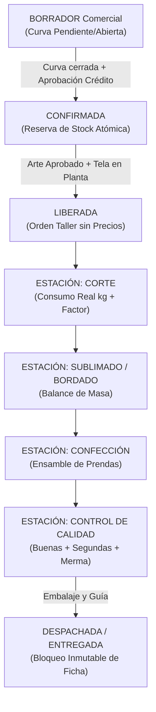

# Reglas de Producción Textil — Corpotex / KeptAI

**Versión:** 1.0  
**Fecha:** 19 de octubre de 2026  
**Autora:** Isabelita (Ingeniera de Producción Textil & Líder Técnico Full-Stack)  
**Proyecto:** KeptAI / Corpotex  
**Ámbito:** Taller de Confección, Almacén de Telas e Insumos, Área de Diseño y Consola Comercial  

---

## 1. Principios de Planta: Las 3 Reglas de Oro

En confección textil de uniformes corporativos (Corpotex / Unicrack), ninguna prenda entra a línea de corte o confección sin cumplir estrictamente las **Tres Reglas de Oro**:

1. **Curva de Tallas Cerrada y Verificada:**  
   Un pedido puede capturarse comercialmente con curva en estado `PENDIENTE` para agilizar la cotización, pero **bajo ninguna circunstancia puede confirmarse, liberarse o entrar a corte** sin que la curva de tallas esté en estado `CERRADA`. La suma de cantidades por talla debe cuadrar exactamente con la cantidad total del pedido (`curvaXS + ... + curvaXXL = cantidadTotal`).  
   *[CÓDIGO: `OrderCreationService.java:confirmOrder`, `TechSheetService.java:validateCurvaTallas`]*

2. **Arte de Personalización Aprobado e Inmutable:**  
   Si el pedido incluye personalización (bordado, sublimado, serigrafía, DTF, vinil textil), no se libera a taller si alguna ubicación carece de un arte en estado `APROBADO`. Una vez aprobado por el cliente o administración (con evidencia de canal, fecha y usuario responsable), el archivo y sus parámetros técnicos (puntadas, dimensiones en cm, colores/hilos) quedan **congelados e inmutables**. Si se requieren cambios, se debe emitir una nueva versión (`v2`, `v3`).  
   *[CÓDIGO: `ArtService.java:approveArt`, `V19__diseno_artes.sql`]*

3. **Materia Prima y Tela Confirmada:**  
   No se inicia el tendido ni corte sin verificar el stock físico de tela en kg. El sistema calcula un semáforo automático (`DISPONIBLE`, `COMPRA_REQUERIDA`, `POR_VERIFICAR`) contrastando el metraje/peso necesario contra el inventario real en rollos y partidas. El Jefe de Taller debe convalidar la partida de teñido asignada para evitar variaciones tonales entre piezas.  
   *[CÓDIGO: `FabricInventoryService.java:calculateSemaphore`, `TechSheetService.java:validateFabric`]*

---

## 2. Ciclo de Vida de una Orden de Producción

### Matriz de Estados de la Orden

| Estado | Significado Operativo | Requisitos para Entrar | Impacto en Inventario / Finanzas |
|---|---|---|---|
| **BORRADOR** | Pedido en cotización o acuerdo comercial preliminar | Captura comercial de cliente y prendas | Sin reserva de stock. Precios editables por vendedor |
| **CONFIRMADA** | Pedido en firme acordado con cliente | Curva `CERRADA`, adelanto o crédito evaluado | **Reserva atómica** de stock de prendas base (`UPDATE ... WHERE stock_fisico - stock_reservado >= pedido`) |
| **LIBERADA** | Aprobada para ingreso a planta | Arte `APROBADO`, tela confirmada | Se genera la Orden de Producción para taller (sin precios, costos ni márgenes) |
| **EN_PRODUCCION** | En tránsito por estaciones de taller | Inicio de tendido y corte | Descuento físico de tela por peso (kg) de los rollos asignados |
| **DESPACHADA** | Entregada a logística o cliente | Calidad aprobada, guía de remisión / acta | Descuento físico definitivo de producto terminado; inicio de plazo de cobro |
| **CERRADA** | Pedido pagado y concluido | Conciliación de cobranza completa | Ficha técnica y orden totalmente bloqueadas e inmutables |
| **ANULADA** | Pedido cancelado | Cancelación autorizada | **Liberación inmediata de stock reservado** |

---

## 3. Reglas de Inventario Textil

Para evitar mezclas y desabastecimiento, KeptAI segrega tres categorías de inventario:

### 3.1 Inventario de Tela Virgen (`keptai.inventario_tela`)
- **Unidad de Medida:** Kilogramos (kg) y rollos físicos.
- **Trazabilidad por Partida de Teñido:** Cada ingreso de tela registra su código de partida (`partida_tenido`), color exacto, tipo de tejido (ej. Jersey 30/1, Piqué 24/1, Franela 20/1) y gramaje en g/m².
- **Regla Monopartida:** Un lote de confección debe cortarse preferentemente con tela de una sola partida de teñido. Si el metraje obliga a combinar rollos de distintas partidas, el sistema emite una **Alerta de Mezcla de Partida (`MIXED_DYE_LOT_ALERT`)** para que el cortador verifique el matiz bajo luz normalizada.

### 3.2 Inventario de Insumos (`keptai.insumo_taller`)
- **Categorías:** Hilos de costura, conos de bordar, botones, cierres, entretelas, etiquetas tejidas y bolsas de empaque.
- **Consumo:** Salidas por orden o por lote de producción.

### 3.3 Inventario de Producto Terminado / Prendas Base (`keptai.producto_variante`)
- **Variantes Obligatorias:** Prenda base (polo, polera, casaca) + Tela + Color + **Talla obligatoria** (XS, S, M, L, XL, XXL).
- **Cálculo de Disponibilidad:**
  $$\text{Stock Disponible} = \text{Stock Físico} - \text{Stock Reservado}$$
- **Kárdex Inmutable:** Prohibida la sobreescritura de stock sin movimiento. Cada ingreso, salida, merma o reserva genera un registro en `keptai.inventario_movimiento`.

---

## 4. Matriz de Mermas, Segundas y Balance de Masa

En cada transferencia entre estaciones de manufactura (Corte $\rightarrow$ Personalización $\rightarrow$ Confección $\rightarrow$ Calidad), el jefe de taller registra el balance de unidades:

$$\text{Entrada} = \text{Buenas} + \text{Segundas} + \text{Merma} + \text{Reproceso}$$

### Catálogo de Causas de Merma y Rechazo

| Estación | Causa | Clasificación Típica | Tratamiento |
|---|---|---|---|
| **Corte** | Falla en tejido / agujero de tejeduría | Merma de tela | Reclamo a tintorería / reposición |
| **Corte** | Error de tizado o desvío de cuchilla | Merma operativa | Reposición de pieza cortada |
| **Bordado** | Descalce de matriz / rotura de aguja | Reproceso o Segunda | Desborde o descarte si daña la prenda |
| **Sublimado** | Mancha de tinta / sombra o fantasma | Merma irrecuperable | Reposición de pieza |
| **Confección** | Costura torcida / puntada suelta | Reproceso | Descosido y corrección en mesa |
| **Confección** | Picado de aguja / corte de tela | Segunda selección | Destino a remate o liquidación |
| **Calidad** | Tono disparejo entre delantero y espalda | Segunda selección | [DECISIÓN PENDIENTE: venta de segundas] |

> **Alerta de Recorte (`SHORTAGE_ALERT`):** Si las prendas buenas acumuladas al salir de una estación son inferiores a la cantidad pactada en el pedido, el sistema genera inmediatamente una alerta de recorte para cortar piezas de reposición antes de liberar el lote a la siguiente fase.

---

## 5. Fórmulas de Cálculo Textil

### 5.1 Consumo Teórico vs. Consumo Real
- **Consumo Teórico Preliminar:**
  $$\text{Consumo Teórico (kg)} = \text{Cantidad de Prendas} \times 0.28\text{ kg}$$
- **Consumo Real en Mesa de Corte:**
  $$\text{Factor Real (kg/prenda)} = \frac{\text{Peso Total de Tela Cortada (kg)}}{\text{Prendas Buenas Cortadas}}$$
  *Cuando se acumulan 5 cortes de la misma prenda y tejido, el factor real registrado sustituye automáticamente al 0.28 kg por defecto.*

### 5.2 Requisición de Compra de Tela (B-10)
Al detectarse `COMPRA_REQUERIDA`, el cálculo del peso a ordenar considera la merma técnica de tejeduría y acabado:
$$\text{Kg a Comprar} = \text{Consumo Estimado (kg)} \times (1 + \text{\% Merma Configurable})$$
*(Por defecto, merma técnica configurable al 5% = 0.05).*

$$\text{Fecha Límite de Compra} = \text{Fecha Entrega Pedido} - \text{Tiempo Producción (días)}$$
*(Tiempo de ciclo estándar por defecto: 10 días hábiles).*

---

## 6. Decisiones Pendientes de Corpotex

La siguiente tabla resume los puntos operativos que dependen de definiciones comerciales y de planta finales de Corpotex. El sistema los implementó con **valores configurables provisionales** para permitir la operación fluida:

| ID Decisión | Asunto Operativo | Decisión Pendiente | Valor Provisional Implementado | Impacto en Código |
|---|---|---|---|---|
| **DP-01** | **Comisión Comercial** | ¿La comisión de ventas se asigna por cliente (cartera) o por pedido (quien cerró la venta)? | No se calculan comisiones automáticas; se segregan ambos campos (`cliente.vendedor_asignado_id` vs `orden.vendedor_id`) | `CustomerService.java`, `B-02` |
| **DP-02** | **Adelanto para Producir** | ¿Se exige porcentaje de adelanto obligatorio (ej. 50%) antes de autorizar la compra de tela y corte? | Configurable en `aprobacion_credito.anticipo_requerido`. Si no se especifica, decide el vendedor con aviso de mora | `CreditService.java`, `OrderCreationService.java` |
| **DP-03** | **Venta de Segundas** | ¿Corpotex comercializa prendas de segunda selección o se destruyen/reciclan? | Se registra el stock de `segundas` en el balance de manufactura sin lista de precios pública | `ManufacturingController.java`, `B-08` |
| **DP-04** | **Equipo de Diseño** | ¿El ponchado y diseño gráfico es 100% interno o se terceriza con talleres externos? | Módulo de artes (`/arts`) soporta diseñador interno (`DISENO`) y carga de evidencia externa | `ArtService.java`, `B-06` |
| **DP-05** | **Recargo por Tallas Especiales** | ¿Tallas XXL o XXXL llevan sobreprecio automático por mayor metraje de tela? | Campo `recargo_talla` en curva de tallas; por defecto 0.00 hasta aprobación de tarifario | `TechSheetDtos.java`, `B-03` |

---
*Documento aprobado para implementación técnica en KeptAI / Corpotex.*
